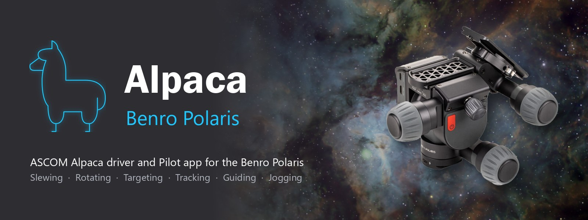
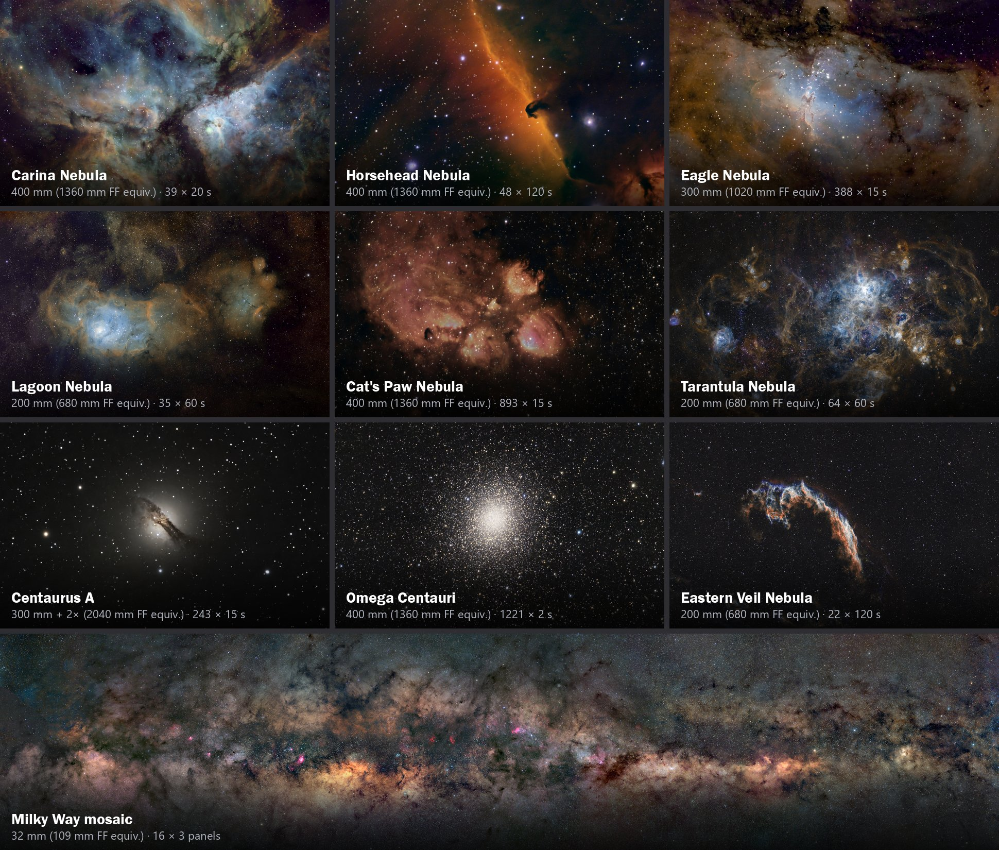

  

  <strong>
    An open-source ASCOM Alpaca driver that turns the
    Benro Polaris into a capable astrophotography mount
  </strong>

  
  
  
  
  
  

  <a href="https://ogecko.github.io/alpaca-benro-polaris/"><strong>Documentation</strong></a>
  &middot;
  <a href="https://www.kickstarter.com/projects/jdmorriso/alpaca-benro-polaris-driver-v20?ref=7xf94o"><strong>Kickstarter</strong></a>
  &middot;
  <a href="https://www.youtube.com/@jdm5001/featured"><strong>Videos</strong></a>
  &middot;
  <a href="https://buymeacoffee.com/DavidMorrison"><strong>Buy Me a Coffee</strong></a>

  Control the Benro Polaris Astro Edition from Stellarium, NINA, PHD2, CCDciel and other
  ASCOM Alpaca applications, with Multi-Point Alignment, plate solving, sync and pulse guiding,
  advanced motion control, orbital tracking and panoramas. The Polaris firmware is left untouched.

  

  <em>
    Visit the documentation at
    <a href="https://ogecko.github.io/alpaca-benro-polaris/">ogecko.github.io/alpaca-benro-polaris</a>.
  </em>

## Getting the Driver

The driver is distributed to backers of the [Kickstarter project](https://www.kickstarter.com/projects/jdmorriso/alpaca-benro-polaris-driver-v20?ref=7xf94o). See the [LICENSE](./LICENSE) for terms, then follow [Getting Started](https://ogecko.github.io/alpaca-benro-polaris/v2.2/getting-started/) to install and connect it.
