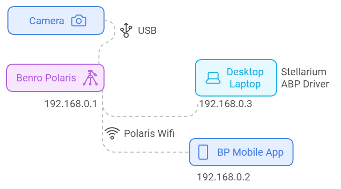
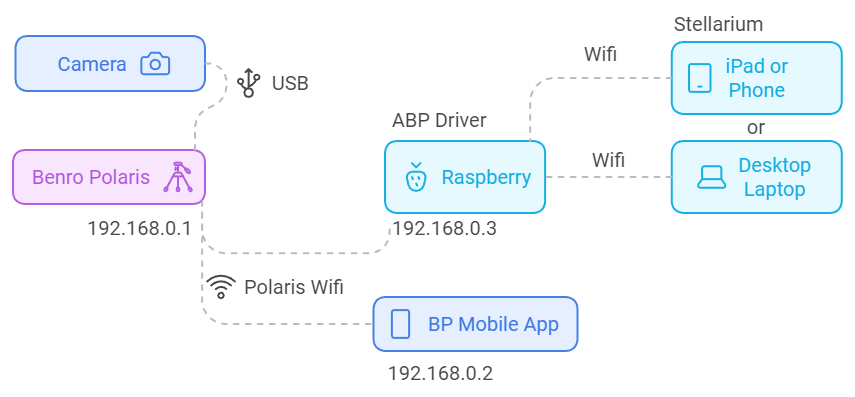
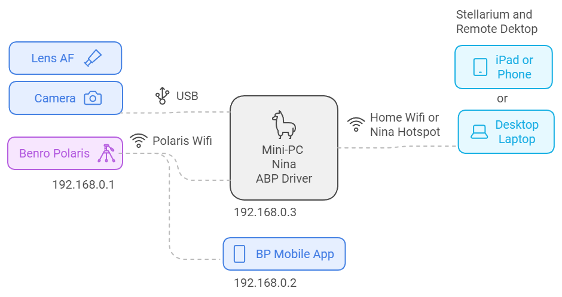
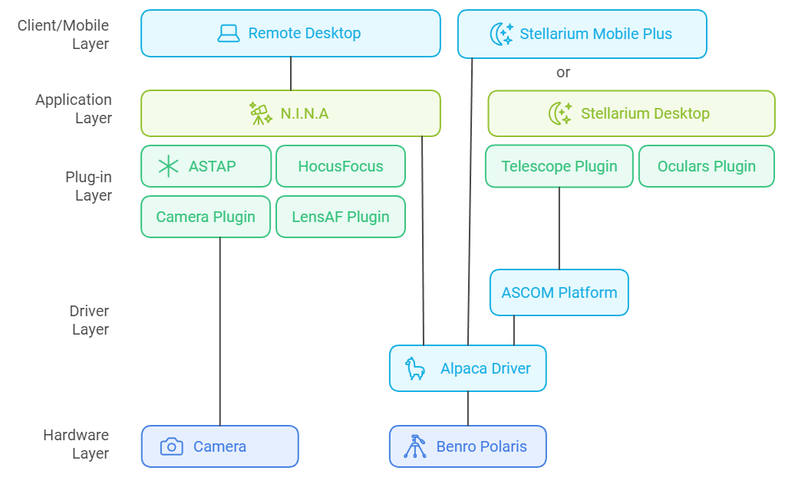

# Architecture
[Hardware](#hardware-architectures) |
[Software](#software-architecture) |
[Development Setup](#development-setup)

This page shows how the Alpaca Driver's hardware and software fit together, and how to set up a computer to work on the driver itself.

## Hardware Architectures
The Alpaca Driver runs on a device separate from the Benro Polaris, such as a MiniPC, laptop, MacBook, Raspberry Pi or desktop, which connects to the Polaris over Wi-Fi. This keeps the Polaris firmware untouched while allowing more powerful processing and flexibility. The setups below are the most common.

If you want to run the Alpaca Driver on a phone or iPad, please read [FAQ A3](./faq.md#a3--can-i-run-the-alpaca-driver-on-my-phone-or-ipad).

### Laptop with Stellarium Desktop


Some laptop Wi-Fi controllers don't support connecting to the Benro Polaris Wi-Fi, so you may also need a USB Wi-Fi adapter such as the [TP-Link AC600 USB WiFi Adapter](https://www.amazon.com/wireless-USB-WiFi-Adapter-PC/dp/B07P5PRK7J/) (about US$17 from Amazon).

### Raspberry Pi
You can install the Alpaca Driver on a Raspberry Pi, so that other applications on your network can control the Benro Polaris. See the [Raspberry Pi Setup Guide](./raspberrypi.md) for more information.



### Docker Container
You can also run the Alpaca Driver in a Docker container, on any operating system and architecture that supports Docker (Windows via WSL2, macOS, Linux, a MiniPC, a Raspberry Pi, etc.), without installing Python or its dependencies directly on the host. See the [Docker Installation Guide](./docker.md) for more information.

### MiniPC (Recommended)
To use more of the Alpaca Driver's capabilities, install it on a MiniPC mounted on or hanging from your tripod. The MiniPC can then control all your astronomy equipment, much like a [ZWO ASIAIR Plus](https://www.zwoastro.com/product/asiair-plus/).



You can control everything from an iPad or phone connected to your home Wi-Fi, or to the MiniPC's own hotspot. The iPad or phone runs (a) Stellarium PLUS, connected to the driver, and (b) a mobile Remote Desktop app, connected to the MiniPC to control NINA.

Alternatively, a desktop or laptop can do the same thing, running (a) Stellarium Desktop, connected to the driver, and (b) Remote Desktop, connected to the MiniPC to control NINA.

[Preparing the MiniPC](./hardware.md) explains how to choose, power, connect and set up a MiniPC.

## Software Architecture
The following diagram shows how the different software modules fit together.



## Development Setup
The following steps are only needed if you want to use VS Code to make changes to the driver. No support is provided for modified drivers.

### Setting up OpenSSH Server on Windows 11 (for Remote VS Code)
Using PowerShell as Administrator, run the following commands:
```
Add-WindowsCapability -Online -Name OpenSSH.Server
Start-Service sshd
Set-Service -Name sshd -StartupType 'Automatic'
Get-Service sshd
New-NetFirewallRule -Name sshd -DisplayName 'OpenSSH Server (sshd)' -Enabled True -Direction Inbound -Protocol TCP -Action Allow -LocalPort 22
```

### Installing Git for Windows and cloning the repository
Download Git for Windows from [git-scm.com](https://git-scm.com/download/win), and install it with the default settings. Then open a PowerShell window and enter the following commands, substituting your own name and email address:
```
git config --global user.name "FIRST_NAME LAST_NAME"
git config --global user.email "MY_NAME@example.com"
git config --global fetch.prune true
git clone https://github.com/ogecko/alpaca-benro-polaris.git
```

### Installing Node.js and npm to rebuild Alpaca Pilot
Download and install Node.js, which includes npm, from [nodejs.org](https://nodejs.org/). Then install the Alpaca Pilot app's dependencies:
```
cd alpaca-benro-polaris\pilot
npm install
```
