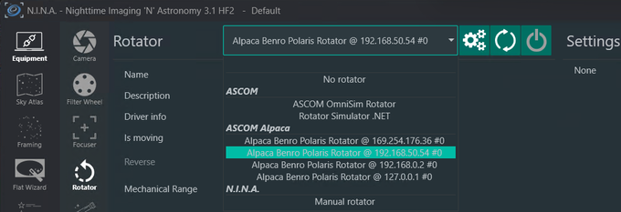
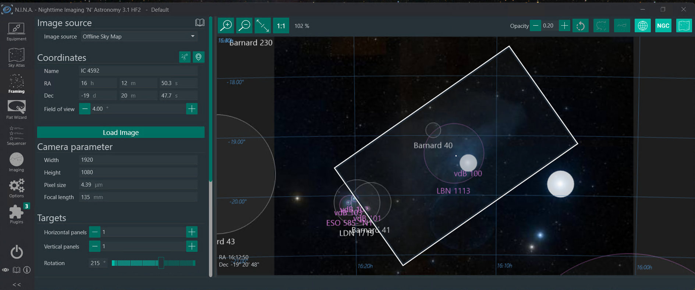
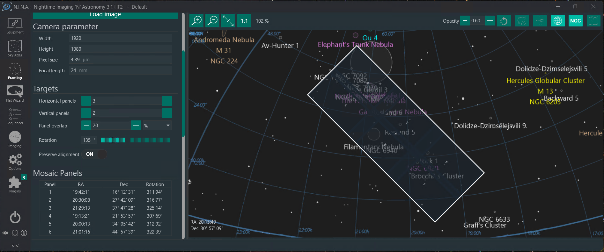
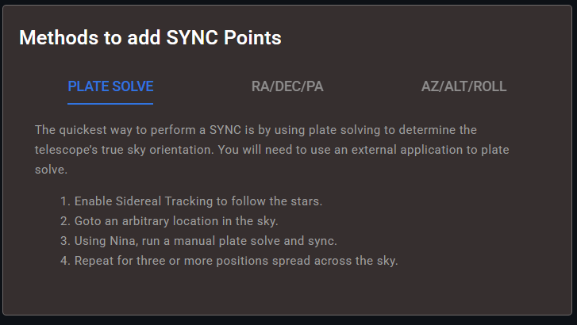
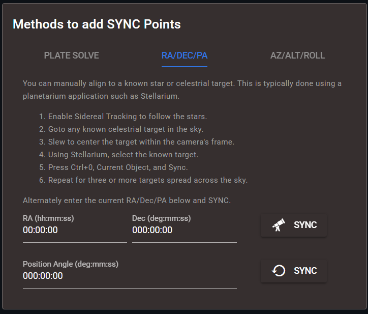
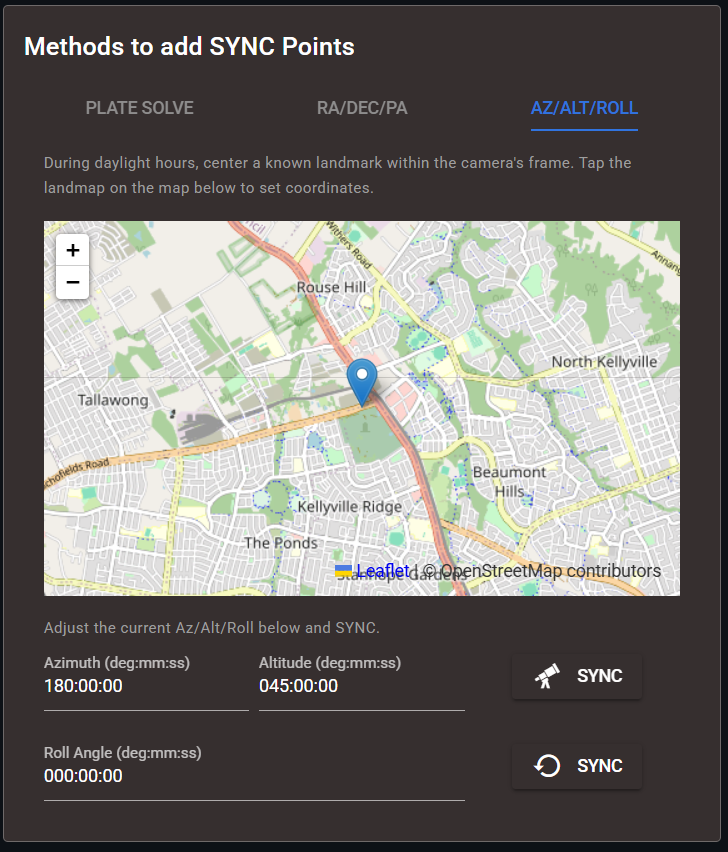
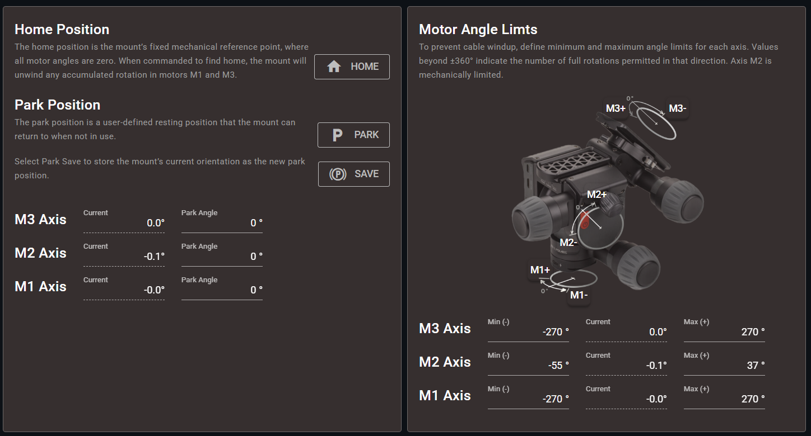

# Control Reference
[Challenges](#challenges) ·
[Rotator](#alpaca-rotator) ·
[Alignment](#alignment-models) ·
[Safety](#equipment-safety) ·
[Filtering](#kalman-filter) ·
[Calibration](#motor-speed-calibration) ·
[Coordinated Speed](#coordinated-speed-control) ·
[PID Controller](#pid-controller)

## Challenges
>PODCAST LINK: [20 - Deep Dive Podcast on Alpaca Benro Polaris V2.0](https://youtu.be/KUBCTnEsnlE)

The Benro Polaris mount, especially with its Astro Attachment, is popular among amateur astrophotographers for its compact design and app-driven interface. But while the hardware is excellent, the software can leave many users frustrated.

When version 1.0 of the Alpaca Driver was launched, it allowed advanced imaging and planetarium software to work with the Polaris. As more people used these applications, limitations quickly surfaced:

- Tracking drift was noticeable during long imaging sessions
- Promised features like three-star alignment never materialized
- Users lacked the precision tools needed for serious deep sky work

With version 2.0 of the Alpaca Driver, we introduce a complete rewrite of the motion control system. The motors are now driven using advanced algorithms that dramatically improve tracking accuracy, responsiveness, and stability.

This guide provides an overview of the **Advanced Control Features** of the Alpaca Driver, including:

- **[Kalman Filtering](#kalman-filter):** Smooths the noisy raw telemetry from the mount into a steadier estimate of its position and velocity.
- **[Alpaca Rotator](#alpaca-rotator):** Exposes the third (Astro) axis as an ASCOM Rotator so you can control roll or position angle for framing, mosaics and panoramas.
- **[Slewing](./pilot.md#radial-dials):** Lets the driver's own motion controller handle manual slews, moving the set point by Az/Alt/Roll or RA/Dec/PA. No longer use Benro Polaris firmware for gotos or slews.
- **[Advanced Goto](./kinematics.md#inverse-position):** Moves to targets along a shortest-path trajectory with optimised acceleration and deceleration, and preserves roll and tracking state.
- **[PID Tracking](#pid-controller):** Uses a closed-loop, three-axis PID controller with feed-forward to hold the mount on its target during tracking.
- **[Orbitals Tracking](./orbitals.md):** Enables non-sidereal tracking of the Sun, Moon, planets, satellites, comets and asteroids.
- **[Multi-Point Alignment](#alignment-models):** Uses the QUEST algorithm to build a correction model from three or more plate-solve syncs, compensating for tripod tilt, polar misalignment and cone error.
- **[Mechanical Alignment Correction](./kinematics.md#mechanical-alignment):** Fits M2 and M3 offsets (how the camera sits on the head) and the M2 scale with every alignment, cutting typical alignment and goto errors from about an arcdegree to a few arcminutes.
- **[Slew & Center Correction](./kinematics.md#slew-and-center):** Reduces the number of corrective slews needed to centre a target, using either Zero Last Residual, Local Gaussian Adjustment or Sync Guiding Adjustment (recommeded).
- **[PEC Drift Correction](./kinematics.md#periodic-error-correction):** Learns the remaining slow drift in RA and Dec from guiding corrections and applies proactive fixes every 200 ms.
- **[PEC Worm Gear Correction](./kinematics.md#periodic-error-correction):** Corrects each motor's worm gear wobble (repeating every 6° of motor rotation, typically around 35 minutes while tracking) from a profile measured once by a calibration test, with no guiding needed.
- **[Sync Guiding (Plate-solve)](./guiding-sync.md):** Treats a plate-solve sync taken without slewing as a guiding correction, so you can guide with the main camera and no guide scope.
- **[Pulse Guiding (Guide-camera)](./guiding-pulse.md):** Accepts micro-corrections from guiding software such as PHD2 during exposures, with separate RA and Dec guide rates (0.75x to 1.0x sidereal is recommended).
- **[Coordinated Speed Control](#coordinated-speed-control):** Drives all three motors together within the Polaris's shared slow-speed setting, and plans gotos, roll changes and jogs as smooth motor speed profiles, for steadier tracking and less drift and overshoot.
- **[Backlash Compensation](./kinematics.md#backlash-compensation):** Drives each motor through its gear backlash at the end of a goto, so Slew & Center corrections land first time (not through a tracking reversal, which is left to the guider).

For a comprehensive technical reference on the updated kinematics, refer to [kinematics.md](./kinematics.md).

 
 

---

## Alpaca Rotator
>VIDEO DEMO: [23 - Alpaca Rotator Framing in Nina and Stellarium](https://youtu.be/_Swd-jIyQis)

The Alpaca Rotator feature is an advanced capability within the Alpaca Driver, specifically designed to enhance precision framing and complex imaging sequences for deep-sky astrophotography.

This guide outlines the purpose, setup, control concepts, and practical usage of the Alpaca Rotator, drawing on the capabilities introduced in the version 2.0 driver.

---

### Introduction

The Alpaca Rotator functionality unlocks and controls the third axis of the Benro Polaris mount.

*   **Primary Purpose:** The main goal of the Alpaca Rotator is to help achieve **better framing of deep sky objects** and assist significantly with **mosaics and panoramas**.
*   **ASCOM Standard:** The feature is implemented by supporting the **ASCOM Alpaca Rotator Interface v3** standard.
*   **Co-ordinate independance:** The rotator enables rotation around the camera’s boresight while **maintaining the existing Azimuth/Altitude (Az/Alt) or Right Ascension/Declination (RA/Dec) coordinates**.
*   **Roll Angle Preservation:** Unlike the standard Polaris firmware, the Alpaca Driver’s new **GOTO commands preserve the roll angle** instead of automatically resetting it to zero after every GOTO operation.

---

### Roll Angle vs Position Angle

The Alpaca Driver allows control over rotation using two coordinate systems: Roll Angle (in the geographic system) and Position Angle (in the equatorial system).

**Roll Angle (Az/Alt/Roll)**

The roll angle is generally considered **intuitive**.

*   It represents the **angle or tilt of the camera relative to the horizon**.
*   The driver automatically calculates how the mount needs to move all motors to achieve a specified roll (e.g., a 30° roll) while keeping the Azimuth and Altitude coordinates consistent.
*   The roll angle is considered related to **Astro Axis**, but in reality it requires all motors to be moved in co-ordination.

**Position Angle (RA/Dec/PA)**

Position angle is the angle between the direction to the celestial north and the top of the image frame, measured counterclockwise from north. The Position Angle (PA) is a **consistent reference** used for framing that is independent of the observer's location. It is often not as intuitive as the roll angle.

*   The Position Angle is defined in the **equatorial coordinate system**.
*   A PA of **0 degrees** means the top of the image frame is pointing toward the **celestial North Pole**.
*   Angles **increase in a counter-clockwise fashion**.
*   The Position Angle is equal to the Roll Angle plus the Parallactic Angle.

**Parallactic Angle**

The Parallactic Angle is the angle between the direction to the celestial north  and the zenith, measured at the position of a celestial object in the sky. It describes how the sky appears to rotate around the object. The Paralactive Angle is unique for every Azimuth/Altitude orientation of the mount. It can be displayed in applications like Stellarium. The Driver uses the Parallactic Angle to calculate the Position Angle.

### Rotator Setup

**Connecting in NINA**

To enable rotator control in third-party applications like NINA (Nighttime Imaging 'N' Astronomy):

1.  In NINA’s Equipment setup, navigate to the **Rotator equipment** section.
2.  Perform a **device discovery** to find the Alpaca Rotator.
3.  Connect to the device. NINA will then have **full control of the rotation axis**.

**Control via Alpaca Pilot**

The Alpaca Pilot App offers direct, real-time control over the rotation axis.

*   **Dashboard Viewing:** The **Dashboard** features **Zoomable Radial Dials** that display the mount’s current roll and position angle (PA) coordinates. You can quickly switch between Azimuth/Altitude/Roll and Right Ascension/Declination/Position Angle views.
*   **Direct Input:** You can **click on the set point** and directly enter a numerical value for the desired roll or position.
*   **Presets (Az/Alt Mode):** When in Azimuth/Altitude mode, you can use the **floating action button** on the roll set point to quickly navigate to common presets, such as **zero degrees** or **plus or minus 45 degrees**.
*   **Movement:** The driver calculates the **best way to move the head** to the target roll/PA location, and the green arrow indicates the desired point. Slew commands now support moving by **Azimuth, Altitude, and Roll coordinates**.

---

### Imaging Applications

The Alpaca Rotator is crucial for advanced framing techniques, particularly when using software like NINA and Stellarium.

**Framing with NINA**

The rotator function is natively integrated with NINA’s framing capabilities.

1.  **Framing Assistant:** In NINA's Framing Assistant, you can **change the proposed rotation angle** (Position Angle) to see the framing adjust visually.
2.  **Rotation View:** Enabling the **rotation view** within the Framing Assistant allows you to change the orientation of the image perspective, which makes the framing process easier.
3.  **Sequenced Correction:** During an imaging sequence, after NINA performs a plate solve and determines the position angle of the captured image, it will **correct any angular offset** by issuing minor adjustments to the rotator to correctly position the panel.

**Mosaics and Panoramas**

The rotator enables precise, structured imaging for large targets.

*   **Tiled Mosaics:** When planning a tiled mosaic (e.g., three wide and two high), NINA calculates the Right Ascension and Declination for each panel.
*   **Preserving Alignment:** By enabling **"preserve alignment"** in NINA, the system automatically recalculates the specific position angle for each individual panel, ensuring the overall mosaic results in a rectangular image.

**Integrating with Stellarium**

To visualize your framing accurately in Stellarium, an adjustment is necessary.

*   **Coordinate Mismatch:** Stellarium’s internal "rotation angle" setting uses a different frame of reference than the standard ASCOM Position Angle used by the driver and NINA.
*   **Correcting the Angle:** To achieve the same framing in Stellarium as calculated in NINA (e.g., a proposed PA of 140°), you must input the **negative of the Position Angle** into Stellarium’s rotation angle setting (e.g., -140°).

### Aligning the Rotator
We recommend performing at least one Position Angle sync (see Method 2 below) at the start of each imaging session. This establishes the roll offset between the mount's Roll Angle and the true sky Position Angle, the zero reference the PID Controller uses for sidereal tracking.

This matters because to maintain a constant Position Angle during tracking, the mount's Roll Angle must continuously change to compensate for the evolving parallactic angle as the target moves across the sky. Since the three motor axes are coupled, a poorly calibrated roll offset will subtly corrupt pointing and tracking accuracy across all axes.

If you have a physical camera rotator, note that rotating it will shift the position angle seen by the camera sensor. It will not update the Position Angle reported by the Driver or the roll offset, so tracking will not be affected. If you want the Driver to report the correct Position Angle, perform a re-syncing after using the physical camera rotator.

 
 

---

## Alignment Models
>VIDEO DEMO: [24 - Multi Point Alignment and Tripod Tilt](https://youtu.be/4CMO0R_yphw)

The V2.0 Alpaca Driver re-engineered the alignment and sync interfaces to support two distinct alignment methods, transforming how the Benro Polaris (BP) achieves accurate polar alignment. This guide outlines the features and operational principles of the two primary alignment modes; Single-Point and Multi-Point Alignment. 

### Single-Point Alignment

Single-Point Alignment (SPA) is the more traditional alignment method supported by the  Driver. This is the default alignment method with the V2.0 Driver:

*   **Function:** It **mirrors the standard Polaris method**, syncing the mount to a single known celestial position.
*   **Correction:** Corrections resulting from the sync apply globally.
*   **Requirement:** This method **relies on precise tripod leveling**.
*   **Limitation:** SPA can be susceptible to drift.
*   **Usage:** Alignment can be achieved simply with a **single plate-solve**. 

When using the Pilot App for initial setup, you can skip the Compass Align and Star Align steps, as the driver will use a default value (assuming the mount is pointing south at 45 degrees altitude). The first plate-solve will correct any misalignment.

The Single Point Alignment is simpler to perform and is still a valid method for alignment of your Benro Polaris. Only progress to Multi Point Alignment when you are prepared to monitor and fine tune the alignment model.

### Multi-Point Alignment

Multi-Point Alignment (MPA), is the advanced alignment feature recommended for achieving high precision:

*   **Function:** This method builds a detailed **correction model** from three or more known synchronization (SYNC) positions.
*   **Compensation:** The model compensates for multiple sources of error that a single point cannot correct, including **tripod tilt, polar misalignment, cone error**, and other mechanical offsets.
*   **Algorithm:** The technology is adapted from the **QUEST algorithm**, which uses a closed-form, quaternion-based solution to provide a precise result.
*   **Benefit:** A major advantage of MPA is that users **no longer need to obsess over leveling their tripod**, as the model is designed to detect and correct for tilt.
*   **Procedure:** To perform  Multi Point Alignment, you simply **perform multiple synced plate solves**. Each new sync automatically adds to the Driver's knowledge of the Polaris alignment at different orientations and times.

### Performing Alignment

The step-by-step procedure, including resetting the model after moving the tripod and reviewing residuals, is in [Multi-Point Alignment](./initial-setup.md#multi-point-alignment) in Initial Setup.

### Adding Sync Points
By adding sync points, you help the Driver build a geometric model of your mount’s orientation relative to the sky. There are three approaches to adding sync points to the model.

**Method 1: Sync via Plate Solve**

This is the most automated and accurate method. When your imaging software performs a **plate solve**, it determines the exact celestial coordinates your camera is pointing at. The Alpaca Driver uses this data to add a sync point to the alignment model.

- Best for: Astrophotographers using tools like NINA and ASTAP
- How: After a successful plate solve, the Alpaca Driver automatically adds the sync point
- Benefit: High-precision alignment with minimal manual input

**Method 2: Sync via RA/Dec/PA Coordinates**

You can manually add a sync point by specifying a known celestial target using **Right Ascension and Declination**.

- Best for: Users targeting known stars or objects
- How: Manually align the image with the known target then confirm the **Sync** with an application like Stellarium or Alpaca Pilot
- Benefit: Useful when plate solving isn’t available or for quick calibration

Nina does not sync the plate-solved Position Angle with the Alpaca Driver. We recommend that you do this manually at least once per imaging session.

- Perform a plate-solve and note the Roll Angle reported.
- Using Pilot, open the Alignment Page. 
- On the Methods to add SYNC Points panel, open the RA/DEC/PA tab.
- Manually enter the Position Angle in decimal degrees.
- Click the Rotator Sync button.

**Method 3: Sync via Geographic Landmark (Azimuth and Altitude)**

The Alpaca Driver now supports syncing using **azimuth and altitude**, which means you can align to visible landmarks, even during the day or without a star field.  At your observing site, you might have a visible landmark like a high-tension power line or surveyers mark. If you point your camera directly at it:

- Use the **Pilot app** to click on the landmark on the map in the Alignment page.
- The Alpaca Driver draws a line from your site to the landmark and calculates its azimuth and altitude
- Click **Sync** to add it to the model

---

**Summary: Sync Methods Comparison**

| Method | Input Type | Best Use Case | Automation Level |
|--------|------------|----------------|------------------|
| **Plate Solve** | RA/Dec from image | Imaging sessions | Fully automatic |
| **Celestial Target** | Manual RA/Dec | Known star/object | Semi-manual |
| **Geographic Landmark** | Az/Alt from Pilot app | Daytime or visual targets | Manual or assisted |

### Resetting Alignment

If you connect to the Polaris and notice that the **Azimuth, Altitude, or Roll coordinates** appear incorrect even when the mount is in the home position, you can reset the alignment to a known state using the following steps:

1. **Clear Sync Points**  
    - Open the **Alignment Page**  
    - Switch to **Multi‑Point Alignment**  
    - Delete all existing sync points in the model  

2. **Switch to Single‑Point Alignment**  
    - Change the alignment mode to **Single Point**  

3. **Reset Axes**  
    - Open the **Connect Page**  
    - Click **Reset Axes** to reset each of the Polaris axes  

4. **Compass Align**  
    - On the compass alignment step, click **SKIP**  

5. **Single Star Align**  
    - On the single star alignment step, click **SKIP**  

This procedure resets the single‑star alignment model in Polaris to the coordinates defined under the **Single Star SKIP** button. From here, you can:

- Perform a **plate solve** to establish accurate positioning  
- Enable **Multi‑Point Alignment** to build a more refined alignment model  

 
 

---

## Equipment Safety

>VIDEO DEMO: [25 - Home, Park and Motor Angle Limits](https://youtu.be/45EP-DExSOQ)

The Benro Polaris mount, while compact and powerful, has a known issue: it can rotate far enough to **wrap cables tightly around the tripod**, risking damage to cables, camera and mount. This kind of entanglement can lead to costly repairs or interrupted imaging sessions.

Version 2.0 of the Alpaca Driver introduces essential safety mechanisms to protect your gear and simplify your setup workflow. These updates address real-world risks and frustrations reported by users — especially around cable management and unexpected mount behavior.

To prevent these issues, the driver now includes:

- **Motor Angle Limits**  
    These define safe rotation boundaries for each axis, ensuring the mount never turns far enough to cause cable strain or collision. You can customize these limits based on your setup.

- **Revised Find Home Behavior**  
    The updated Find Home routine uses sensor feedback to return the mount to a known, safe orientation, without taking shortcuts and over-rotating cables.
  
- **Improved Park Functionality**  
    The Park feature now respects motor limit, allowing you to safely stow the mount at a custom location, again without risking cable wrap or tripod collisions.

### Motor Angle Limits

The driver tracks the actual physical rotation of the mount's motors (M1, M2, M3) using **Motor Angles**. Unlike standard coordinates (like Azimuth), which wrap around (e.g., 360° returns to 0°), the motor angle **does not wrap around**; it continuously records how far the motor has moved from its home position. These angles are also not dependant on one another, so the M1 angle is not effected by the Astro Axis.

You can define a **maximum amount of rotation** in each direction for each motor angle to prevent potential twisting of cables.

M2 also has a fixed mechanical range of −8° to +81.5°, which limits how Altitude and Roll can combine. The driver keeps every move within it automatically, rather than raising an alarm (see [Reachable Envelope](./kinematics.md#reachable-envelope)).

1.  **Limit Breach:** If a motor axis **exceeds its defined rotation limit** (e.g., Motor 3 goes beyond $270^\circ$), the system will issue a **notification banner**, and **all control to the Polaris will be stopped**. This halt prevents further motion, including tracking, to protect the cables.
2.  **Reviewing the Alarm:** You must click the **review button** on the banner, which takes you to the settings page, where you can inspect which alarm limit was exceeded (e.g., M3 current value > maximum limit).
3.  **Resetting the Alarm:** You must click the **reset button** to acknowledge the limit breach. This action provides a **one-minute window** during which you can move the mount and correct the rotation.
4.  **Clearing the Alarm:** The notification banner and limit indication will disappear once the motor axis is brought back **within the defined limits**.

> **Important Safety Note:** Although these safety measures are built into V2.0, we advise against operating the Polaris **unattended**, as some failure modes may still be beyond the driver's control. 

### Home

The new **Home** functionality moves the mount based entirely on motor angles:

*   **Action:** When you click "Home," the driver commands the motors to wind back so that the **M1, M2, and M3 Motor Angles are all zero**.
*   **Orientation:** If your mount is set up pointing south, the Home position (0, 0, 0 motor angles) will typically result in an azimuth of $180^\circ$, an altitude of $45^\circ$, and a roll of $0^\circ$.
*   **Alternative Reset:** If you need a complete the joystick double tap function of the Benro Polaris App, an **axis reset** function is still available, but it is located only on the Alpaca Pilot Connect page.

### Park

The **Park** function provides a customisable, safe resting position for mounting and unmounting equipment.

*   **Motor-Based:** Like the Home function, the Park function operates by defining target **motor angles**, not coordinate values.
*   **Default:** By default, the Park position is set to motor angles of $(0, 0, 0)$, making it identical to the Home position.
*   **Customisation:** You can **customize** the Park angle from the **settings page**. This is often useful, particularly when using an L-mount for your camera.

**Setting a Custom Park Position**

1.  **Access Settings:** Navigate to the settings page within the Alpaca Pilot App.
2.  **Adjust Motor Angles:** Use the diagrams to move the motor angles to a desired orientation.
    *   *Example: Move the M3 axis to around $90^\circ$ to easily access the lever and tightening knob on the camera mount.*
    *   *Example: Bring the M2 axis down to approximately $-45^\circ$ to make the plate level, facilitating camera mounting and unmounting.*
3.  **Save:** Click the **Save** button to update the motor angles for the Park location.

**Unparking the Mount**

1.  **Execution:** When the mount successfully reaches the custom Park location, a **yellow banner** will appear on the dashboard.
2.  **Function Lock:** In the Park state, **most functions are disabled**.
3.  **Resuming Use:** To resume normal use of the mount (e.g., initiating a GOTO or tracking), you must click the designated button to **unpark** it.

 
 

---
## Kalman Filter
>VIDEO DEMO: [31 - Setting Overrides, Kalman Filtering and PWM](https://youtu.be/aDFKAWBNQHU)

The **Kalman Filter** is a core component of the motion control system introduced in **Alpaca Driver v2.0**. It plays a critical role in improving the **accuracy, stability, and responsiveness** of the Polaris mount by filtering noisy sensor data and enhancing the system’s understanding of its own motion.

> **Note:** Kalman Filter Tuning is optional. You can skip this step if you're not ready to dive in.

---

### Purpose and Function

The Kalman Filter is designed to solve a fundamental problem: **sensor noise**. The Polaris mount reports its orientation every 200 milliseconds, but these readings can fluctuate significantly — especially at arcsecond-level precision. The key benefits of the Kalman Filter include:

- **Noise Reduction**  
    Raw telemetry from the mount is often jittery. The Kalman Filter smooths out these fluctuations, removing spikes and inconsistencies that would otherwise degrade tracking accuracy.

- **State Estimation**  
    Rather than relying solely on raw data, the filter combines:

    - **Measured telemetry** (what the mount says it's doing)
    - **Predicted motion** (what the system expects based on recent behavior)  

    This fusion produces a more reliable estimate of the mount’s true position and velocity.

### An Analogy

Imagine trying to track a fast-moving object while standing on a rocking boat in thick fog. Your view is shaky, your footing unstable, and your guesses are rough at best.

The **Kalman Filter** is like a digital stabilizer:

- It predicts where the object should be
- It compares that prediction to your noisy observations
- It fuses both into a much clearer, more stable estimate

This is exactly what the Alpaca Driver does; giving your mount a steadier, smarter sense of where it’s pointing, even when the raw data is unreliable.

This is particularly important for M3, whose position updates less frequently than the other motors. The Kalman Filter uses M3's velocity to predict its position between updates, helping maintain accurate pointing estimates during fast movements such as rolls and polar-alignment changes.

### Tuning and Diagnostics

While the default settings are well-optimized, the **Kalman Filter Tuning** page in the Alpaca Pilot App allow deeper insight and control. To access the Kalman Filter Tuning Page, Open the **Alpaca Pilot App** and naigate to  **KF Tuning** under the Performance Tuning in the Side Menu

**What You Can Do**

- **Visualize performance** using real-time charts showing:
    - Blue line: raw sensor data
    - White line: filtered estimate
- **Adjust filter parameters** to control how much trust is placed in raw telemetry vs predicted motion
- **Test slow movement** to observe how the filter responds to subtle tracking changes

**Example Parameters Explained**

- **Angular Position Measurement Error**  
    This setting tells the filter how noisy you believe the raw data is.  

    - Set it **low** (e.g. near zero) if you trust the sensor readings completely — but expect a jittery output  
    - Set it **higher** to smooth out fluctuations and get a more stable estimate

- **Kalman Gain**  
This value is a key parameter in the Kalman Filter algorithm that determines how much weight to give to new measurements versus the filter’s internal prediction. It controls how much the system “trusts” the incoming sensor data compared to its own estimate of what should be happening.

    - A **high Kalman Gain** means the filter relies heavily on the latest measurement — making it more responsive but potentially noisier.
    - A **low Kalman Gain** means the filter favors its prediction — resulting in smoother output but slower reaction to changes.

    - If you increase the measurement error, make sure the **Kalman Gain stays above 0.15**. A typical stable value is around **0.15** to **0.25**, which balances responsiveness with smoothness

 
 

---
## Motor Speed Calibration

The **Motor Speed Controller Calibration** feature in Alpaca Driver v2.0 allows advanced users to fine-tune motor behavior for their specific Polaris mount. While the system works well with default values, calibration can improve tracking precision, especially for long-exposure astrophotography.

Calibration is optional. For how to run, review and approve the tests, see [Motor Speed Calibration](./initial-setup.md#motor-speed-calibration) in Initial Setup.

Calibrating your motor speed controller ensures:

- More accurate slews
- Smoother tracking
- Better guiding performance
- Potentially improved deep-sky imaging results

> **NOTE:** With [Coordinated Speed Control](#coordinated-speed-control) on, only the fast-speed calibration is used: slow speeds come from the Polaris firmware's own table.

 
 

---
## Coordinated Speed Control

**Coordinated Speed Control** changes how the driver commands the Polaris motors. The Polaris's slow speeds use one speed level shared by all three axes, so setting a speed on one motor changes the others. Coordinated Speed Control chooses that shared level for all three motors together, then fine-tunes each motor's speed by switching it between neighbouring speeds. It also plans every move as a smooth speed profile the motors can actually follow.

### What It Changes

- **Tracking:** Holds all three axes at their required speeds at the same time, which markedly improves tracking at low altitudes and near zero roll. It also responds faster to guiding corrections.
- **Gotos:** Each goto is planned at the start, with a speed profile the motors can follow:
    - **Long gotos** (the pointing moving more than 15°) prioritise speed and move in motor-angle space: each motor moves directly to its target position, with all motors arriving as quickly as possible. If multiple motor-angle solutions can achieve the target, the driver selects the fastest solution that respects motor limits and avoids cable wrap.
    - **Short gotos** (15° or less) follow a path that moves the pointing smoothly and naturally towards the target. Changes in M3 are coordinated with M1 and M2 to maintain the pointing direction throughout the move. This allows the system to perform rolls while preserving the current pointing, rather than swinging away from the target.
    - **Gotos while tracking** go straight in motor angles to where the target will be when the mount arrives. Very small moves, such as dithers and Slew & Center corrections, are executed at the slower, more precise speeds to ensure accurate positioning.
- **Roll and Position Angle Changes:** The mount maintains the same Az/Alt when not tracking, or the same RA/Dec when tracking, while rotating the camera. The rotation runs at the motors' full speed. The pointing wanders a little during it, more when M1 and M3 don't yet have approved fast-speed [calibration](#motor-speed-calibration) tests (a motor running off its baseline speed pulls the pointing further off), and ends on target. At low altitudes, M1 and M3 must rotate further to achieve the same camera rotation, so large changes take longer. A rotation past what the motors can reach at that altitude goes to the nearest one they can reach, keeping the pointing.
- **Jogging near Altitude 0:** On a level mount, jogging Az/Alt through M2 = 0 (where M1 and M3 turn about the same axis) moves the pointing and lets the camera rotation follow, instead of swinging M1 and M3 to hold it.
- **Flips:** Some gotos, such as those crossing from negative to positive altitude, require a mount flip, with M1 and M3 each rotating by about 180°. The driver determines this at the start of the goto and moves directly to the target in motor-angle space. Where motor limits permit, M1 and M3 rotate in opposite directions to minimise cable wrap. The two flip solutions overlap by about 8°, allowing moves from positive altitude down to approximately −8°, or from negative altitude up to approximately +8°, without a flip.
- **Unwinds:** If the nearest motor-angle solution would take M1 or M3 beyond its limit, the driver takes the alternative route around instead. In Equatorial Mode (Wedge), the driver also preserves at least 120° of tracking range on M1 (about 8 hours), performing a full-turn unwind during a goto if necessary rather than interrupting a session. While these moves are in progress, Alpaca Pilot displays **FLIP CW**, **FLIP CCW** or **UNWIND** in its status.
- **Jogging:** Ramps up to and down from jog speeds, which reduces overshoot when you release a jog.
- **Goto Completion:** During a goto, the driver holds the PID integral to prevent integral windup from disturbing tracking afterwards. A goto is marked complete only when the mount reaches the target and the motors have settled. With Backlash Compensation enabled, this also requires the backlash to be taken up. If the goto has not completed within 45 seconds beyond its planned move time, the driver completes it anyway. The log records the outcome `GOTO complete on target`, `TIMED OUT` or `STOPPED AT A MOTOR LIMIT` along with the elapsed time and final error for each motor. A rotator move (roll or position angle) completes the same way, sharing the timeout, which restarts with each move requested: a goto timing out also completes a rotate asked for during it. It logs `ROTATE complete ...`, and until then the Pilot shows Rotating and ASCOM `IsMoving` is true.
- **Faster Motions:** Above the slow-speed range (approximately 0.24°/s), the driver uses the Polaris's fast mode, allowing each motor to run at up to its own maximum speed.

### Turning It On or Off

In Alpaca Pilot, open the **Settings** page and use the **Coordinated Speed Control** toggle under **Advanced Control Features**. The change takes effect immediately, with no restart. It is on by default; turn it off to return to the previous speed controller and motion planning.

### Calibration

With Coordinated Speed Control on, slow speeds always come from the Polaris firmware's own speed table, so their calibration isn't used. Fast speeds use the [Motor Speed Calibration](#motor-speed-calibration) of each motor once its fast-speed tests are approved, and the built-in baseline until then. Calibrating the fast speeds makes the planned moves more accurate, so gotos finish closer to their planned times. A motor whose calibrated fast speeds don't rise with the commanded speed keeps the baseline, and the log warns about it.

 
 

---
## PID Controller

>VIDEO DEMO: [33 - PID Control and Kinematics](https://youtu.be/6vJbSb0gl3M)

The Proportional-Integral-Derivative (PID) Controller is the core component of the revised motion control system in the Alpaca Driver version 2.0. While the system works well with the default parameters, this section is designed for advanced users who wish to **diagnose poor tracking** or fine-tune the controller’s performance.

### Purpose

The PID Controller is responsible for **closed-loop speed regulation** and is essential for achieving stable tracking. It works by measuring the error between where the mount *should* be (the Set Point) and where it *actually* is (the Present Value).

The driver utilizes a **3-axis PID controller** for closed-loop motor positioning and explicitly handles **zero crossover** to eliminate the need for traditional backlash correction. The PID controller sums up the proportional, integral, derivative, and feed-forward values to determine the precise **motor speed** required to drive each of the three motors in the Polaris head.

### Tuning Interface

You can access the PID tuning pages via the **Alpaca Pilot App**, which provides a detailed visualization of the controller’s real-time performance.

1.  Open the **Alpaca Pilot App** (accessible via browser or the settings cog in NINA’s Equipment tab).
2.  Navigate to the side menu and choose the **PID Tuning**.

The PID Tuning page provides an overview of all three axes, allowing you to monitor tracking performance. You can switch between viewing axes in three different domains a. equatorial (Right Ascension, Declination, Position Angle); b. topocentric (Azimuth, Altitude, Roll) and c. motor (M1, M2, M3) coordinates.

### Diagnosing Tracking

To assess how well the mount is tracking, focus on the **RMS Error** and the behavior of the chart lines.

**RMS Error**

The RMS (Root Mean Square) error measures the running average of how far the mount’s position deviates from its intended position, measured in **arcseconds**.

*   **Goal:** The lower the RMS error, the better.
*   **Performance Benchmark:** An RMS error **under three arc seconds** is considered very good.

**Position Charts (Top Charts)**

These charts display the target position versus the actual position for each coordinate.

*   **Set Point (Green Line):** This is the target position the mount is trying to achieve. During sidereal tracking, the set point is expected to be **flat, steady, and horizontal** when viewed in Equatorial Coordinates.
*   **Actual Position (White Line):** This is the mount’s measured position.
*   **Ideal Tracking:** The white line should **very closely track the green line**. Ideally, the white line should be slightly underneath the green line.
*   **Warning Signs:** Watch for large swings, **oscillations, or zigzags** in the white line, which indicate a problem with tracking or control.

**Velocity Charts (Bottom Charts)**

These charts show the movement and speed of the mount’s motors. They display four key signals used to blend the final motor speed output.

| Line Colour | Component | Function in Control System | Ideal Behavior in Steady State |
| :--- | :--- | :--- | :--- |
| **Cyan** | **Output Signal** | The actual speed being commanded to the motor. | Should closely follow the Green Line. |
| **Green** | **Feed Forward** | The speed the motor *should* be going at to maintain sidereal motion. | Should be straight and horizontal. |
| **Magenta** | **KP (Proportional)** | Corrects deviation proportional to how far off the target you are. | Should **hover around the zero mark** (average value of zero). |
| **Olive** | **KI (Integral)** | Corrects for persistent errors (how far you have *been* off target). | Should be straight and flat. |
| **Orange/Brown** | **KD (Derivative)** | Dampens fast movement to reduce oscillations. | Should be straight and flat, mirroring the Cyan line velocity. |

If the system is tracking well, the velocity graphs should be **smooth, straight, and steady**, indicating the mount is making precise, calm adjustments rather than overcorrecting or jittering.

### Dynamic Inputs and Tuning

The PID Tuning detail page (accessed by clicking **Tune** on an axis) allows you to view dynamic tests, simulating real-world commands. The goal of tuning is to ensure the mount responds quickly to commands without overshooting or oscillating.

**Dynamic Tests (Goto, Slew, Pulse Guide)**

The PID controller is designed to react differently to these inputs:

*   **GoTo (Step Input):** Simulates applications slewing to a target. The set point jumps, and the PID causes the speed to accelerate quickly to the maximum slew rate, then decelerate toward the new position. This uses kinematically optimized trajectory planning.
*   **Slew (Ramp Input):** Holding a slew button (e.g., in the Alpaca Pilot Dashboard) causes the set point to move up on a **steady ramp** at the commanded slew rate (e.g., 1 degree per second).
*   **Pulse Guiding (Velocity Input):** Simulates micro-corrections from guiding software (like PHD2) via the Pulse Guiding API. This appears as a **jump in speed** (velocity pulse) and a subsequent step in the set point for the duration of the pulse.

**Adjusting PID Parameters**

Tuning involves adjusting the proportional (KP), derivative (KD), and integral (KI) gains. Changes take effect **immediately** but are not persistent unless you manually click **Save** in the settings. The current recommended default parameters are set with **Kp=1.0, Ki=0.05, and Kd=0.5**.

| Parameter | Tuning Goal & Effect | Symptoms of Misalignment |
| :--- | :--- | :--- |
| **KP (Proportional Gain)** | Controls **responsiveness**. Determines how aggressively the system responds to the immediate error signal. Increasing KP speeds up the response to GOTOs. | **Too High:** Mount accelerates too quickly, **overshoots** the target, and causes **oscillations** (a sine wave pattern). |
| **KD (Derivative Gain)** | Controls **dampening**. Used to slow down the system when motion is fast, reducing oscillations and overshoot. Should generally be set at about **half of KP**. | **Too Low (with high KP):** Mount overshoots target and oscillates. |
| **KI (Integral Gain)** | Eliminates **persistent errors**. Increases motor output slowly to close any sustained, small gap (steady state error) between the PV and the SP. | **Too Low:** The Present Value (PV) trails consistently below the Set Point (SP) during steady tracking. |

 
 

---
