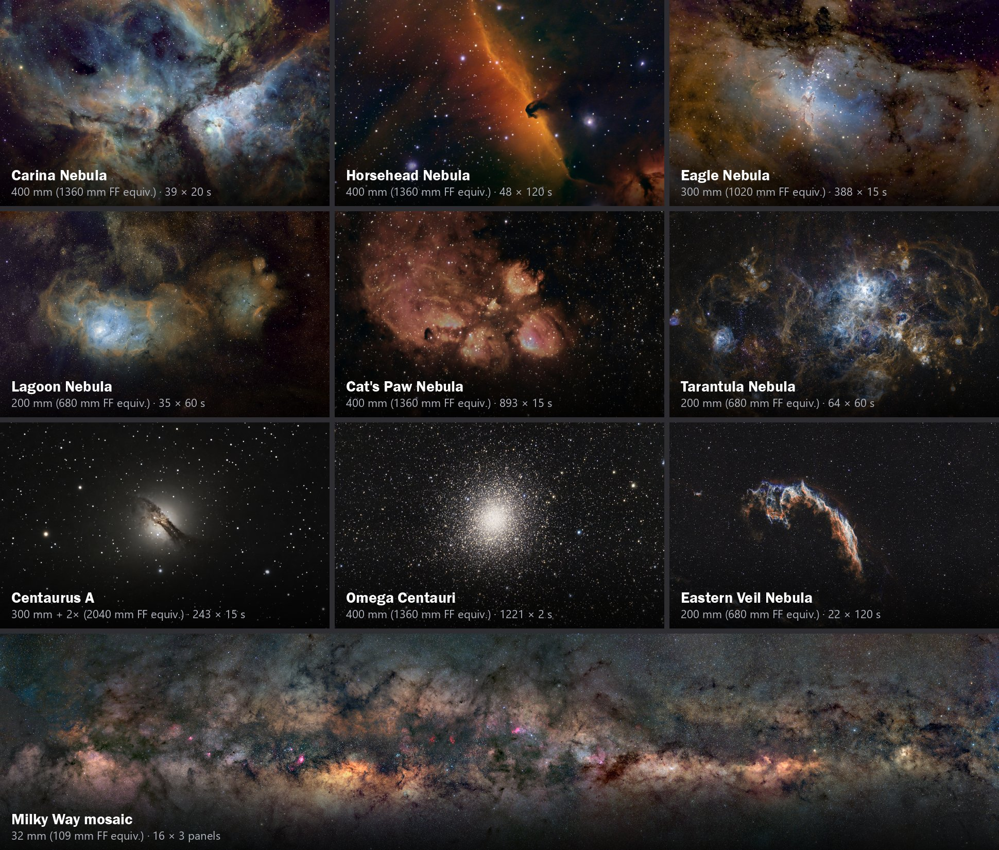

# Deep-Sky Imaging
[Planning](#planning-a-session) |
[Focal Length and Exposure](#choosing-a-focal-length-and-exposure) |
[Setting Up](#setting-up-and-connecting) |
[Focusing and Aligning](#focusing-and-aligning) |
[Framing](#framing-the-target) |
[Capturing](#capturing-the-sequence) |
[Monitoring](#monitoring-and-refining) |
[Calibration Frames](#calibration-frames) |
[Stacking and Processing](#stacking-and-processing)

Deep-sky objects such as nebulae, galaxies and star clusters are faint, so deep-sky imaging builds up their light over a long total exposure. Instead of one very long exposure, you capture many shorter sub-exposures ("subs"), then stack them: stacking averages out the noise and reveals faint detail that no single sub shows. The Alpaca Driver turns the Benro Polaris into a mount that can do this, with accurate pointing from Multi-Point Alignment, plate solving to frame the target, and tracking and guiding that keep it steady through a long sequence.

This guide outlines a typical deep-sky imaging session with the Benro Polaris, the Alpaca Driver and NINA. It assumes you're already familiar with operating Alpaca Pilot and NINA; see [Alpaca Pilot](./pilot.md) and [Using NINA](./nina.md) for those. The images below were all captured this way.

## Planning a Session

* **Choose a target.** Alpaca Pilot's catalog lists hundreds of imaging targets, and its rating, visibility and size filters help you find ones that suit your equipment and sky. NINA's Sky Atlas is another good source. Check that the target fits your field of view: a large nebula needs a shorter focal length than a small galaxy.
* **Check its altitude.** The Polaris can point no higher than an altitude of 70°, so choose targets that stay below it during your session, and above any trees or buildings. Targets low in the sky are dimmer and blurrier, so the best time to image is usually when the target is high, but still below 70°.
* **Check the Moon.** Moonlight brightens the sky and washes out faint detail. For emission nebulae, narrowband filters (such as Hα, OIII and SII) cut through moonlight and light pollution. A catalog entry's **Class** field shows which narrowband emissions a nebula has, and how strong they are (see the [Catalog Reference](./catalog.md#class)).

## Choosing a Focal Length and Exposure

* **Focal length:** Most of the images above were taken with 200 mm to 400 mm camera lenses. Lenses up to about 800 mm work with the Polaris, but longer focal lengths show tracking errors more, so start shorter. A small-sensor astronomy camera makes a lens act longer: on an IMX585 sensor, with its 3.4× crop factor, a 400 mm lens frames like about 1,360 mm on a full-frame camera.
* **Sub-exposure length:** How long each sub can be depends on how well the target is held still:
    * Without guiding, keep subs short, typically 15 to 60 seconds, and re-centre the target regularly.
    * With [Sync Guiding](./guiding.md#approach-1-plate-solvesync-guiding-hardware-free), NINA plate-solves your own images every 1 to 3 minutes and the driver corrects any drift, so subs can be longer.
    * With [Pulse Guiding](./guiding.md#approach-2-pulse-guiding-hardware-based), using a guide scope and PHD2, subs of up to about 300 seconds are possible.
* **Gain or ISO:** Set the gain (or ISO) so that the histogram's peak sits clear of the left-hand side, without saturating more than the brightest stars.
* **Total exposure:** More total exposure gives a smoother, deeper image. The images above range from about 30 minutes to over 3 hours each. You can add to a target over several nights.

## Setting Up and Connecting

1. **Start the Alpaca Driver.**
    The driver starts by itself when the PC starts. If you skipped that during installation, launch it by double-clicking the desktop shortcut.
2. **Open Alpaca Pilot.**
    In your browser, navigate to the Alpaca Pilot App.
3. **Power on the Polaris.**
    Use a short press followed by a long press to power on the mount.
4. **Confirm Wi-Fi connectivity.**
    Check that your mini-PC keeps a stable Wi-Fi connection to the Polaris.
5. **Connect and configure the Polaris.**
    On Alpaca Pilot's Connect page:

    - Set **Astro Mode**
    - **Reset all axes** and wait for them to finish
    - **Skip** the compass alignment
    - **Skip** the single star alignment

## Focusing and Aligning

1. **Point towards the celestial pole.**
    Using Alpaca Pilot or NINA:

    - Slew the mount to point roughly towards your celestial pole (north or south)
    - This doesn't need to be accurate
    - Stars move less near the pole, which helps with focusing in the next step

2. **Focus.**
    - Use your camera and lens to reach a rough focus
    - Run **NINA's Autofocus** for a precise focus
    - If you're guiding, focus and align your guide scope as well
3. **First plate solve (anywhere, for Single Point Alignment).**
    In NINA's Imaging tab:

    - Click **Start Tracking**
    - Open the Plate Solving panel
    - Plate-solve and sync to achieve an initial alignment

4. **Second plate solve (at the pole, for Multi-Point Alignment).**
    In Alpaca Pilot:

    - Enable **Multi-Point Alignment**
    - Search for "pole" in the Alpaca Pilot catalog
    - Goto your celestial pole and wait for the mount to settle

    Then, in NINA, plate-solve and sync at the celestial pole.

5. **Third plate solve (at the target's future position).**
    In Alpaca Pilot:

    - Goto your imaging target from the catalog
    - Decrease its Right Ascension by 1 or 2 hours, which points to where the target will be later in the session
    - Once the mount settles, plate-solve and sync again in NINA

    A sync point along the target's path keeps the Multi-Point Alignment accurate as the target moves across the sky (see [Advanced Motion Control](./control.md)).

## Framing the Target

Use NINA's Sky Atlas or Stellarium to locate your target, then:

1. Send it to the **Framing Assistant**, and view it on NINA's **Offline Sky Map**. Adjust the framing and rotation to suit the target.
2. Use **Slew and Center** to move the mount onto the target, refining its position with repeated plate solves.
3. Click **Add Target to Sequence** and choose the **Legacy Sequencer**, or the [Advanced Sequencer](./getting-started.md#learning-sequencing) for more control.

## Capturing the Sequence

1. **Create a sequence.**
    In NINA's Legacy Sequencer:

    - Set the number of images (for example 150) and the exposure time (for example 30 s)
    - If you're not guiding, re-centre the target with **Slew and Center** every 20 to 30 frames, manually or from the Advanced Sequencer

2. **Start the imaging sequence.**
    Begin the sequence from NINA's Imaging tab, and check the first few frames. Zoom in on the image to check that the stars are round and the tracking is steady.

To keep the target steady for longer subs, add guiding:

* **Sync Guiding** needs no extra hardware. Add a **Solve and Sync** instruction that runs every 1 to 3 minutes in NINA's Advanced Sequencer.
* **Pulse Guiding** uses a guide scope and camera with PHD2.

The [Guiding Guide](./guiding.md) explains both approaches. Don't combine them, and avoid dithering, which hasn't shown a benefit on the Polaris.

## Monitoring and Refining

You can check and refine the tracking during the sequence on Alpaca Pilot's **PID Tuning** and **Alignment** pages.

* **PID Tuning page:**
    - **Angular Position (PV vs SP):** PV should closely follow a steady SP ramp on all axes for accurate tracking. In the equatorial co-ordinate view, Right Ascension, Declination and Position Angle show as steady horizontal SP lines.
    - **Angular Velocity (OP):** OP should be a steady horizontal line. Large oscillations may indicate instability. The PID controller works to close any gaps.
    - **RMS Error:** A quick measure of the tracking performance over the last 30 seconds. A value near **2 arcseconds** is ideal for high-quality tracking.
    - **Pulse Guiding:** Use **equatorial co-ordinates** to watch corrections from your guiding software. You should see the SP being "bumped" up and down as it corrects for the guide star's movement.
    - **Advanced Tuning:** Experienced users can adjust the PID parameters to reduce oscillations and improve responsiveness (see [Advanced Motion Control](./control.md)).
* **Alignment page:**
    - **Sync Point Residuals:** Review the residuals to find misaligned sync points.
    - **Model Refinement:** Delete sync points with large residuals to improve the Multi-Point Alignment model.

## Calibration Frames

Calibration frames remove the camera's own noise, dust shadows and vignetting from your images. Capture them at the end of the session, with the same camera settings:

* **Darks:** The same exposure time, gain and temperature as your subs, with the lens capped.
* **Flats:** Evenly lit frames that record dust and vignetting. Don't change the focus or the camera's rotation before taking them. Stop tracking and raise the camera to point upwards, then cover the lens with a flat panel, or with a phone or tablet showing Alpaca Pilot's [Flat White](./pilot.md#vi-flat-white) page, which fills the screen with white. NINA's **Flat Wizard** finds the right exposure for you.
* **Bias or dark flats:** Very short exposures (bias), or exposures matching your flats (dark flats), with the lens capped.

## Stacking and Processing

Stacking software calibrates each sub with your calibration frames, aligns the subs and combines them into one image. [Siril](https://siril.org/) is free and includes scripts that do all of this in one step. The combined image then needs processing:

1. Remove the background gradient caused by light pollution and moonlight.
2. Calibrate the colour, for example with Siril's photometric colour calibration.
3. Stretch the image to bring out the faint detail.
4. Reduce the noise, and enhance the target, for example by removing the stars and processing the nebula on its own.

With narrowband filters, combine the channels into a colour image, for example in the SHO palette (SII, Hα and OIII as red, green and blue) used for several of the images above. [Learning Siril](./getting-started.md#learning-siril) in Getting Started lists resources for learning to process your images.
