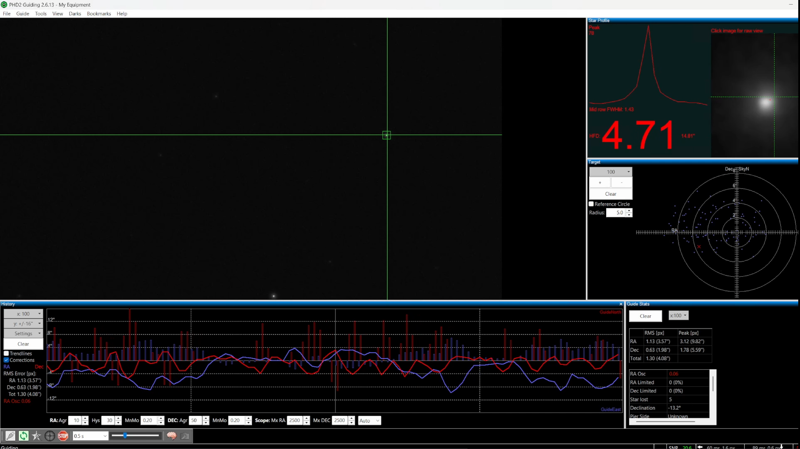
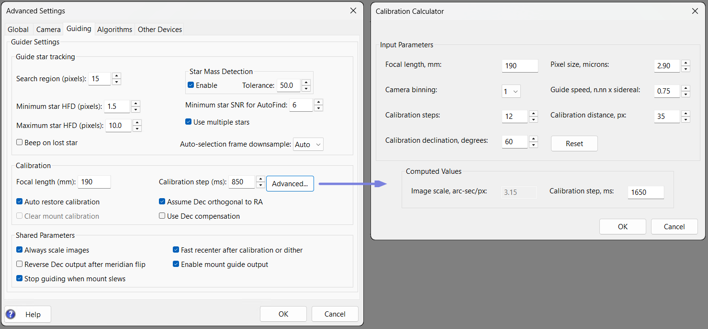
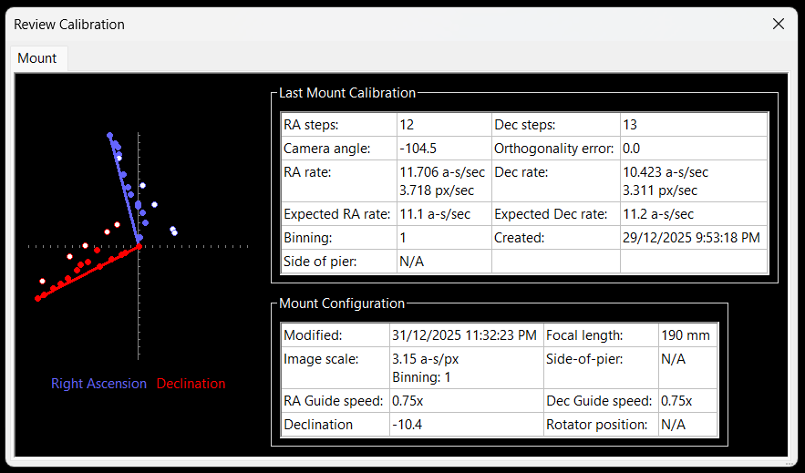
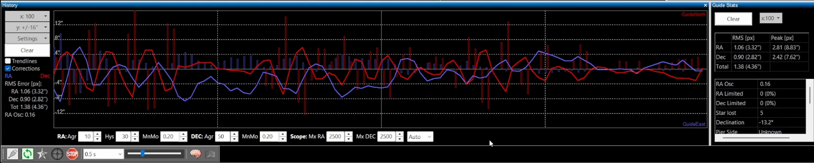

# Pulse Guiding
[Introduction](#pulse-guiding-introduction) ·
[Prerequisites](#prerequisites) ·
[Equipment Setup](#equipment-setup) ·
[Calibration](#calibration) ·
[Guiding with PHD2](#guiding-with-phd2) ·
[Improving Guiding](#improving-guiding)

This guide introduces how to use **PHD2** and pulse guiding with the **Alpaca Driver** on a **Benro Polaris mount**. It is intended for users who are new to pulse guiding, as well as those moving on from unguided imaging or [Sync Guiding](./guiding-sync.md).

Use pulse guiding or sync guiding, not both: the guider holds its guide star at the lock position it set when guiding started, so it pulls each sync correction straight back. To keep the target centred during a long pulse-guided session, use NINA's **Center After Drift** trigger instead. When the plate solve drifts past its threshold, NINA stops guiding, re-centres the target, and restarts guiding with a new lock position. Each re-centre is a slew, which resets the driver's PEC Drift Correction, so don't set the threshold too tight (about 0.3 to 0.5 arc minutes).

## Pulse Guiding Introduction

>VIDEO DEMO: [27 - Guiding the Alpaca Benro Polaris](https://youtu.be/dn1nLxT5eWw)

### Why Pulse Guide?

Pulse-guiding is used to correct **small tracking errors and drift** that occur during long-exposure or long-session astrophotography. Even with good multi-point alignment and careful setup, small mechanical imperfections, AHRS drift, atmospheric effects, and tracking rate errors may cause stars to slowly trail or drift over time. Pulse-guiding helps correct many of these issues.

For the Benro Polaris, the **primary benefit of pulse-guiding is eliminating drift**, enabling longer more consistent imaging sessions. It’s important to set realistic expectations. Pulse-guiding cannot fix:

* Poor focus, optical issues, or unfavourable seeing conditions
* Vibrations caused by tripod flexure, ground instability, or wind
* Mechanical binding, balance problems, cable drag or obstructions
* The inherent mechanical in-precision of the Polaris

> Note: Pulse-guiding is totally optional. You can still obtain excellent DSO images without the use of pulse-guiding. Pulse-guiding is not a replacement for good setup, it is a **fine correction tool**, not a cure-all.

### How It Works
Pulse-guiding is controlled by a separate guiding application that connects to the guiding camera as well as the Alpaca Driver. The guiding application operates by:

* Continuously monitoring a selected guide star (or stars) from the guide camera
* Measuring small deviations from the star’s expected position
* Sending **pulse-guiding correction commands** to the Alpaca Driver

The Alpaca Driver then:

* Refines the target's equatorial setpoints
* Translates these corrections into motor-level adjustments
* Sends the updated motion commands to the Benro Polaris mount

### Supported Applications

The Alpaca Driver exposes pulse-guiding commands through the **ASCOM Alpaca ITelescopeV3 Interface**. Any guiding application that supports this pulse-guiding interface can work with the Alpaca Driver.
The following guiding solutions have been tested with v2.0:

* **CCDciel’s Pulseguider** — provides integrated guiding, including star selection, calibration, and corrections. Ideal for macOS and non-NINA platforms.
* **PHD2** (used alongside **NINA**) — PHD2 handles guiding, while NINA manages imaging and dithering (via PHD2)
* **NINA Direct Guider** — enables dithering without a guide scope. Not recommended as we have not seen significant improvements with this solution.

The remainder of this secion will focus on the second solution, using **PHD2**.

## Prerequisites

### Equipment and Software
To perform pulse guiding you will need a guide camera, a guide scope or off-axis guider, and a way to mount them.

**Guide Camera**

A dedicated guide camera captures rapid images of a guide star and sends them to the guiding application, which makes corrections to the mount through the Alpaca Driver. Choose a camera with:

- **High sensitivity** (mono sensors are preferred for better low-light performance)
- **USB connectivity** (USB 2.0 or 3.0, depending on your MiniPC)
- **ASCOM compatibility** (for use with PHD2)

Examples include the ZWO ASI120MM Mini, ZWO ASI220MM, ToupTek GPM462M and QHY5L-II Mono.

**Guide Scope or OAG**

You'll need a way to collect and focus light from a guide star onto the guide camera. You can choose one of two approaches:

- **Guide Scope**: A small refractor (e.g. 30–60 mm aperture) mounted in parallel with your main lens or telescope, for example the SVBony SV106 50 mm guide scope.
- **Off-Axis Guider (OAG)**: Uses a small prism to divert light from the edge of your main telescope's field of view into the guide camera. Ideal for long focal length setups where differential flexure is a concern.

**Mounting**

Secure mounting is critical to avoid flexure between the guide scope and the main imaging system. You can consider:

- **iShoot 220mm Arca Swiss Plate and QR-50B Clamps**: used with the Polaris in the L-Bracket orientation, with three clamps to hold your camera and lens, guide scope and MiniPC (or focuser), all above the mount.
- **William Optics Dual Side Dovetail Plate**: 245 mm long and weighs 330 g.
- **YUEOCT Metal Finder Scope Mount Adapter AT-05**: mounts the guide scope via the camera's flash hot or cold shoe.

**Example setup:** a ToupTek GPM462M camera and SVBony 50 mm guide scope, mounted with QR-50B clamps on a 220 mm Arca Swiss plate.

**Software**

You will also need to download and install the following software on the MiniPC:

* **ASCOM Platform** - Download the latest ASCOM Platform from the [ASCOM Home page](https://ascom-standards.org/index.htm)
* **PHD2 Guiding Application** - Download the free PHD2 application from the [PHD2 Download page](https://openphdguiding.org/downloads/)

### ASCOM Setup
Once the ASCOM Platform is been installed, you need to use the **ASCOM Diagnostics App** to create a dynamic driver link to the Alpaca Driver's Telescope and Rotator. This step makes the Alpaca Driver's Telescope and Rotator available to all ASCOM-compatible applications, including PHD2, and only needs to be done once.

>Note: Nina does not require the ASCOM dynamic driver link to communicate with the Alpaca Driver, as it connects directly via the Alpaca protocol. Unforuntely, PHD2 on Windows only supports ASCOM, so this setup is necessary.

1. Launch **ASCOM Diagnostics App**
2. Select **Choose and Connect to Device** from **Choose Device** menu
3. Select **Telescope** from the dropdown, then click **Choose**
    * On the **ASCOM Telescope Chooser** dialog, click **Alpaca** from the menubar
    * Click **Discovery Enabled** until it is green
    * Click **Discover Now**
    * Using the dropdown, choose each **NEW ALPACA DEVICE**, Clicking **Ok** twice on each one, until no more new alpaca devices are present in the dropdown.
    * On the **ASCOM Telescope Chooser** dialog, click **Alpaca** again
    * Click **Manage Devices** to list all the new alpaca devices you added.
    * Review the **IP Address** of each Telescope driver listed, and remove all unwanted drivers.
    * Aim to leave only one Telescope driver so it is easier to choose the correct one from PHD2. 
    * Click **Close** when complete.
    * Using the dropdown, choose the **Alpaca Benro Polaris Telescope** you kept
    * Click **Ok**
    * Click **Connect** to confirm the Alpaca Driver Telescope is setup. 
4. Select **Rotator** from the dropdown, then click **Choose**
    * On the **ASCOM Rotator Chooser** dialog, click **Alpaca** from the menubar
    * Click **Discovery Enabled** until it is green
    * Click **Discover Now**
    * Using the dropdown, choose each **NEW ALPACA DEVICE**, Clicking **Ok** twice on each one, until no more new alpaca devices are present in the dropdown.
    * On the **ASCOM Rotator Chooser** dialog, click **Alpaca** again
    * Click **Manage Devices** to list all the new alpaca devices you added.
    * Review the **IP Address** of each Rotator driver listed, and remove all unwanted drivers.
    * Aim to leave only one Rotator driver AND one Telescope so it is easier to choose the correct one from PHD2. 
    * Click **Close** when complete.
    * Using the dropdown, choose the **Alpaca Benro Polaris Rotator** you kept
    * Click **Ok**
    * Click **Connect** to confirm the Alpaca Driver Rotator is setup. 
5. Close the **Device Connection Tester** dialog box
6. Close the **ASCOM Diagnostics App**

## Equipment Setup
Once PHD2 has been installed, you need to perform some initial setup. This includes connecting, focusing and configuring the equipment.

### Connecting Equipment
Connecting PHD2 to the guide camera and Alpaca Driver (one time setup)

1. Ensure your **guide camera** is physically connected and power it on.
2. Ensure the **Alpaca Driver** is running and connected to the Polaris.
3. Launch **PHD2**
4. Select **Guide** from the **PHD2** menubar, then **Connect Equipment**
5. Choose **New Using Wizard**, from the **Manage Profiles** dropdown.
    * Camera: select your **guide camera** from the dropdown list
    * Scope: set your **Guide scope focal length** eg 190mm for SV106. Click **Next**.
    * Mount: select **Alpaca Benro Polaris Telescope (ASCOM)** from the dropdown list. Click **Next**.
    * Leave Adaptive Optices as None (not required), then click **Next**.
    * Rotator: select **Alpaca Benro Polaris Rotator (ASCOM)** from the dropdown list. Click **Next**.
    * Finish the wizard and save the profile.
6. On the **Connect Equipment** diaglog, click the **Camera Setup** button
    * You will find **Camera Setup** next to the Camera **Connect** button
    * Change the Camera Mode to **16 bit**. Click **Ok**.
    * Click **Connect All**, or **Connect** each device individually.
8. Select **Guide** from the **PHD2** menubar, then **Advanced Settings**.
    * Change to the **Camera** tab.
    * Change the **Saturation by Max-ADU Value** to 65535.
    * Click **Ok**

### Guide Scope and Camera
Focusing, Rotating and Aligning the guide camera (one time setup)

1. Ensure your **main camera** is centered on a recognisable landmark, like a powerline tower, tall building, or tall fixed object, as far away as possible. This can be done during twilight hours or even during daytime.
2. Ensure you have a laptop, tablet or phone, near the guide camera. This will allow you to remote into the Mini-PC running PHD2, make guide camera focus and alignment adjustments, and see the effect immediately.
3. Using **PHD2**, connect to all equipment
5. On the bottom left toolbar of the main PHD2 window  
    - Click **Loop Exposures**. Also available from the **Guide** menubar item.
    - Set an appropriate **Exposure Duration** from the dropdown eg 0.01 s
    - Adjust the **Gamma Adjustment Slider** to see the landmark image 
6. Focus the **guide camera**. eg for an SV106 guide scope
    - Set the helical focuser to half way
    - Slide the lipstick **guide camera** in/out to roughtly focus
    - You may need an extension tube attached to the camera to reach rough focus
    - Fine tune the focus with the helical focuser  
7. Rotate the **guide camera** to orient the landmark so it points upwards correctly.
8. Align the **guide camera** with the **main camera**. eg for an SV106 guide scope
    - Loosen the guide scope **mounting screws**
    - Adjust the mounting screws to point the **guide camera** to the exact same position as seen by the **main camera**
9. Instead of using **PHD2** to focus and align the guide camera you may consider using **Nina**. It provides an excellent **cross-hairs overlay** that can assist with alignment. 
    - Using PHD2, disconnect all equipment
    - Using Nina, open the **Image tab** and enable **cross-hair overlay**
    - Connect to the **main camera** and point mount at the landmark
    - Connect to the **guide camera**, then physically focus, rotate and align.
    - Connect back to the **main camera**

### PHD2 Settings
Using PHD2, configure the following settings for use with the Alpaca Driver.

* Check **Enable Server** from the Tools menu, to allow Nina to work with PHD2
* Set **Exposure Duration** to 0.5 s as a starting point..
* Adjust **Gamma Adjustment Slider** to make stars visible in PHD2.
* Click the **Brain Button** or choose **Advanced Settings** from the **Guide** menu
    - Select the **Guiding** tab of **Advanced Settings**
    - Enable **Use Multiple Stars** to improve guide star stability and robustness, particularly in poorer seeing or when individual stars fluctuate in brightness. Averaging several stars smooths out the seeing, so the driver corrects the mount's real drift rather than chasing the turbulence.
    - Enable **Assume Dec orthogonal to RA** to help PHD2 achieve a successful calibration.  Geometrically, Right Ascension and Declination are always perpendicular. However, guiding software works in camera pixel space, not celestial coordinates. Factors such as targets near the celestial poles, guide camera rotation, small mechanical tolerances, differential flexure, and polar misalignment can cause RA and Dec to appear non-orthogonal to the guider. With the Alpaca Driver’s multi-point alignment, you should have very good polar alignment. With a stable setup and non-polar targets, it’s generally safe to let PHD2 assume Dec is orthogonal to RA. This can help improve the chances of a good calibration.
    - Ensure **Focal Length** and **Pixel size** is set correctly for your guide scope and guide camera
    - Leave all remaining settings at default to start with

### Alpaca Driver Settings
Using Alpaca Pilot, configure the following Alpaca Driver guiding settings.

* **Guide Rate** - I typically use **0.75× Sidereal**, but the default **1.0×** also works well in most cases. If you feel the guiding application is pushing the mount around too much, causing it to oscillate, you can reduce the **Guide Rate**. Typically the RA and Dec guide rates are matching. This can be adjusted on the Alpaca Pilot *Settings* page.

* **Sidereal Tracking** - For guiding to work, sidereal tracking **must be enabled** in the driver. The tracking rate must be set to **Sidereal** and auto-guiding is not suitable for Lunar, Solar, or Custom Orbital tracking.

* **PID Tuning** - When autoguiding is active, you can monitor the pulse guide commands and shifts in Right Ascension and Declination Setpoints from the PID Tuning page.

* The **EQ vs Az/Alt Mode** in the Alpaca Dashboard does **not** affect guiding. It only changes which coordinate system is displayed on the radial dials.

 

## Calibration
Calibration determines how your mount responds to guide pulses in Right Ascension (RA) and Declination (Dec). During this process, **PHD2** measures how far and in what direction a guide star moves in response to controlled pulse commands. It then builds a model that allows it to calculate the precise pulse corrections required to counteract tracking drift.

For best results, calibration should be performed under the following conditions:

* **CRITICAL: Disable PEC Drift Correction if you are using Dithering** - 
We recommend not using Dithering with the Alpaca Driver as we have not seen any significant improvement in guiding or hot pixel reduction. If you decide to use Dithering, then you should switch off PEC Drift Correction. Unlike calibration, dither steps aren't recognised, and you don't want PEC to learn them as drift. PEC Worm Gear Correction can stay on.

* **PEC can stay on during calibration** - 
We recommend using the Alpaca Driver's Periodic Error Correction over PHD2's own Predictive PEC algorithm. The Driver’s version models both the RA and Dec axes independently and applies corrections directly within the mount's tracking loop. This can reduce the size of guide corrections and produce smoother tracking. To use PEC with an autoguider:

    * Leave PEC on while you calibrate. The driver recognises PHD2's (and CCDciel's) calibration pulses, and PEC Drift Correction ignores them, rolling back anything it learnt during the calibration (`pec_ignore_guider_calibration`, on by default).
    * PEC Worm Gear Correction doesn't learn from guiding, so it can stay on too; calibrating with it on means PHD2 measures a mount with its worm gear error already removed.
    * Avoid switching PEC Drift Correction off and on around calibration: switching it restarts the drift model, which then has to learn the drift again.

* **Connect the Rotator so one calibration lasts the night** - 
On the Benro Polaris the Position Angle (PA) changes from target to target, and PHD2's calibration is only valid at the PA it was made at. If PHD2 is connected to the **Alpaca Benro Polaris Rotator** with **Reverse the sign of Angle** enabled (see [Re-Calibration](#re-calibration)), PHD2 adjusts its calibration to each new PA itself, so you can calibrate once and slew to other targets. Without the Rotator, calibrate at your imaging target so the PA is the same for calibration and imaging: slew to the target, ignore PHD2's calibration location warning, and click Calibrate. PHD2 will make a small slew to remove backlash before starting the calibration.

* **Close to the intended imaging target** - 
    RA/Dec guide commands are translated into coordinated motor movements whose relationship varies with sky position. Calibrating near the imaging target ensures the transformation between guide corrections and motor motion remains accurate. 

* **Within ±20° of the celestial equator (Dec ≈ 0°)** - 
    Near the celestial equator, guide pulses produce the largest and most measurable star movement, resulting in more accurate calibration data.

* **Within one hour of the celestial meridian** - 
    Calibrating near the meridian minimizes atmospheric refraction and mechanical flexure effects, providing a more stable and representative measurement of mount behavior.

Following these guidelines ensures calibration is accurate, reliable, and representative of actual guiding conditions.

### Calibration Process
To Calibrate **PHD2**, use the Calibration Assistant:

1. Following the guidelines above, slew the Polaris close to your intended imaging target using NINA, Stellarium, or Alpaca Pilot.
2. Enable **Sidereal Tracking**.
3. In **PHD2**, connect to all required equipment.
4. From the **Tools** menu, select **Calibration Assistant**.
5. We no longer recommend clicking **Slew** or manually entering a **Calibration Location**. Instead, calibrate using your current telescope pointing.
6. Click **Calibrate** to begin the calibration process.

PHD2 will perform a small slew to remove backlash, then start sending a sequence of pulse guide commands, monitoring how the mount moves in response to the commands. It will walk out the Right Ascension axis and back, then do the same for the Declination axis. You can monitor its progress with Alpaca Pilot. The process typically takes 1-3 minutes.

Once the calibration process is complete, PHD2 will sumamrise the results in a popup window. You can then decide whether to **Accept calibration** or **Discard calibration**. You can also review the most recent calibration data by choosing **Review Calibration Data** from the **Tools** menu item.

A good calibration looks like the following image. Red dots indicate measured position for declination change. Blue does indicate measured position for RA change. White dots indicate reverse measurements.

### Calibration Errors

As the Alpaca Driver needs to convert RA and Dec pulses into suttle changes in M1-M3 motion speeds there can be some cross-coupling between axes, unlike an equatorial mount. This can mean that the Polaris can be slower to respond to guide pulses, or deviate slightly from expected motion, so calibration may occasionally report warnings or errors. For example:

- **Calibration failed – star did not move enough**    
    Usually due to the **Guide Rate** being too low (increase on Alpaca Pilot Settings)    
    Or the **Calibration Step size** too small (increase in PHD2, Advanced Settings, Guiding ).  
    Monitor the RA and Dec movement from Alpaca Pilot, PID Tuning page, to diagnose further.

- **Calibration failed – RA or Dec did not reverse**    
    PHD2 did not detect movement when reversing RA or Dec direction.  
    Usually due to excessive backlash or mechanical slack or sticktion  
    Try increasing **Guide Rate** or **Calibration Step size**.

- **The RA and Declination angles computed in the calibration are questionable**  
    Check that you enabled **Assume Dec orthogonal to RA**, as this will force the orthogonality error to zero.

### Re-Calibration

PHD2 assumes that the relationship between RA/Dec guide pulses and pixel motion on the guide camera remains fixed, as it would on a conventional equatorial mount. You normally need to repeat calibration only when this relationship changes, for example when:

* You physically rotate the guide camera relative to the mounts RA or Dec axis.
* You slew to a new DSO with a different Position Angle (PA). This is not necessary when using the Rotator setting described below.
* You change the camera's roll angle for framing, thereby changing the PA. This is also not necessary when using the Rotator setting described below.
* You change equipment or optical parameters that affect the calibration, such as the guide scope, main camera or lens focal length.

**One calibration per night with the Rotator**
When PHD2 is connected to the **Alpaca Benro Polaris Rotator**, it can automatically adjust its calibration as the Position Angle changes. This means you do not need to recalibrate after slewing to a new target or changing the roll angle, provided the rotator is configured correctly.

To enable this, change the following PHD2 setting:

1. Click the **Brain Button** or choose **Advanced Settings** from the **Guide** menu
2. Select the **Other Devices** tab
3. Under **Rotator Settings**, enable **Reverse the sign of Angle**
4. Click **Ok**

With this option enabled, PHD2 uses the rotator's roll angle with the correct sign to adjust its calibration when the mount slews to a target at a different Position Angle. You should therefore need to perform only one PHD2 calibration per night, provided the guide-camera geometry and other calibration-dependent settings remain unchanged.

Note: If you use a separate ZWO rotator that rotates only the main imaging camera, while the guide camera remains fixed relative to the mount, changes in the ZWO rotator's angle do not require recalibration.

## Guiding with PHD2

Once you have calibrated PHD2, auto-guiding with PHD2 is relatively simple. If you have configured Nina to use PHD2, it will automatically run through steps 1 through 4 for you. 

1. Start **PHD2** and **Connect All Equipment**
2. Click **Begin Looping Exposures** to start the guide camera
3. Click **Auto-Select Star** to select a guide star
4. Click **Begin Guiding** to start the auto-guiding process

To monitor the guiding performance, use the **View** menu in PHD2

1. Click **Display Graph** to show the auto-guiding history.
2. Click **Display Target** to show spread of motion of the guide star.
3. Click **Display Star Profile** to show the expanded guide star pixel profile.
4. Click **Display Stats** to summarise the guiding performance.

 

Below is a typical Graph and Statistics of an auto-guiding session.

* The Polaris has been tested to be capable of RMS Error of around 1.5 to 3.0 arc-seconds.
* Small oscillations are normal
* Large or runaway corrections indicate setup issues
* Initial results may not be perfect. Allow guiding to settle for a few minutes.

## Improving Guiding

Guiding corrects whatever the mount gets wrong, but the less there is to correct, the better the guiding. This section describes the tracking errors that limit guiding on the Benro Polaris, how to recognise each one, and what the driver offers to reduce it. A quick reference table is at the end.

### Slow Drift

* **What you see:** The guide star drifts steadily in one direction, mostly in RA and Dec, and the guider keeps pushing it back with corrections that are mostly one-sided. Without guiding, the target slowly wanders out of frame over tens of minutes.
* **Cause:** The alignment model (QUEST) is never perfect, so the mount's idea of the sky is slightly off. The resulting drift rate changes slowly as the mount moves across the sky and as the night progresses.
* **Solution:** Switch on **PEC Drift Correction** in Pilot's settings. The driver learns the drift rate from the guide corrections (Pulse Guiding or Sync Guiding), averaged over about 7.5 minutes, and applies it every 200 ms, leaving the guider only what remains. It starts once it has enough corrections to be confident (see [Periodic Error Correction](./kinematics.md#periodic-error-correction)).
* **Tips:**
    * It ignores PHD2 and CCDciel guider calibration pulses, so it can stay on while calibrating.
    * It pauses learning while a motor reverses its tracking direction, for example M2 as a target passes its highest point. The motor first turns through its gear backlash before the lens follows, so the star drifts for several minutes and the guider pulls it back. PEC keeps applying the rate it had learned, but doesn't learn that drift, so it doesn't keep correcting it after the gear has caught up. The driver log shows when learning pauses and resumes.
    * It stops applying the rate if the guide corrections stop, for example clouds pass preventing plate solving: after about 5 minutes, or three times the usual time between corrections if that is longer. It carries on from the next correction.
    * A single correction far larger than usual, such as a bad plate solve or the mount slipping, is treated as a one-off jump rather than drift, so it doesn't throw the rate off. Several large corrections in a row are taken as a real change in drift and learned.
    * Switch it **off** if you dither: dither steps look like drift, and PEC would learn them.
    * A good Multi-Point Alignment (and Mechanical Alignment Correction) reduces the drift in the first place.

### Worm Gear Wobble

* **What you see:** A slow, smooth wave in the guide graph, with a period of a few minutes to an hour or more. In the PHD2 Log Viewer's frequency analysis it shows as a peak, often around 30-40 minutes, but it varies with where the mount is pointing.
* **Cause:** Each motor drives its axis through a worm gear (6°, 60 teeth). Small irregularities in the gear make each axis wobble by about 30-150 arc seconds, repeating every 6° of that motor's rotation. Because the wobble is tied to the motor angles, it repeats in the same way night after night.
* **Solution:** Measure each motor's worm once with the **M1-M2-M3-WORM-PROFILE** test on Pilot's Calibration page (see [Worm Gear Calibration](./initial-setup.md#worm-gear-calibration)) (about 20 minutes, using plate solves), approve the result, then switch on **PEC Worm Gear Correction**. The driver then removes the wobble before it happens, with or without guiding. See [Worm Gear Correction](./kinematics.md#periodic-error-correction) for the test.
* **Tips:**
    * PEC Drift Correction and PEC Worm Gear Correction work together: the worm correction removes the wave, and the drift correction learns what is left. The PEC button on Pilot's status panel switches both.
    * The PEC switches are live settings. Press **Save** on the Config page to keep them after the driver restarts.

### Payload Slip on M2

* **What you see:** Regular sharp kicks in the guide graph, every 10-40 seconds, in RA and Dec at the same time: the star jumps 10-20 arc seconds, then the guider brings it back over several frames. PHD2's RA Osc stays low (the guider isn't over-correcting) and lowering the aggressiveness only slows the recovery. It is most likely with a heavy lens.
* **Cause:** M2 carries the camera, the lens and the M3 Astro Module off its axis, and this is hard to balance (a guide camera crossbar adds more). When M2 has to lift a heavy payload slowly while tracking, it creeps ahead and then slips back about 20 arc seconds, over and over. With a 300 mm f/2.8 (2.4 kg) this gave 8" RMS guiding; the same target at a different roll gave 2.4".
* **Solution:** On the Dashboard's **Roll** dial, open the presets and choose **ZM2**. The driver rotates the camera to the roll that keeps M2 almost still while tracking the target for the next 2 hours, within the mount's roll limits. Ensure you have the rotator connected to PHD2 (otherwise you will need to recalibrate the guider after changing the roll angle). The framing rotates, but the target stays centred.
* **Tips:**
    * Balance what you can: slide the lens back in its clamp so its balance point is as close as possible to the tilt pivot.
    * M1 is never affected (its axis is vertical, so the payload's weight can't turn it).
    * If the kicks come back later in the night (the roll drifts as the target crosses the sky), choose ZM2 again.

### Gear Backlash

* **What you see:** Two distinct patterns, occurring at particular points in the sky rather than throughout the night:
    * **Increased drift lasting several minutes:** The star suddenly requires much larger guiding corrections, sometimes reaching PHD2's maximum pulse duration. After 5–15 minutes, guiding settles again.
    * **A steady back-and-forth every 8-10 seconds,** The star moves back and forth, usually in Dec, with a noticeable increase in guiding RMS Error.

* **Cause:** Each motor drives its axis through gears with some mechanical slack, known as backlash. On the Polaris, this can amount to 150–620 arcseconds. While a motor takes up this slack, the motor turns but the axis doesn't move as expected, even though the driver assumes it does.
    * **When a motor reverses:** During tracking, a motor sometimes needs to change direction. For example, M2 as a target passes its highest point, or M1 as a target near the pole changes direction. The motor must first take up the gear slack before the axis responds, allowing the star to drift by as much as the backlash. 
    * **When a motor barely moves:** At very low tracking speeds (below approximately 4" per second), guiding corrections can repeatedly push the motor back and forth through the gear slack. Each correction takes effect late, causing overshoot and a repeating 8–10-second oscillation in the guiding loop.

* **What the driver does and what you can do:**
    * **PEC pauses learning during backlash:** PEC Drift Correction automatically pauses learning around a motor reversal. This prevents it from learning the temporary corrections needed to compensate for backlash and then mistakenly applying them as ongoing drift corrections after the gears re-engage.
    * **Recognise an approaching reversal** The driver logs each tracking-direction reversal several minutes in advance, whether guiding is enabled or not. For example:

        `->> Polaris: M2 reverses its tracking direction in 4 min; its gear backlash (up to 720") can show as drift for about 18 min`

    * **Watch for oscillation with ZM2:** The ZM2 roll strategy (see [Payload Slip on M2](#payload-slip-on-m2)) keeps M2 nearly stationary, which can help with a heavy payload but may leave the motor operating at very low speeds. If you see 8–10 second oscillations after selecting ZM2, try reducing RA and/or Dec aggressiveness.
    * **Distinguish guiding errors from goto errors:** Backlash can also leave Slew & Center corrections a few arcminutes short or past the target, requiring another iteration. This is a separate effect from the guiding symptoms described above.
    * **Backlash Compensation (needs Coordinated Speed Control):** When enabled, the driver compensates for each motor's gear slack at the end of every goto, helping Slew & Center corrections reach the target more accurately on the first attempt. Backlash compensation does not attempt to correct slack due to motor reversals during guiding. At the very low motor speeds involved, guide corrections can repeatedly reverse direction without fully taking up the gear slack, leaving the guider to compensate. You may still see the motor oscillate over an 8–10 second cycle; reducing guiding aggressiveness can help.
  

### Computer Stalls

* **What you see:** An occasional single large disturbance, not regular, often when the computer is busy (saving images, a virus scan or Windows update starting).
* **Cause:** The driver's control loop runs on the guiding computer. If the computer stalls for a second or more, the motors keep their last speed for that time, and the guider then sees a jump. The driver log shows warnings such as `Event loop lag detected` and `HIGH CPU LOAD breakdown` at that time.
* **Solution:** Keep the guiding computer free of heavy background work during imaging: exclude the driver, log and image folders from Windows Defender scans, pause Windows Update, and close programs you don't need.

### Quick Reference

| What you see in the guide graph | Likely cause | What to do |
| ------------------------------- | ------------ | ---------- |
| Steady drift, mostly one-sided corrections | Imperfect alignment model | PEC Drift Correction; refresh Multi-Point Alignment |
| Slow wave, minutes to an hour | Worm gear wobble | Worm profile test and PEC Worm Gear Correction |
| Regular sharp kicks every 10-40 s, heavy lens | M2 payload slip | ZM2 roll preset, better balance |
| A drift bump for 5-15 minutes, at the same point in the sky | A motor reversing through its gear backlash | Check the log for "reverses its tracking direction"; PEC pauses learning; Backlash Compensation |
| Slew & Center needs extra iterations, a few arcminutes short or past | A goto ending with a motor's gear slack open | Backlash Compensation |
| Back-and-forth every 8-10 s, calmer with lower aggressiveness | A slow motor going back and forth through its backlash | Lower the aggressiveness on that axis; longer guide exposures |
| A single large jump at random | Computer stall | Check the log for lag warnings; reduce background load |
| Rapid back-and-forth, high RA Osc | Guider over-correcting | Lower PHD2 aggressiveness or the Guide Rate |
| Drift after a dither | PEC learning the dither | Switch off PEC Drift Correction when dithering |

 

## Final Notes

Guiding with PHD2 and N.I.N.A. can feel **finicky at first**, especially at longer focal lengths. Once dialed in, it dramatically reduces drift and enables longer, cleaner exposures.

Focus on star quality rather than graph perfection, make one change at a time, and keep notes of what works.

 
 

