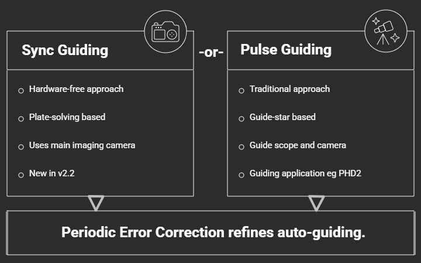
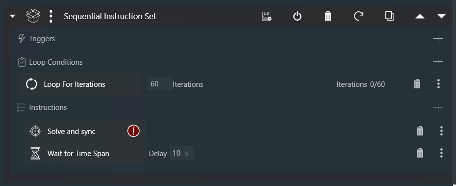

# Sync Guiding
[Choosing an Approach](#choosing-an-approach) |
[How It Works](#how-sync-guiding-works) |
[Periodic Error Correction](#periodic-error-correction) |
[Worm Gear Calibration](#worm-gear-calibration) |
[Sync Guiding with NINA](#sync-guiding-with-nina) |
[Sync Guiding with CCDciel](#sync-guiding-with-ccdciel)

Guiding corrects the tracking errors that remain after alignment. Multi-Point Alignment gives the Benro Polaris an accurate pointing model, but periodic error and other mechanical errors still make the target drift. The Polaris's periodic error is over 14 arc minutes, on a repeating 35-minute cycle, so without guiding, long exposures at long focal lengths show drift and trailed stars.

## Choosing an Approach

The Alpaca Driver supports two approaches to guiding:

* **Sync Guiding** needs no extra hardware. Your imaging software plate-solves an image from your main camera every 1 to 3 minutes and syncs the result, and the driver corrects the drift. It's the easiest way to start, and it suits sub-exposures of up to a few minutes.
* **[Pulse Guiding](./guiding-pulse.md)** uses a small guide scope and guide camera with PHD2, which corrects the mount every few seconds, within each exposure. It suits the longest focal lengths and exposures, up to about 300 seconds.

Use one approach or the other, not both. Running them together makes them fight: the guider holds its guide star at the lock position it set when guiding started, so it pulls each sync correction straight back. To keep the target centred during a long pulse-guided session, use NINA's **Center After Drift** trigger instead.

## How Sync Guiding Works

Normally a plate-solve sync adds a new point to the Multi-Point Alignment model. With **Sync Guiding (Plate-solve)** switched on in Alpaca Pilot's settings, a sync taken **without slewing** is treated differently: the driver uses the small difference between where the mount thought it was pointing and where the plate solve says it is pointing as a guiding correction, and moves the mount back onto the target.

* **No extra hardware:** No guide scope or guide camera to buy, mount, power or cable up.
* **Accurate:** A full-frame plate solve measures the pointing far more precisely than a single guide star.
* **Hands-free:** The corrections happen during your normal imaging sequence, without stopping to re-centre.

Each correction also feeds Periodic Error Correction, which learns how the mount is drifting and corrects it continuously between syncs.

## Periodic Error Correction

Periodic Error Correction (PEC) anticipates the Polaris's tracking errors and corrects them before they show in your images, every 200 milliseconds. It has two parts, each with its own switch in Alpaca Pilot's settings:

* **PEC Worm Gear Correction** corrects the wobble from each motor's worm gear, which repeats every 6° of the motor's rotation and can move the view by 30 to 150 arc seconds. It uses a profile of your mount's gears, measured once with the [Worm Gear Calibration](#worm-gear-calibration) below, and works with or without guiding.
* **PEC Drift Correction** learns the slow drift that remains, from your guiding corrections, whether from sync guiding or pulse guiding. It starts correcting once it has received a few corrections and its estimate of the drift is reliable.

The **PEC** button on Alpaca Pilot's status panel switches both on and off together. For how PEC works in detail, see [Periodic Error Correction](./kinematics.md#26-periodic-error-correction-pec) in the Kinematics Reference.

## Worm Gear Calibration

The worm gear profile only needs to be measured once for your mount, and again if you image with a very different lens. The **M1-M2-M3-WORM-PROFILE** test moves the mount to about 50 positions up to ±7.5° from where it starts, and at each one waits for a plate-solve sync to measure where it really points. It takes about 20 minutes.

**Choosing a lens:** Use a lens that gives an image scale of 2 to 5 arc seconds per pixel, which for most cameras is a 100 to 300 mm lens. For example, a 200 mm lens on an IMX585 camera gives 3 arc seconds per pixel over a 3.2° × 1.8° field. Use short exposures (2 to 5 s) with plenty of stars, so that each plate solve is quick and reliable.

**To measure the profile:**

1. In Alpaca Pilot's **Settings**, set **Focal Length** and **Focal Ratio** to the lens you're using, for example 200 mm and f/4. Each lens keeps its own profile.
2. Point the mount 30 to 45° above the horizon in the eastern or western sky (azimuth roughly 45 to 135° or 225 to 315°), at a field with plenty of stars and about ±9° of clear sky around it. Avoid due north or south and the area around the celestial pole.
3. In NINA, connect the camera, then the mount to the Alpaca Driver. Set the plate-solve exposure time to 1 s, then in the Advanced Sequencer create a loop of about 60 iterations, each running a **Solve and Sync** followed by a **Wait for Time Span** of about 10 seconds to let the mount settle.

    

4. Start the sequence, and keep it running until the test finishes.
5. In Alpaca Pilot, open **Calibration** under **Performance Tuning**, select the **M1-M2-M3-WORM-PROFILE** test, press **Test** and confirm. The driver starts tracking and rotates the camera to a roll of ±45°, then steps through the positions.

**While the test runs**, don't guide, slew, park or jog the mount, as any of these stops the test. Your syncs are only used as measurements, and don't change the pointing model. If no sync arrives for a minute, the test stops with **NO DATA**. When it finishes, stop the NINA sequence.

**Review and approve the result.** The results show each motor's measured wobble, for example `M3 85"@224` (85 arc seconds of wobble, peaking at 224° of the worm's cycle), and how reliable each measurement is. A motor shown as `off` couldn't be measured reliably, and gets no correction. If the result looks reliable, approve it, then switch on **PEC Worm Gear Correction**. The driver combines up to five of your most recent approved tests, so repeating the test on another night improves the profile. For how to read every column of the results, see [Worm Gear Correction](./kinematics.md#26-periodic-error-correction-pec) in the Kinematics Reference.

## Sync Guiding with NINA

1. **Switch on the features.** In Alpaca Pilot's settings, switch on **Multi-Point Alignment**, **Sync Guiding (Plate-solve)** and **PEC Drift Correction** (and **PEC Worm Gear Correction**, once you have a worm gear profile).
2. **Align the mount.** Reset any old Multi-Point Alignment, turn on tracking, and capture at least three sync points: ideally at your celestial pole, and along the path your target will take (see [Deep-Sky Imaging](./dso-imaging.md#focusing-and-aligning)).
3. **Centre the target.** Use NINA's **Slew and Center** to put your target in the middle of the frame. The first sync after a goto adds an alignment point and starts sync guiding; the following syncs are used as guiding corrections.
4. **Start the PEC model (optional).** On NINA's Imaging tab, run a few manual plate solves about 30 seconds apart. This helps PEC learn the drift sooner.
5. **Build the sequence.** In NINA's Advanced Sequencer, create a loop that takes your light frames with a **Smart Exposure**, then runs a **Solve and Sync**, so that a sync happens every 1 to 3 minutes. For example, with 30 s sub-exposures, take 4 frames between each sync.
6. **Start the sequence**, and watch the first few syncs. In Alpaca Pilot, the **Sync Guiding** and **Periodic Error Correction** rows of the status panel show the corrections arriving.

## Sync Guiding with CCDciel
CCDciel can also sync guide, using the Alpaca Driver's `PolarisSyncGuide` script:

* In Alpaca Pilot, enable **Multi-Point Alignment** and **Sync Guiding (Plate-solve)**.
* Install the Alpaca Driver's CCDciel scripts (see [Alpaca Driver Scripts](./ccdciel.md#alpaca-driver-scripts)), then add a `PolarisSyncGuide` step to your plan after the light frames, so it runs every 1 to 3 minutes of imaging. It solves the image just taken (no extra exposure) with CCDciel's `Astrometry_sync` command.
* After a goto, the first sync adds an alignment point and turns sync guiding on; the following syncs are used as guiding corrections (if within 3 degrees).
* After a sync the driver moves the mount back onto its target, so the script waits a few seconds (the settle argument) before the next exposure.
* Sync guiding with CCDciel is new: please report how it works for you.
* Don't combine sync guiding with pulse guiding: the guider pulls each sync correction straight back to its lock position.
