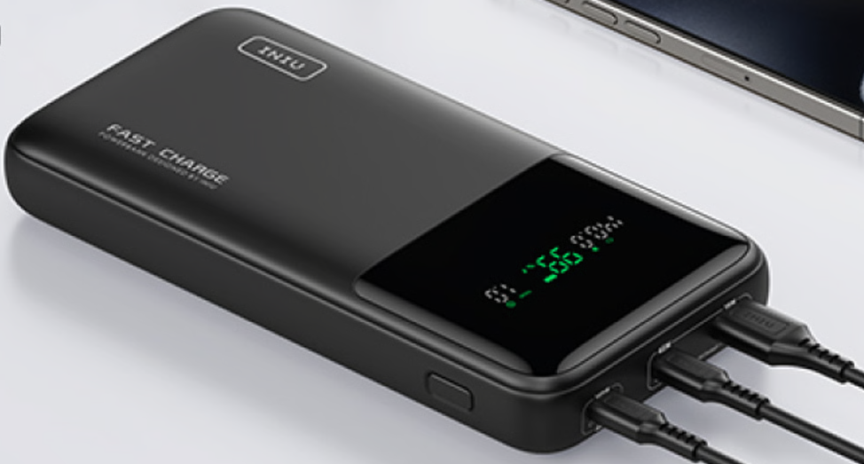
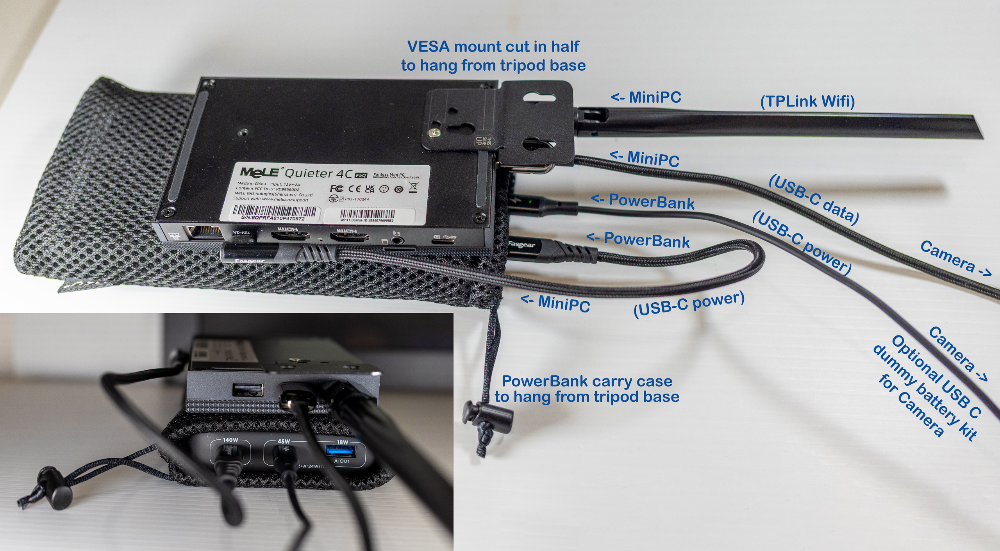

# Preparing the MiniPC
[Choosing a MiniPC](#choosing-a-minipc) |
[Powering](#powering-the-minipc) |
[Connecting Up](#connecting-up-the-minipc) |
[Setting Up Windows](#setting-up-windows) |
[Optional Steps](#optional-steps)

The recommended way to run the Alpaca Driver is on a MiniPC mounted on your tripod, which can then control all your astronomy equipment. This guide covers choosing, powering, connecting and setting up a MiniPC. For the other ways to run the driver, on a laptop, a Raspberry Pi or in a Docker container, see [Architecture](./architecture.md#hardware-architectures).

## Choosing a MiniPC
The MiniPC should be small, fan-less, fast and power efficient. That way you can mount it on your tripod, it won't cause any vibrations, it can store and process your images, and it can run for a whole night on a battery. I'd recommend the [MeLE Mini PC Quieter 4C](https://www.amazon.com/MeLE-Mini-Quieter-4C-Astrophotography/dp/B0CP3YL6J7) (around US$200 from Amazon on sale). See Cuiv's review of the [Quieter 4C Mini-PC](https://www.youtube.com/watch?app=desktop&v=j8lcDyw1toQ).

Unfortunately its built-in Wi-Fi doesn't support connecting to the Benro Polaris Wi-Fi, so you'll also need a USB Wi-Fi adapter such as the [TP-Link AC600 USB WiFi Adapter](https://www.amazon.com/wireless-USB-WiFi-Adapter-PC/dp/B07P5PRK7J/) (about US$17 from Amazon). The MiniPC can run without internet connectivity, but the extra Wi-Fi adapter lets it connect to the Benro Polaris and the internet at the same time.

We have received reports of compact "mini" USB Wi-Fi adapters having difficulty keeping a stable connection with the Polaris. For this reason, we specifically recommend the model above, as its full-size external antenna gives a more reliable connection.

## Powering the MiniPC
A battery I'd recommend is the [INIU 140W Power Bank](https://www.amazon.com.au/dp/B0CB1FWNMK). What an awesome product, 27000mAh of storage with 140W fast charging and discharging capabilities! I use this powerbank to power the mini-PC and my camera. 



The MiniPC connects to the camera via USB-C, so it can control the lens AF as well as capture and process images. You only need to connect the camera to the Benro Polaris for initial setup and star alignment. Unfortunately the Quieter 4C doesnt provide enough output over USB-C to power the camera, so I run a separate [USB-C Power Adapter for LP-E6](https://www.amazon.com.au/dp/B08PD8Z3JG) from the power bank  directly into the camera for power. 

After one night of failed images with a dewed up lens, I also have a [NEEWER USB Lens Heater](https://www.amazon.com/Telescope-Temperature-Regulator-Condensation-Astrophotography/dp/B0C6Q4YFFC) which I power from a separate power bank, as it can be power hungry, although less critical. If I had more equipment to power, like a cooled astronomy camera or a laptop in the outback, I'd consider upgrading to a [Jackery Portable Power Station 500](https://www.amazon.com.au/Jackery-Portable-Explorer-Generator-Adventure/dp/B08744R27F).

## Connecting Up the MiniPC
The image below shows how you could configure the cables and physical setup of the MiniPC and PowerBank. Note that the USB-C Dummy Battery Kit cable is optional. You can power your camera from your standard camera battery if you prefer.



## Setting Up Windows
The following steps are a high-level summary of how you may wish to set up Windows on your MiniPC. They are not comprehensive.

### BIOS Settings
You can set the Mele PC to automatically boot when it is powered on. This can save you from having to manually press the Power button to boot the device.

To set the Mele PC BIOS to auto power on:

1. Reboot MelePC, pressing the **Del key** until it enters BIOS settings
2. From the BIOS, navigate to the **Advanced**, then **Customer Exclusive Functions**
3. Enable **Auto Power On**
4. Then **Save changes and Exit**


### Local Account
Use a local account with administrative privileges to set everything up. Using a Microsoft Account may have implications on the need for internet connectivity. 

To create a local account:

1. In the Settings app select Accounts > Other users 
2. Under Add other user, select Add account
3. Select the option Add a user without a Microsoft account
4. Complete the user details
5. Under Account Options, select Change account type
6. Select Account Type `Administrator` then click `OK`

To enable autologin:  

1. Open `regedit` from the start menu
2. When prompted with *“Do you want to allow this app to make changes to your device?”*, click **Yes**  
3. Copy and paste the following into the regedit address bar `Computer\HKEY_LOCAL_MACHINE\SOFTWARE\Microsoft\Windows NT\CurrentVersion\PasswordLess\Device`
4. Right click on `DevicePasswordLessBuildVersion`, and select **Modify**
5. Change Value Data from `2` to `0`, and click **OK**
6. Close `regedit`
7. Open `netplwiz` from the start menu
8. Uncheck `Users must enter a user name and password to use this computer`
9. Click **OK**
10. Enter the autologin **User name**, **password** and **confirm password**, click **OK**

### Microsoft Account
Recent versions of Windows increasingly encourage the use of a Microsoft account instead of a local account. When you sign in with a Microsoft account, Windows Backup automatically syncs certain settings, including Wi-Fi profiles, across your devices by default.

This behavior can interfere with the Wi-Fi configuration on the MiniPC. To prevent Windows from sharing the MiniPC’s settings with other devices, disable settings sync:

To isolate the MiniPC’s Windows settings:

1. Open Settings
2. Go to Accounts
3. Select Windows backup
4. Turn off Remember my preferences

This will stop Windows from syncing system settings (including Wi-Fi networks) to and from other PCs using the same Microsoft account.

### Power Saving
Make sure that your power saver functions are set so that your computer will not go to sleep/hibernate mode. Also its useful to disable your screensaver.
You need to set the Power Management to High Power.

To disable hibernation:   

1. Open the **Command Prompt** as Administrator:  
    - Type `cmd` in the Start menu search.  
    - Right‑click **Command Prompt** and select **Run as Administrator**.  

2. When prompted with *“Do you want to allow this app to make changes to your device?”*, click **Yes**.  

3. In the Command Prompt window, enter `powercfg /h off`

### Defender Scans
Microsoft Defender can temporarily consume most of a Mini PC's CPU resources during an imaging session, causing the Alpaca Driver to become unresponsive for several seconds.

There are three potential sources of activity:

* **Real-time scanning:** Defender scans each new image as NINA saves it and scans the driver's log files as they are written.
* **Scheduled scans:** Defender's scheduled scan may run during the night depending on your configuration.
* **Automatic maintenance:** Windows can perform maintenance tasks overnight, including security scans, updates and disk optimisation.

Windows automatic maintenance commonly uses 2:00 AM as its default start time. If Defender or other background tasks overload the CPU, the driver may report warnings such as **Event loop lag detected** and **Polaris position update: lag**. The **HIGH CPU LOAD breakdown** log entry may identify MsMpEng.exe (the Defender process) as a major contributor. If the driver freezes for too long, it may disconnect from the Polaris mount and have to reconnect.

**Recommended solution:** Exclude the trusted driver and image folders from Defender's scans, and schedule maintenance and Defender's scheduled scan for the daytime.


**Exclude the Alpaca Driver and NINA image folders:**

1. Open **Windows Security** from the Start menu.
2. Go to **Virus & threat protection**, then **Manage settings** under *Virus & threat protection settings*
3. Scroll to **Exclusions** and click **Add or remove exclusions**
4. Click **Add an exclusion**, choose **Folder**, and select:
    * **Alpaca Driver folder:** For example, `C:\Users\<you>\alpaca-benro-polaris`. This contains the driver, its Python environment, and its logs and data folders.
    * **NINA image folder:** Use the location configured in NINA under Options > Imaging > Image file path, for example, `D:\Astro\Images\`.
  
    Only exclude folders you trust. Defender will no longer scan files in these locations as part of its real-time and scheduled scanning, which reduces protection for those files.

**Schedule Defender's scan for the daytime:**

1. To move Defender's scheduled scan to noon, open Windows PowerShell as Administrator and run:

    ```
    Set-MpPreference -ScanScheduleTime 12:00:00
    ```

    This sets the scheduled scan time to 12:00 PM. The actual schedule can also depend on other Defender settings and Windows policies.

**Move Windows automatic maintenance to the daytime.** 

1. Open **Control Panel**.
2. Goto **System and Security** >  **Security and Maintenance**
3. Expand **Maintenance** and click **Change maintenance settings**
4. Set the maintenance time to a daytime hour, such as **12:00 PM**.
5. Untick **Allow scheduled maintenance to wake up my computer at the scheduled time** if you do not want maintenance to wake the Mini PC.
5. Click **OK** to save the changes.

**Verify the Defender settings:**

1. Open **PowerShell** as Administrator and run::

    ```
    Get-MpPreference | Select-Object ExclusionPath, ScanScheduleDay, ScanScheduleTime
    ```

    Check that the driver and image folders appear under ExclusionPath and that ScanScheduleTime is set to the intended time. ScanScheduleDay indicates the configured scan day; a value of 0 means every day.

**Check the driver log on the next imaging night:**

1. After applying these changes, check the driver's log for the **HIGH CPU LOAD** breakdown entries.

2. If Defender was responsible for the CPU spikes, you should see fewer instances of **MsMpEng.exe** dominating CPU usage and fewer event-loop lag warnings. Other background processes can still cause CPU spikes, so use the log to confirm whether the problem has improved.

### Remote Desktop Server
Enable Remote Desktop Server to allow access from your laptop.
Open Settings > System > Remote Desktop > Enable, Set Password.
Disable the Require Devices to use Network Level authentication.

## Optional Steps
The following steps are optional, depending on where you image and what equipment you use.

### Mobile Hotspot
This step is only needed if you want to use the MiniPC at a remote location where there is no Wifi connection. Windows 11 allows you to setup your own WiFi hotspot hosted on the MiniPC. This allows you to connect directly to the MiniPC's Wifi and operate it via Remote Desktop.

#### Loopback Driver
In order to create a hotspot, Windows 11 needs to create a tether to an existing network connection. When in the outback you may not have internet connectivity so we'll link the hotspot to a Loopback driver

1. Open Device Manager. This can be done by right clicking on the start menu and clicking Device Manager.
2. Select the computer name at the top of the list
3. In the Action menu, select "Add legacy hardware"
4. Click the "Next" button
5. Select "Install the hardware that I manually select from a list"
6. Select "Network Adapters"
7. Click the "Next" button
8. On the left side, select "Microsoft" Note: It may take a moment for these lists to appear and populate, depending on the speed of your mini-PC
9. On the right side, select "Microsoft KM-TEST Loopback Adapter"
10. Click the "Next" button
11. Click the "Next" button and complete the installation
12. Open the Control Panel. This can be done by opening the start menu and searching for "Control Panel"
13. Click "Network and Internet"
14. Click "Advanced Network Settings"
15. Expand the Microsoft KM-TEST Loopback Network Adapter. 
16. Rename the KM-TEST loopback adapter to "Loopback"
17. Restart the mini-PC

#### Startup Task
Because you will want this to run headless and won't have a way to start it manually, this needs to start automatically at boot time. 

1. Run Task Scheduler
2. Create a new Task called StartMobileHotspot
3. Change general to run when user is logged on or not
4. Change trigger to "At system Startup"
5. Change action to "Start a program" linking to 

    `alpaca-benro-polaris\platforms\win\StartMobileHotspot.cmd`

6. Change conditions to uncheck only start if on AC power

#### Startup Registry Key
If the Task Scheduler startup doesnt enable the mobile hotspot on startup, you can try to use the Windows Registry as well.

1. Press Win + R, and type regedit, accept the account privileges check.
2. Navigate to `\HKEY_CURRENT_USER\Software\Microsoft\Windows\CurrentVersion\Run` 
3. Create a new String Value named `StartMobileHotspot`
4. Set its value to the full path of the StartMobileHotspot.cmd ie `powershell.exe -ExecutionPolicy Bypass -File "C:\....\platforms\win\StartMobileHotspot.cmd"`
5. Make sure you expand the .... in the quoted full path to StartMobileHotspot.cmd.

Note, you may need to re-create this registry value after a Windows Update.

#### Error 0x904
You may encounter an 0x904 error when using Remote Desktop to connect to MiniPC via its hotspot. If you encounter this issue, you can try downloading Remote Desktop from the Windows Store. This has successfully resolved the 0x904 issue on some machines.

### ASCOM Platform
ASCOM stands for Astronomy Common Object Model. It is a universal standard for Astronomy and used by many different applications and equipment manufacturers. The standard was modernised with a HTTP/REST API in 2018 under the ASCOM Alpaca initiative. The Alpaca Driver complies with the ASCOM ITelescopeV3 interface and provides an Alpaca ASCOM  REST API. 

You may need to install the ASCOM Platform software for compatibility with some astronomy equipment or applications. You will need to install the ASCOM Platform with Stellarium as it is not bundled by default. You do not need to install the ASCOM Platform on a laptop that uses Remote Desktop to access the MiniPC. 

To install the ASCOM Platform:

1. Download the ASCOM Platform from https://ascom-standards.org/ (Download button on the top-right-hand side of the home page).
2. The remaining instructions assume you are using ASCOM Platform 7.1.3 
3. Open the installation .exe file and click `Yes` on the User Account Control dialog.
4. Click `Next` to install any pre-requisites eg Microsoft .net Framework 3.5 Service Pack 1 
5. This can take quite some time to download and install (5 min for me)
6. Once the blue window shows the operation has completed successfully, press any `key` to continue.
7. Accept the ASCOM Platform Installer default options and click `Install`.
8. Click `Finish`.

You can also download other versions from the [ASCOM GitHub Releases Site](https://github.com/ASCOMInitiative/ASCOMPlatform/releases).

### Gemini EAF Focuser
The Canon RF 2x and 1.4x Extenders do not appear to work with Nina and the LensAF plugin. You can work around their issue by using an Electronic Auto Focuser (EAF)
to manually adjust the focus of an attached Canon lens. A cheap EAF available from AliExpress is the [Gemini EAF Product](https://www.aliexpress.com/item/1005006731851010.html). You can connect a simple timing belt and pulley to the focuser so that it can move the manual focus ring of any lens. The following timing belt worked fine for me [2GT-6 Timing Belt](https://www.amazon.com.au/VGOL-Printer-Timing-Closed-Rubber/dp/B0CB8BFRCX)

Use the following instructions to set up the Gemini EAF driver on your MiniPC

1. Download and install the Ascom Platform as described.
2. Download the Gemini EAF Driver files from [Google Drive](https://drive.google.com/drive/mobile/folders/1-12XzPuiMEo5033jg36qKqBsfmllL0Zl).
3. Run the installation program 'CH341SER.EXE'
4. Click Install then Ok.
5. Run the installation program 'ASCOM GeminiFocuserPro Setup.exe'
6. Accept the License Agreement
7. Click Install then Finish.
8. Run the program 'GeminiFocuserProConsole.exe'
9. Click the button to set the directory used to store the log file.
10. Choose the Com Port 'COM3'
11. Click Connect, the EAF should beep.
12. Click Disconnect and Exit.

### Gemini Power Hub 3
The [Gemini Power & Data Hubs Advanced 3](https://geminiastro.cc/products/powerbox-adv3/) (Power Hub 3) is a great alternative to an unpowered USB hub. Mounted alongside the MiniPC, it provides both power and data to all your equipment from one place: the TP-Link Wi-Fi adapter, the focuser, the main camera, the guide camera, a GPS dongle, dew heater strips and more.

* It has two 5 Gbps USB 3.2 ports and four USB 2.0 ports. Plug the cameras into the USB 3.2 ports, and lower-speed devices such as the focuser, Wi-Fi adapter and GPS dongle into the USB 2.0 ports.
* It runs from a 12 V DC supply, such as a 12 V battery or a portable power station.
* Beware of using a 5 Gbps (USB 3) USB-B to USB-A cable to connect the hub to the MiniPC.
