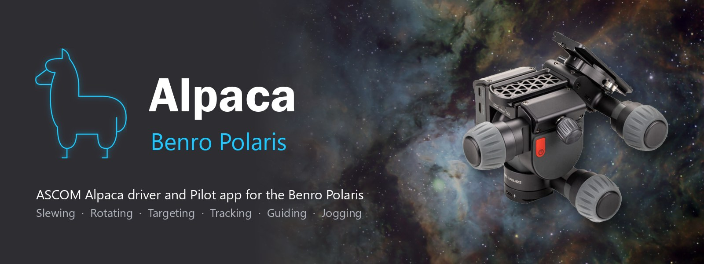
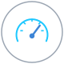
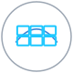
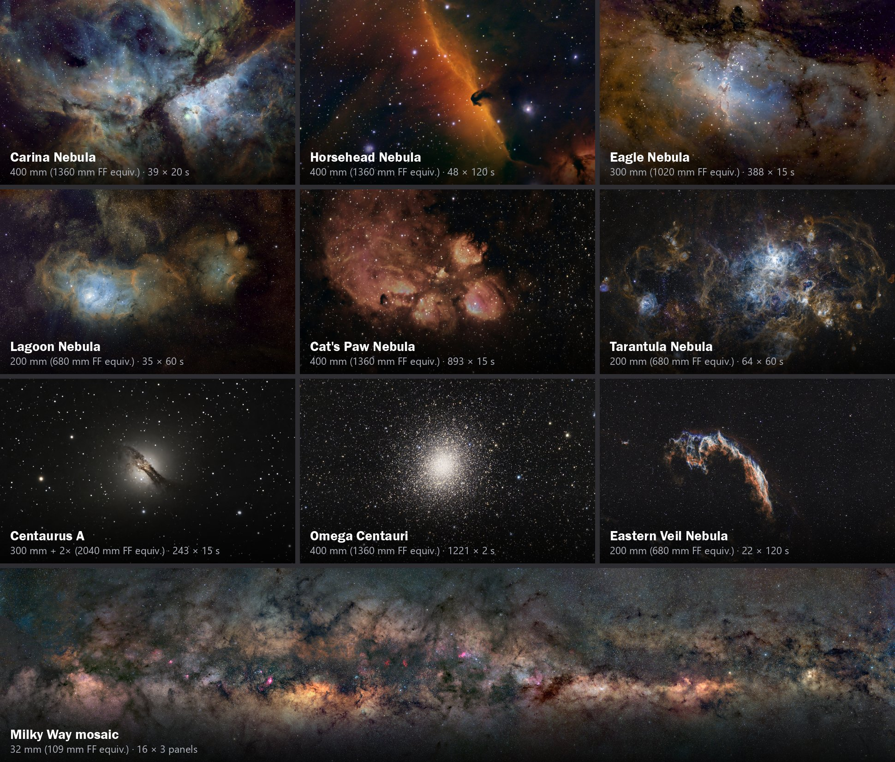

# Alpaca Benro Polaris Driver

  

The Alpaca Benro Polaris Driver is an open-source [ASCOM Alpaca](https://ascom-standards.org/) driver for the [Benro Polaris Astro Edition](https://www.benro.com/en/product/benro-polaris.html). 

The driver leaves the Polaris firmware untouched, replacing the Benro app as the mount's controller. It implements its own pointing model, tracking, and guiding algorithms to dramatically improve accuracy, minimise drift, and unlock advanced astrophotography capabilities.

It integrates with popular astronomy applications, including [NINA](https://nighttime-imaging.eu/), [Stellarium](https://stellarium.org/en/), [PHD2](https://openphdguiding.org/), [CCDciel](https://www.ap-i.net/ccdciel/en/start), [SkySafari](https://skysafariastronomy.com/) and other ASCOM Alpaca applications. It also includes [Alpaca Pilot](./pilot.md), a browser app for controlling and monitoring the mount from a phone, tablet or PC.

The driver transforms the Polaris from a simple panorama platform into a capable astrophotography mount, supporting guided deep-sky exposures of up to 300 seconds and complex, multi-layered panoramas aligned to galactic, equatorial, or topocentric coordinate systems.

[Getting Started](./getting-started.md) · [Features](#features) · [Gallery](#gallery) · [Documentation](#documentation) · [Videos](https://www.youtube.com/@jdm5001/featured)

 

## Features

The Alpaca Driver adds these capabilities to the Benro Polaris, beyond what the Benro app offers.

<table class="features">
  <tr>
    <td align="center" width="25%">
       
      <b>Multi-Point Alignment</b> 
      Auto-levels and corrects for polar, boresight and cone error
    </td>
    <td align="center" width="25%">
       
      <b>Plate Solving</b> 
      Solve, Sync and Center on targets accurately and quickly
    </td>
    <td align="center" width="25%">
       
      <b>Autofocus</b> 
      Hands-free focus runs with NINA and Hocus Focus
    </td>
    <td align="center" width="25%">
       
      <b>NINA Sequencing</b> 
      ASCOM telescope and rotator for automated imaging
    </td>
  </tr>
  <tr>
    <td align="center" width="25%">
       
      <b>Stellarium</b> 
      Click a target in the planetarium and the Polaris slews to it
    </td>
    <td align="center" width="25%">
       
      <b>Sync Guiding</b> 
      Guide with your main camera, no guide scope needed
    </td>
    <td align="center" width="25%">
       
      <b>Pulse Guiding</b> 
      PHD2 guide-camera corrections for longer exposures
    </td>
    <td align="center" width="25%">
       
      <b>Advanced Control</b> 
      PID tracking, periodic error and backlash compensation
    </td>
  </tr>
  <tr>
    <td align="center" width="25%">
       
      <b>Deep Sky Catalog</b> 
      500+ curated imaging targets, cross-referenced to 25+ catalogues
    </td>
    <td align="center" width="25%">
       
      <b>Orbital Tracking</b> 
      Satellites, planets, moons, comets and meteor shower radiants
    </td>
    <td align="center" width="25%">
       
      <b>Panoramas</b> 
      Plan and capture multi-panel and Milky Way mosaics and vertical panoramas
    </td>
    <td align="center" width="25%">
       
      <b>Astro Cameras</b> 
      Current DSLR, Mirrorless, Planetary and DSO astro cameras
    </td>
  </tr>
</table>

 
 

## Gallery

These deep-sky images were captured with a Benro Polaris and the Alpaca Driver, using 200 mm to 400 mm camera lenses on a MiniCam8 (IMX585) astro camera, giving 680 mm to 2040 mm full-frame equivalent focal lengths, with sub-exposures from 2 s to 120 s. The Milky Way mosaic at the bottom is 48 panels (16 × 3), captured with the MiniCam8 and an EF 32 mm lens.

  

## Compatible Software

| Application | What it does with the Polaris |
|---|---|
| [Stellarium Mobile PLUS](https://stellarium-labs.com/stellarium-mobile-plus/) | Slew from your phone or tablet over Wi-Fi |
| [Stellarium Desktop](https://stellarium.org/en/) | Full planetarium software with point and click slewing and live mount position on the sky |
| [SkySafari 7](https://skysafariastronomy.com/) | Alternate mobile planetarium and telescope control |
| [NINA](https://nighttime-imaging.eu/) | Full imaging automation: sequencing, plate solving, autofocus, framing, rotator, sync guiding |
| [CCDciel](https://www.ap-i.net/ccdciel/en/start) | Imaging, focusing, plate solving, sync guiding and pulse guiding (Windows, macOS, Linux) |
| [PHD2](https://openphdguiding.org/) | Pulse guiding with a guide scope and camera |
| [ASTAP](https://www.hnsky.org/astap.htm) | Plate solving and stacking software |
| [Siril](https://siril.org/) | Image stacking and processing, including panoramas |
| [Alpaca Pilot](./pilot.md) | Dashboard, catalog, alignment, tuning and diagnostics, in any web browser |

Other applications that support the ASCOM Alpaca standard should also work.

 

## Requirements

- **A Benro Polaris Astro Edition.** The driver is tested on hardware versions 1.2 to 1.4 with firmware V6.0.0.40 to V6.0.0.54. See the [Release Notes](./release-notes-v2.2.0.md#tested-compatibility) for the full list.
- **A camera and lens.** Any camera that NINA or CCDciel can control. Beta testers have used Canon, Sony, Nikon, Pentax and ZWO cameras with lenses up to 800 mm.
- **A computer to run the driver.** A Windows 11 laptop, a mini-PC mounted on the tripod, a Mac, or a Raspberry Pi (Zero 2 W and up). [Architecture](./architecture.md#hardware-architectures) compares the options, and [Preparing the MiniPC](./hardware.md) sets up a fully self-contained MiniPC rig.

When you have these, follow the [Getting Started](./getting-started.md) guide.

 

## Documentation

| Guide | What's inside |
|---|---|
| [Release Notes v2.2](./release-notes-v2.2.0.md) | New features, compatible hardware and software, bug fixes and known issues |
| [Video Playlists](https://www.youtube.com/@jdm5001/featured) | Demonstrations for [v1.0](https://www.youtube.com/playlist?list=PL5B1qfE_F9mEwhNBDOyi76xihVkCnHX-d) (the basics), [v2.0 and v2.1](https://www.youtube.com/playlist?list=PL5B1qfE_F9mFwr-02vfALFQKvrGpzEA_D), and [v2.2](https://www.youtube.com/playlist?list=PL5B1qfE_F9mFjg4Jb2zVQf3a41sgI5Ake) |
| [Getting Started](./getting-started.md) | Quick-start steps, then a beginner's learning plan for the Polaris, Alpaca, Stellarium, NINA and Siril |
| [Preparing the MiniPC](./hardware.md) | Choosing, powering, connecting and setting up a MiniPC to run the driver and NINA |
| [Installation Guide](./installation.md) | Step-by-step install on Windows, plus [macOS](./installation_macos.md), [Raspberry Pi](./raspberrypi.md) and [Docker](./docker.md) |
| [Alpaca Pilot Guide](./pilot.md) | The dashboard, catalog, alignment and panorama tools |
| [Control Reference](./control.md) | Alignment models, the rotator, safety limits, Kalman filter, speed calibration and PID tracking |
| [Using Stellarium](./stellarium.md) | Connecting and controlling the Polaris from Stellarium |
| [Using NINA](./nina.md) | Capturing, autofocus, plate solving and sequencing |
| [Using CCDciel](./ccdciel.md) | Capturing, focusing, plate solving and guiding with CCDciel |
| [Sync Guiding](./guiding-sync.md) | Guiding with plate solves from your main camera, Periodic Error Correction and the worm gear calibration |
| [Pulse Guiding](./guiding-pulse.md) | Guiding with PHD2, a guide scope and camera, and improving guiding performance |
| [Troubleshooting](./troubleshooting.md) and [FAQ](./faq.md) | Solutions to common problems, and answers to common questions |

## Support the Project

The Alpaca Benro Polaris Driver is developed independently by David Morrison. If it has improved your nights under the stars, you can support continued development:

You can also back the [Kickstarter project](https://www.kickstarter.com/projects/jdmorriso/alpaca-benro-polaris-driver-v20?ref=7xf94o), which stays open to fund ongoing support and new features.

## Use at Your Own Risk

This is not official Benro software. Benro may not support you, and using it may void your warranty. Extensive testing has kept the risk of hardware damage very low, but it is not zero.

- **Don't leave the mount unattended while the driver is controlling it.** If the driver loses its connection to the Polaris, the last movement command may continue indefinitely, and the driver cannot enforce its motor angle limits.
- **Only use the driver on an isolated, protected network.** The ASCOM Alpaca standard is open by design and is not secure.

## Acknowledgements

This project would not exist without the help of many people.

<b>Technical expertise, beta testers, backers and organisations</b>

### Technical Expertise

* Vladimir Vyskocil - for his significant contribution to the project, the [Polaris protocol](https://github.com/vyskocil/Polaris/wiki/Polaris-protocol-commands), exploring an initial prototype, being a sounding board, and inspiration for this project.
* Stefan Berg - for creating and maintaining N.i.n.a.
* Robert B. Denny - for his work in writing a template for Alpaca drivers everywhere.
* Steven Byrnes - and the SeeStar_alp driver developers for sharing their great work.
* Peter Simpson - for leading the ASCOM architecture and developing the conformance test suite.
* ASCOM Initiative Members - for their tireless standards work to improve astronomy device compatibility.

### Beta Testers
The beta testers' perseverance and feedback improved the documentation and the quality of the software.

* Vladimir Vyskocil
* bakermanz (Mark)
* LanzaSteve (Steve Everitt)
* Alex Murdock
* Daniel Michaud
* Paul C
* Spiderx01 (William Siers)
* 5x5Stuido (John Harrison)
* Ladislav (Ladi Slav)
* saltyminty (Mingyang Wang)
* hqureshi79 (Humayun Qureshi)
* Chris-F2024
* Cosimo (Cosimo Streppone)
* RjhNZ (Richard Healey)
* Matt17463 (Matthew McDaniel)
* Cynical Sarge (Andrew Sargent)

### Kickstarter Backers
Thank you to all the [Kickstarter project backers](https://www.kickstarter.com/projects/jdmorriso/alpaca-benro-polaris-driver-v20/community), especially those who pledged Game-Changing and That's-Awesome amounts. Let me know if you want to be anonymous.

### User Group Feedback
Thank you to everyone in the [Polaris Camera Controller Global Group](https://www.facebook.com/groups/326138891873755). More than 120 members supported the project in its first two days, and their requests set its priorities.

### Organisations and Services

* Benro - for creating and distributing such great products, including the Benro Polaris.
* Napkin AI - for making it so easy to create all the diagrams.
* Notebook LM - for the [Deep Dive Podcast](https://youtu.be/puRRH7VJ6cw) and helping synthesize the beta feedback.
* Grammarly - for reviewing and editing the documentation.
* GitHub - for hosting git and providing many vanilla dev support tools.
* Kickstarter - for helping so many creatives.

