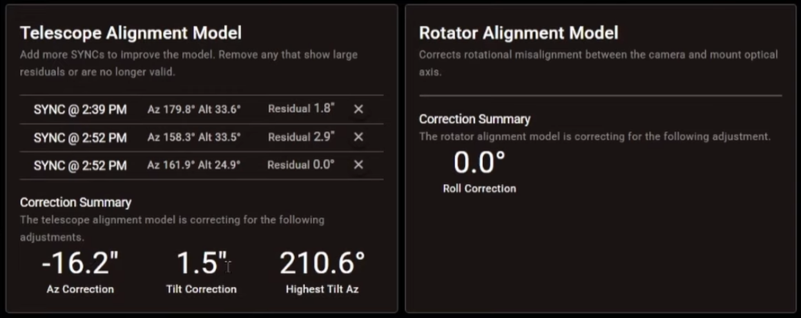
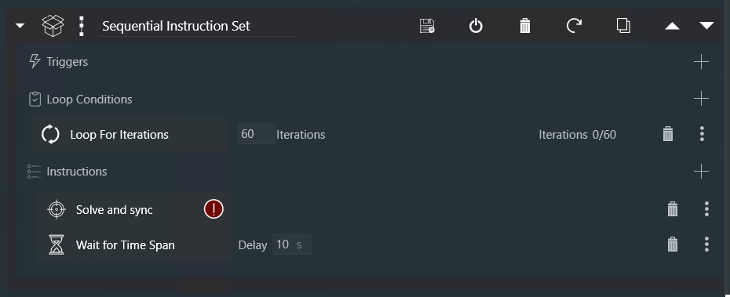

# Initial Setup
[Site Location](#site-location) · [Multi-Point Alignment](#multi-point-alignment) · [Speed Calibration](#motor-speed-calibration) · [Worm Gear Calibration](#worm-gear-calibration)

Once Alpaca Pilot is [connected to the Polaris](./pilot.md#connecting-polaris), these steps get the most out of the mount. Only the site location is required. The others improve pointing and tracking, and most of them only need doing once.

| Step | When | Needed? |
|---|---|---|
| [Site Location](#site-location) | Whenever you change observing site | Required |
| [Multi-Point Alignment](#multi-point-alignment) | At the start of each imaging session | Recommended |
| [Motor Speed Calibration](#motor-speed-calibration) | Once, to improve fast movement control | Optional |
| [Worm Gear Calibration](#worm-gear-calibration) | Once, to improve unguided and sync-guided tracking | Optional |

## Site Location

The driver needs your observing site's latitude and longitude to track accurately. Until they're set, Alpaca Pilot shows a **PreSetup** warning and won't move the mount. Set them in Alpaca Pilot's **Settings**, under **Observing Site Information**, in any of these ways:

* **Click on the map.** Find your observing site on the map and click it.
* **Enter the coordinates.** Type the **Latitude** and **Longitude** in decimal degrees, north and east positive, based on the World Geodetic System [WGS84](https://en.wikipedia.org/wiki/World_Geodetic_System).
* **Locate with a mobile device.** Using a phone or tablet, click **Locate** in its browser to use the GPS location of the device. Browsers only allow this over HTTPS and Location Services must be enabled. See [Using HTTPS](#using-https).
* **Locate with the browser.** Using a laptop or desktop, click **Locate** to use the internet location of the device running your browser. Browsers only allow this over HTTPS, or over HTTP when the browser is on the same computer as the driver (`http://localhost`). See [Using HTTPS](#using-https).
* **Locate with a GPS receiver.** At a dark site without internet, a USB GPS receiver plugged into the computer running the driver gives the site's latitude, longitude and elevation, over HTTP or HTTPS. See [GPS Receiver](#gps-receiver) below.

With internet, Alpaca Pilot fills in the site's elevation, pressure and name from a web service. Without it, the location is named by its coordinates. To keep several sites, click the save icon beside **Location**, then choose a site from the **Location** list next time.

Click **Save** at the top of Settings, so the location is kept after the driver restarts.

### Using HTTPS

Alpaca Pilot runs over HTTP by default, so your browser may show it as **"Not Secure"**, and restricts some features to HTTPS: location access (the **Locate** button) and the clipboard (such as the Panorama Grid's **Copy** button). The one exception is a browser on the same computer as the driver, using `http://localhost`, which browsers treat as secure.

Alpaca Pilot supports HTTPS from version 2.2. When the driver starts, it creates its own certificates for HTTPS. To use them, install the driver's CA certificate on each device you browse from, then turn on HTTPS in Alpaca Pilot.

**Download the Certificate**

1. Open the **Alpaca Pilot Connect** page.
2. Open the **Network Services** dropdown dialog.
3. Click **Download CA Certificate**.

**Install on Windows**

1. Open the downloaded `alpaca_pilot_ca.crt` file.
2. Click **Install Certificate**.
3. Select **Local Machine**, then click **Next**.
4. Accept **User Access Control**, click **Yes**.
4. Choose **Place all certificates in the following store**, then click **Browse**.
5. Select **Trusted Root Certification Authorities**, then click **OK**.
6. Click **Next**, then **Finish**.

**Install on macOS**

1. Open the downloaded `.crt` file — **Keychain Access** will launch automatically.
2. Add the certificate to the **System** keychain.
3. Locate `alpaca-pilot-ca` in the certificate list and double-click it.
4. Expand the **Trust** section and set **When using this certificate** to **Always Trust**.
5. Close the dialog and enter your password to confirm the changes.

**Install on iOS**

1. Open the **Alpaca Pilot Connect** page in **Safari** and download the CA certificate (Safari will prompt that a profile is ready to install).
2. Go to **Settings → General → VPN & Device Management**, tap the **alpaca-pilot-ca** profile, then tap **Install** in the top-right corner (you'll be prompted for your device passcode).
3. **This alone is not enough — the CA is installed but not yet trusted.** Go to **Settings → General → About → Certificate Trust Settings**.
4. Under **Enable Full Trust for Root Certificates**, toggle **alpaca-pilot-ca** to **on**.


**Restart Your Browser**

* **Chrome:** Navigate to `chrome://restart`
* **Safari:** Fully close Safari (swipe it away from the App Switcher)
* **Firefox:**

    1. Open `about:config`
    2. Search for `security.enterprise_roots.enabled`
    3. Set the value to `true`
    4. Restart Firefox

**Enable HTTPS**

1. Open the **Alpaca Pilot Connect** page.
2. Open the **Network Services** dropdown.
3. Select **HTTPS**, then click **Save**.
4. The Driver will restart with HTTPS enabled.
5. Alpaca Pilot will detect the restart and redirect to HTTPS.

**Certificate Warnings**

If you're upgrading from an earlier driver version and still see certificate warnings or connection failures after following the steps above, the browser or the OS may be holding onto stale security state from before the upgrade.

On Windows, do a full power-off rather than Restart. Windows 11 enables "Fast Startup" by default, which hibernates the session instead of fully reinitializing it on Restart. Leftover network state can persist across a restart; only a genuine power-off clears it. 

On any device that connected to an earlier version of the driver, also clear that browser's site data

* **Chrome/Edge**: Settings → Privacy and security → find the site under "All sites" and delete its data; 
* **Safari on iOS/iPadOS**: Settings → Safari → Clear History and Website Data

### GPS Receiver

A USB GPS receiver plugged into the computer running the driver sets the site's latitude, longitude and elevation from GPS satellites, with no internet or HTTPS needed. It's the easiest way to set an accurate location at a dark site without internet. Any receiver that outputs standard NMEA sentences works, such as the inexpensive u-blox receivers.

**Connecting the receiver:**

* Plug it directly into the computer running the driver. A cheap USB hub, and cameras or USB 3 cables close by, can block the GPS signal completely. In testing, a receiver that got a fix plugged directly into the computer never got one through a hub shared with a guide camera.
* Give it a clear view of the sky. Its first fix after being plugged in can take several minutes.

**Locating:**

1. In Settings, click the arrow beside **Locate** and choose **Use GPS Receiver**.
2. Leave **Connection to GPS Receiver** as **USB / Serial (NMEA)**, and choose the **Serial Port**. GPS receivers are marked in the list, and if only one is plugged in it's chosen for you.
3. Leave **Baud Rate** at `9600` unless your receiver's documentation says otherwise. u-blox receivers ignore it.
4. Click **OK**, then **Locate (GPS)**. The button shows its progress while it waits for three matching GPS fixes, then sets the latitude, longitude and elevation.

**Linux and Raspberry Pi notes:**

* u-blox receivers appear as `/dev/ttyACM0`, and receivers with a CH340 USB-serial chip as `/dev/ttyUSB0`. To check, run `ls /dev/ttyACM* /dev/ttyUSB*`.
* The user running the driver must be in the `dialout` group to read the receiver. The Raspberry Pi's default `pi` user already is. To check, run `groups`.
* On a Raspberry Pi Zero 2 W, plug the receiver into the micro-USB port marked **USB** with an OTG adapter, not the **PWR** port.

**GPS Daemon (GPSD), Linux only:** GPSD is a Linux service that shares a GPS receiver between programs, for example with KStars/Ekos, or to keep the computer's clock on GPS time. Use it only if you need that: while GPSD is running it holds the receiver, so choose **GPS Daemon (GPSD)** in Alpaca Pilot rather than USB / Serial.

1. Install gpsd and its status client. On a Raspberry Pi, run:
    ```Bash
    ./setup.sh -g
    ```
    The `-g` option adds the gpsd packages to setup's package installation; it doesn't select GPSD in Alpaca Pilot. On other Linux systems, install the `gpsd` and `gpsd-clients` packages.

2. Configure gpsd to use the receiver. Find its stable USB path with `ls -l /dev/serial/by-id/`, then set it in `/etc/default/gpsd`, for example:
    ```Bash
    DEVICES="/dev/serial/by-id/usb-your-receiver"
    USBAUTO="false"
    ```

3. Start gpsd and confirm the receiver has a fix:
    ```Bash
    sudo systemctl enable --now gpsd.socket
    sudo systemctl restart gpsd
    cgps -s
    ```
    Exit `cgps` with **Ctrl+C** after confirming it reports a fix.

4. In Alpaca Pilot's Settings, click the arrow beside **Locate**, choose **Use GPS Receiver**, and set **Connection to GPS Receiver** to **GPS Daemon (GPSD)**. The defaults (host `127.0.0.1`, port `2947`) are correct when gpsd runs on the same computer as the driver. Click **OK**, then **Locate (GPS)**.

## Multi-Point Alignment

>VIDEO DEMO: [24 - Multi Point Alignment and Tripod Tilt](https://youtu.be/4CMO0R_yphw)

Multi-Point Alignment builds a model of how the mount is set up from three or more sync points, and corrects for tripod tilt, polar misalignment and cone error. Without it, the driver uses Single-Point Alignment, where one plate-solve sync aligns the mount but the tripod must be accurately level. For how the two work, see [Alignment Models](./control.md#alignment-models).

Align at the start of each imaging session. The model is saved, so it survives restarting the driver or the computer, but it must be reset whenever you move or re-level the tripod.

Each step below ends with a **plate solve and sync**: your imaging app takes an image, works out exactly where it points, and syncs the mount to it. In NINA, use the Plate Solving panel on the Imaging tab (see [Manual Plate Solving](./nina.md#manual-plate-solving)); in CCDciel, see [Plate Solving](./ccdciel.md#plate-solving). Without plate solving, you can sync on a known star instead (see [Sync with a Target](./pilot.md#sync-with-a-target)), or on a landmark (see [Adding Sync Points](./control.md#adding-sync-points)).

**Before you start:**

1. Complete the Connect page's steps in Alpaca Pilot: Astro Mode, reset the axes, and skip the compass and single star alignment (see [Astro Mode Setup](./pilot.md#astro-mode-setup)).
2. Level the tripod as well as you can. The model corrects for tilt, but good levelling still helps.
3. Focus the camera, for example with NINA's Autofocus.
4. Start tracking, from your imaging app or Alpaca Pilot.

**Building the model:**

1. **Turn on Multi-Point Alignment** on Alpaca Pilot's Settings or Alignment page. If you've moved the tripod since the model was last used, reset it: on the Alignment page, switch to **Single-Point Alignment**, which clears the sync points, then back to **Multi-Point Alignment**.
2. **First sync.** Plate solve and sync wherever the mount is pointing. The mount is now aligned.
3. **Celestial pole.** Search for "pole" in Alpaca Pilot's catalog, goto it, and wait for the mount to stop. Then plate solve and sync. A point at the pole keeps the model accurately polar aligned.
4. **Along the target's path.** Goto your imaging target, then plate solve and sync. For a long session, also add a point where the target will be later: decrease its Right Ascension by an hour or two (enter `d-2` in Alpaca Pilot's Right Ascension setpoint), wait for the mount to stop, plate solve and sync, then goto the target again.
5. **Sync the Position Angle** (if you use the Alpaca Rotator). NINA doesn't sync the plate-solved Position Angle, so enter it on Alpaca Pilot's Alignment page once per session (see [Adding Sync Points](./control.md#adding-sync-points)).

**Reviewing the model:**

On Alpaca Pilot's Alignment page, each sync point shows a **residual**: the angle between where the mount reported it was pointing and where the model, from the other sync points, predicts it was. Lower residuals mean a better fit. A very good model has residuals of arc seconds, with none of arc minutes or whole degrees.



Residuals over 5° are flagged **Amber**, and over 10° **Red**. These points don't fit the model, and pull its accuracy down across the whole sky, so review them for deletion. They're usually caused by poor centring before the sync, the mount moving during it, sync points clustered together, an incorrect site location, or the tripod moving.


Delete a sync point by clicking the cross beside it. If the mount is tracking, the model adjusts and the mount moves to where it now thinks the target is. If that's off target, plate solve and sync again.

## Motor Speed Calibration

>VIDEO DEMO: [32 - Calibrating Speed Control for your Polaris](https://youtu.be/U_0-mBDuTjE)

The driver works well with its default motor speeds, but measuring your own mount's speeds makes slews more accurate and tracking smoother. It only needs doing once, and can be done during the day. For how the calibration is used, see [Motor Speed Calibration](./control.md#motor-speed-calibration) in the Control Reference.

**Preparing:** make sure the mount can move freely, and remove the camera and any other payload.

**Running the tests:**

1. In Alpaca Pilot, open **Calibration** under **Performance Tuning** in the side menu.
2. Select a motor: **M1** (Azimuth), **M2** (Altitude) or **M3** (Rotation, the Astro Axis). Each motor has its own calibration.
3. Click **Test**. With no test selected, the driver tests every speed, measuring the motor's actual speed at each.
4. Watch each test complete in the table. Click **Abort** to stop at any time.

**Reviewing the results:** the table shows each test's commanded speed, measured speed, % change from the baseline, and standard deviation. A low % change and a low standard deviation mean a reliable test. If a test shows a high standard deviation or an unexpectedly large change, select it and click **Test** again to retest that speed.

**Approving the results:** select the tests to approve, or leave them all unselected to approve everything, then click **Approve**. The driver uses the approved speeds instead of its defaults from then on.

**Rerunning tests:** to rerun tests, select their checkboxes, click **Test** and confirm. Tests marked **HIGH STDEV** or **HIGH CHANGE** (more than 25% from the default) can't be approved: rerun them, or leave those speeds at their defaults. M3 is the hardest motor to measure, as it reports its position less often, so if its results stay unreliable, leave it at its defaults and let the PID controller correct for it. To reset every motor to its defaults, delete `data/speed_testdata.json`, and restart the driver.

## Worm Gear Calibration

Each motor's worm gear makes the view wobble by 30 to 150 arc seconds, repeating every 6° of the motor's rotation. **PEC Worm Gear Correction** cancels this wobble using a profile of your mount's gears, which this calibration measures. Of the two calibrations, it gives the biggest improvement, both unguided and with sync guiding, especially at longer focal lengths (see [Periodic Error Correction](./guiding-sync.md#periodic-error-correction)).

The profile only needs measuring once, and again if you image with a very different lens. The driver combines up to five of your most recent approved tests, so repeating the test on another night improves the profile.

The **M1-M2-M3-WORM-PROFILE** test moves the mount to about 50 positions up to ±7.5° from where it starts, and at each one waits for a plate-solve sync to measure where it really points. It takes about 20 minutes.

**Choosing a lens:** use a lens that gives an image scale of 2 to 5 arc seconds per pixel, which for most cameras is a 100 to 300 mm lens. For example, a 200 mm lens on an IMX585 camera gives 3 arc seconds per pixel over a 3.2° × 1.8° field. Use short exposures (2 to 5 s) with plenty of stars, so that each plate solve is quick and reliable.

**Measuring the profile:**

1. In Alpaca Pilot's **Settings**, set **Focal Length** and **Focal Ratio** to the lens you're using, for example 200 mm and f/4. Each lens keeps its own profile, so if these are left at the defaults, the test is filed under the wrong lens.
2. Point the mount 30 to 45° above the horizon in the eastern or western sky (azimuth roughly 45 to 135° or 225 to 315°), at a field with plenty of stars and about ±9° of clear sky around it. Avoid due north or south and the area around the celestial pole.
3. Set up your imaging app to plate solve and sync repeatedly, about every 10 seconds, for about 20 minutes. In NINA, connect the camera, then the mount, and set the plate-solve exposure time to 1 s. Then in the Advanced Sequencer, create a loop of about 60 iterations, each running a **Solve and Sync** followed by a **Wait for Time Span** of about 10 seconds to let the mount settle. If the test log shows many syncs discarded as "motors not settled", lengthen the wait a little.

    

4. Start the sequence, and keep it running until the test finishes.
5. In Alpaca Pilot, open **Calibration** under **Performance Tuning**, select the **M1-M2-M3-WORM-PROFILE** test, click **Test** and confirm. The driver starts tracking and rotates the camera to a roll of ±45°, then steps through the positions.

**While the test runs**, don't guide, slew, park or jog the mount, as any of these stops the test. Your syncs are only used as measurements, and don't change the alignment model. If no sync arrives for a minute, the test stops with **NO DATA**. You can click **Stop** at any time. When it finishes, stop the sequence: syncs after the test are ordinary alignment points.

**Reviewing and approving the result:** the results show each motor's measured wobble, for example `M3 85"@224` (85 arc seconds of wobble, peaking at 224° of the worm's cycle), and how reliable each measurement is. A motor shown as `off` couldn't be measured reliably, and gets no correction. If the result looks reliable, approve it, then switch on **PEC Worm Gear Correction** in Settings. For how to read every column of the results, see [Periodic Error Correction](./kinematics.md#periodic-error-correction) in the Kinematics Reference.
