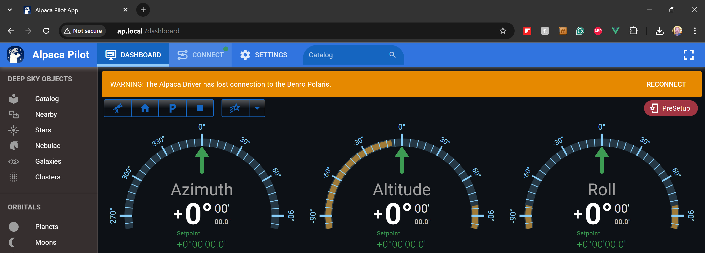
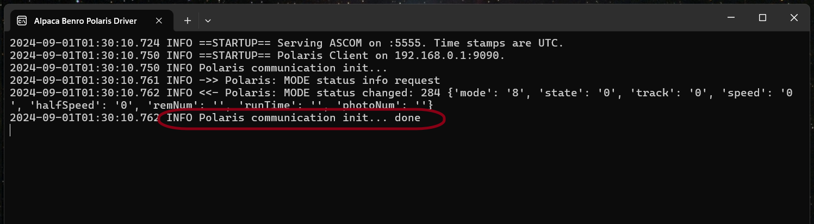
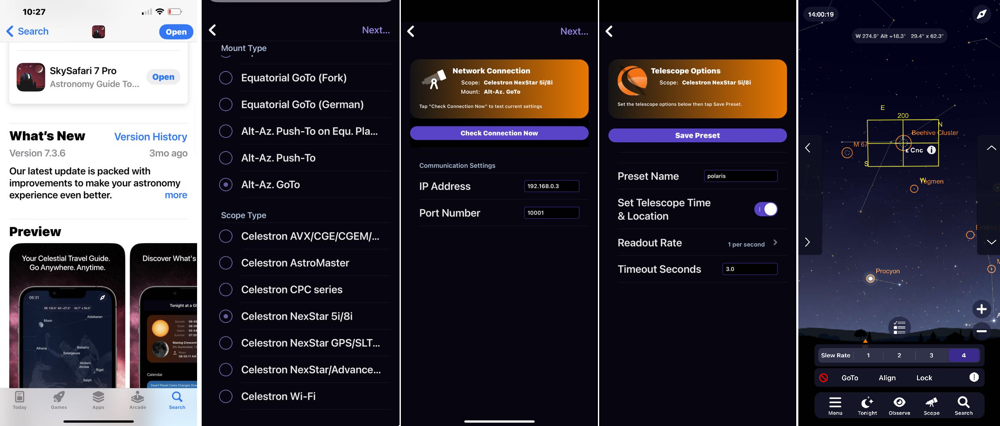

# Installation Guide 
[Microsoft Win11](#to-install-on-windows-1011) | [Apple MacOS](./installation_macos.md) | [Raspberry Pi](./raspberrypi.md) | 
[Startup](#starting-the-alpaca-pilot-app) | 
[Deep-Sky Imaging](./dso-imaging.md) | 
[Stellarium](#stellarium-desktop) | 
[Sky Safari](#sky-safari-pro) | 
[Nina](#installing-nina) | 
[Architecture](./architecture.md) 


## Software Installation

### To Install on Windows 10/11

You can view a demonstration of parts of this documentation in the following YouTube Video.

[](https://www.youtube.com/watch?v=qXRiTLS2EaY)

The `setup.bat` script installs and configures the Alpaca Driver. It uses [uv](https://docs.astral.sh/uv/) to install Python and the required libraries, and [Git](https://git-scm.com/) to download and update the driver. The setup script also configures the required network ports in Windows Firewall, offers to start the driver automatically when Windows starts, and places a shortcut to the driver on your desktop.

1. **Logon to Windows with an administrator account**

    Use an administrator account so `setup.bat` can offer to start the driver automatically at Windows startup (see Step 4).

    Before continuing, enable Windows Location permissions. The driver needs Location access to scan for and connect to the Polaris Wi-Fi network. Without it, Windows may block the Wi-Fi scan and the driver may report "No Wi-Fi interfaces found".
   
    Open **Settings > Privacy & security > Location** <br>
    Enable **Location services**, as well as **Let apps access your location**, and **Let desktop apps access your location**.
   
2. **Open a Command Prompt**

    Press **Windows + R**, type `cmd`, and press **Enter**.

3. **Download the setup script**
   
    Copy and paste the following command into the Command Prompt, then press **Enter**: 

    ```text
    curl -fL -o setup.bat https://raw.githubusercontent.com/ogecko/alpaca-benro-polaris/main/platforms/win/setup.bat
    ```

4. **Run the setup script**

    ```text
    setup.bat
    ```
    You can optionally specify the version or Git branch to install. In this example, `dev2_2` selects the v2.2 development branch:

    ```text
    setup.bat dev2_2
    ```

    During installation:

    * You will be asked **Start the Alpaca Driver automatically when Windows starts? [N/y]**. Press Enter (the default) to start the driver manually from the desktop shortcut. Type **y** and press Enter to start it automatically; you will then need to enter your **Windows password**.
    * If you chose automatic startup, also accept the **User Account Control** prompt. It is needed to set up the startup task and to open the Windows Firewall for the driver.
    * Wait a few minutes while the required files and software are downloaded and installed.

    When installation is complete, the driver should be up and running, and the script displays the address of the Alpaca Pilot App.

    By default, the driver is installed in `C:\Users\<Username>\alpaca-benro-polaris`

    If the driver does not start automatically, see [Troubleshooting A8](./troubleshooting-install.md#a8---no-start-at-boot).

    <details markdown="1">
    <summary>Advanced options</summary>

    You can provide additional options when running `setup.bat`. For example:

    ```text
    setup.bat -d D:\Astro\Bin\alpaca-benro-polaris dev2_2
    ```

    | Option        | Description                                                                        |
    | ------------- | ---------------------------------------------------------------------------------- |
    | `-d folder`   | Install the driver in the specified folder instead of the default location. The folder is remembered, so later runs use it again without `-d`. |
    | `-p password` | Specify the Windows password on the command line instead of being prompted for it. |
    | `-s`          | Do not configure the driver to start automatically at Windows startup.             |
    | `-y`          | Run unattended and do not pause when the installation finishes.                    |
    | `-v`          | Show every detail on screen. Without it only the steps and any errors are shown, and the details are saved to `%TEMP%\alpaca-setup.log`. |
    | `-h`          | Display the built-in help.                                                         |

    **Starting the driver manually**

    If you skipped automatic startup by using `-s` or by pressing **Enter** at the password prompt, you can start the driver manually in either of the following ways.

    - **Using the desktop shortcut**

         Double-click the **Alpaca Benro Polaris Driver** shortcut that `setup.bat` placed on your desktop.

    - **Using a Command Prompt**

         Run the following command:

         ```text
         cd %USERPROFILE%\alpaca-benro-polaris
         .venv\Scripts\python.exe driver\main.py
         ```

         A console window will remain open while the driver is running.

         The first time the driver runs, Windows may ask whether to allow it through the firewall. Click **Allow access**.

    </details>

### Updating the Driver

To update the Alpaca Driver to the latest version, repeat **step 4** above.

The update process will:

1. Stop the currently running driver.
2. Download the latest version.
3. Install any required updates.
4. Restart the driver.

Your existing settings and data, including alignment and calibration data, are preserved.

### Starting the Alpaca Pilot App

Once the Alpaca Driver is running, you can access the Alpaca Pilot App from any web browser.

5. **Open a web browser**

    Open **Chrome**, **Edge**, **Firefox**, or another supported web browser.

6. **Open the Alpaca Pilot App**

    Enter the following address in the browser's address bar:

    ```text
    http://ap.local
    ```

7. **Verify that the app opens**

    The Alpaca Pilot App should display the startup screen and switch to the dashboard shown below.

    

8. **(Optional) Enable HTTPS**

    Browser features like Location and Clipboard access only work over a secure (HTTPS) connection. If you need them, follow the [Pilot User Guide – Using Alpaca Pilot over HTTPS](./pilot.md#using-https) to install the driver's CA certificate and switch Alpaca Pilot to HTTPS.

### Connecting to Polaris

Before you can use the Polaris, complete the following steps.

9. **Open the Connect page**

    Click **Connect** in the top toolbar of the Alpaca Pilot window. The Connect page guides you through the steps required to connect the driver to your Benro Polaris device.

10. **Set up and power on the Polaris**

    Set up your Benro Polaris tripod head and turn on the device.

    If you cannot turn on the Polaris, see [Troubleshooting B1](./troubleshooting-polaris.md#b1---polaris-wont-start).

11. **Complete the connection procedure**
    
    On the **Connect** page in the Alpaca Pilot App, follow each step indicated by a checkmark.

    For detailed instructions, see the [Pilot User Guide – Connecting Devices](./pilot.md#connecting-polaris).

    Make sure all applicable checkmarks are green. The final **Multi-Point Alignment** step will remain incomplete until you have successfully aligned on three or more stars.

12. **Verify the connection**

      After the driver has successfully connected to the Polaris, the Alpaca Pilot log — or the driver's console window if you started it manually — should contain:

      ```text
      communications init... done
      ```

      The log should look similar to the following:

      

## Troubleshooting

If you do not see the `communications init... done` message, see [Troubleshooting C1](./troubleshooting-network.md#c1a---wi-fi-2-not-connected) for steps to diagnose and resolve connection problems.

## Next Steps

To plan and run an imaging session, see [Deep-Sky Imaging](./dso-imaging.md) and [Planetary Imaging](./planetary.md).

## Optional Steps
   
### Stellarium Desktop
Stellarium is a free open-source planetarium for your computer. 
While there are free and paid Mobile Stelarium Apps and free Web versions, 
I'd recommend using the desktop version as it is full-featured and has been 
tested with the Alpaca Driver.

#### Installing Stellarium

1. Download the relevant desktop version from https://stellarium.org/en/
2. The remaining instructions assume you are using v24.2 of the Windows x86 64bit version for Windows 10+
3. Open the installation .exe file and click `Yes` on the User Account Control dialog.
4. Select your language and click `OK`.
5. Select `I accept the agreement` and click `Next`.
6. Choose your installation folder and click `Next`.
7. Select `Start Menu Folder` and click `Next`.
8. Select `For all users` and click `Next`.
9. Click `Install`.
10. Check `Launch Stellarium` and click `Finish`.

#### Seting up Stellarium

1. Press `F11` to exit full-screen mode.
2. Press `A` to remove the Atmosphere. Press `D`to see Deep Sky Objects.
3. Press `F2` to open the Configuration Dialog.
4. Select the `Extras` tab on the Configuration Dialog menu bar.
5. Click `Get Catalog 5 of 9` and repeat for `6`,`7`,`8` and `9 of 9`.
6. If you are copying Oculars settings, duplicate the following file:
    `C:\Users\XXXXX\AppData\Roaming\Stellarium\modules\Oculars\ocular.ini`

### Sky Safari Pro
The following screen captures show the settings you need to use for Sky Safari Pro to work with the Alpaca Driver. Choose an Mount as Alt-Az , Brand as Celestron NexStar 5i/i8 , IP Address 192.168.0.3, Port 10001, Preset Name as Polaris and Save Preset.



### Installing Nina
Nina is an open-source free software application covering image capture, autofocus, plate-solving, centering, star detection, guiding, and a lot more. Much of this now works with the Benro Polaris (well not guiding yet). The open-source nature makes it a bit more complicated to install and setup, but it's worth the effort - and it's free.

The [Astro What](https://astrowhat.com/) website has a good set of instructions for [Installing Nina and its Pre-requisiites](https://astrowhat.com/articles/setting-up-a-pc-with-n-i-n-a.18/page/installing-n-i-n-a.45/). 
