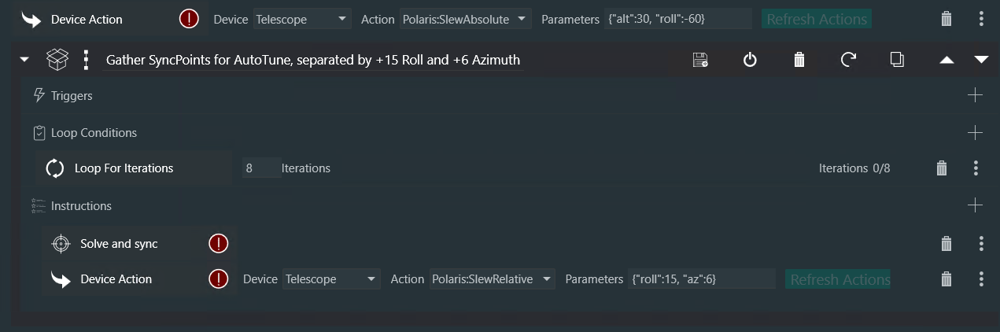
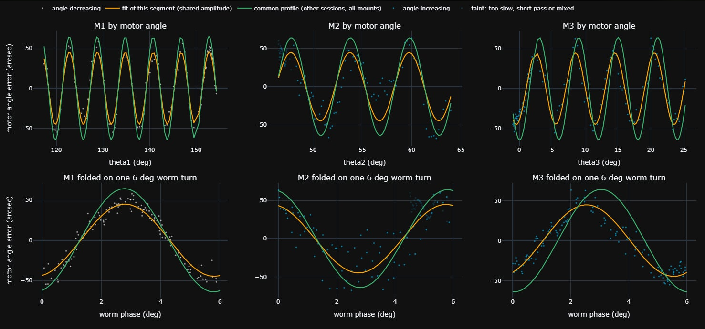
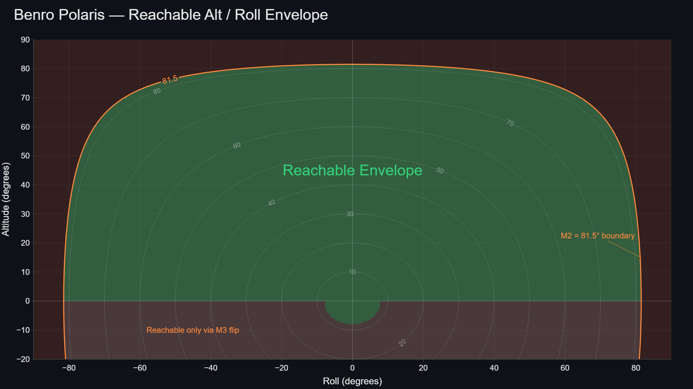

[Home](../README.md) | [Hardware](./hardware.md) | [Installation](./installation.md) | [Pilot](./pilot.md) | [Control](./control.md) | [Stellarium](./stellarium.md) | [Nina](./nina.md) | [CCDciel](./ccdciel.md) | [Guiding](./guiding.md) | [Troubleshooting](./troubleshooting.md) | [FAQ](./faq.md)


# Alpaca Benro Polaris Driver — Kinematics Reference
[Overview](#1-overview) | 
[QUEST](#21-quest-alignment-optimisation) |
[SCC](#22-slew--center-correction) |
[MAC](#23-mechanical-alignment-corrections) |
[Sync Guiding](#24-plate-solvedsync-guiding) |
[Pulse Guiding](#25-pulse-guiding) |
[PEC](#26-periodic-error-correction-pec) |
[Backlash](#27-backlash-compensation) |
[Envelope](#28-reachable-altitude-and-roll-envelope) |
[Base Frame](#31-base-frame-b---representations-and-conversions) | 
[Topo Frame](#32-topocentric-frame-t---representations-and-conversions) | 
[Equatorial Frame](#33-equatorial-frame-e---representations) | 
[Forward Flow](#41-forward-kinematics--motors--sky-angular-position) | 
[Inverse Flow](#42-inverse-kinematics--sky--motors-angular-position) | 
[Feed Forward](#43-inverse-kinematics--sky--motors-angular-velocity-feed-forward) | 


## 1. Overview

The Benro Polaris is a three-axis motorised camera mount designed for precision tracking and pointing. Accurate operation requires compensating for multiple sources of mechanical, optical, and dynamic error while transforming between four distinct reference frames: the camera sensor frame, the mount base frame, the local sky frame, and the celestial reference frame. This document defines these reference frames, along with the variables, rotation matrices, and quaternions associated with each, and describes the kinematic chains that relate them.

The document also outlines the principal mitigation techniques used to reduce tracking and pointing errors, including alignment correction, calibration, guiding, and dynamic compensation methods. These error sources and their corresponding mitigation strategies are summarised in the table below.


| Category        | Error Type              | Specific Cause                                 | Description and Effect                                                                                                                                 | Mitigation                                         |
| --------------- | ----------------------- | ---------------------------------------------- | ------------------------------------------------------------------------------------------------------------------------------------------------------ | -------------------------------------------------- |
| Measurement Errors  | Sensor Noise            | IMU / Encoder Noise and Drift                  | IMU or encoder noise introduces inaccurate motion estimation, causing small random pointing fluctuations.                                               | Kalman Filter (v2.0)                                     |
| Physical Errors | Polar Misalignment      | Tripod Bearing                                 | An inaccurate tripod bearing introduces a rotational offset around the vertical axis, causing systematic pointing errors across the sky.               | Multi-Point Alignment (QUEST v2.0)                      |
| Physical Errors | Polar Misalignment      | Tripod Tilt                                    | A tilted tripod means the mount's azimuth axis is not truly vertical, causing the effective polar alignment to vary across different pointing positions. | Multi-Point Alignment (QUEST v2.0)                      |
| Physical Errors | Polar Misalignment      | Cone Error                               | A misalignment between the camera boresight and other axes means the boresight traces a small circle around the true target position rather than pointing directly at it. The resulting pointing error varies systematically with Az/Alt. | Multi-Point Alignment (QUEST v2.0)           |
| Physical Errors | Roll Angle Misalignment | Mount Encoder / Camera Orientation Offset      | A fixed offset between the mount's reported roll angle and the true camera orientation on the sky. If uncalibrated, corrupts the PID roll setpoint and subtly degrades pointing and tracking across all coupled axes. | Position Angle Sync (v2.0)                  |
| Physical Errors | Motor Offsets and Scale | M2/M3 Zero Offsets, M2 Scale                   | Offsets in M2's and M3's angles (or the camera tilted on the head) and M2 turning slightly further than reported create pointing errors that vary with pointing direction. | Mechanical Alignment Correction (MAC v2.2)              |
| Dynamic Errors  | Motor Backlash                | Loose Gear Mesh / Gear Play                    | Mechanical slack causes delayed or reversed response during direction changes, particularly affecting pulse guiding corrections.                         | Speed Controller defaults to continuous Motor Engagement (v2.0)                |
| Dynamic Errors  | Slew and Center Cycling | Local Residual Pointing Error                 | After QUEST alignment, a small residual pointing error remains at the last sync point due to the global nature of the QUEST fit. This can cause Slew and Center to continuously cycle to reach the target orientation                       | Slew and Center Correction: Zero Last Residual (ZLR), Local Gaussian Adjustment (LGA), or Sync Guiding Adjustment (SGA) (v2.2)|
| Dynamic Errors  | Post-Slew Motor Oscillation           |   Motion Dynamics and PID Tuning                   | After a slew, the PID controller requires time to stabilise at the new position. Starting an exposure before settling completes may cause plate solves to fail or star trails on the first image. | Nina Settings: Settle Time and Pointing Tolerance; Pilot Settings: Kc Goto Tollerance (v2.0); Goto Progress (v2.2) |
| Dynamic Errors  | Tracking Motor Oscillation           |   PID Steady State                | A slight timing shift between measurement and control can cause a periodic jump in motor control to catchup.  | Synchronous Control (v2.2) |
| Dynamic Errors  | Kinematic Constraints   | Motor Axis Solution Choice | Some pointing orientations have multiple solutions and may effect slew duration, windup limits, and motion paths.                                                      | Motion Planner (v2.2)                     |
| Dynamic Errors  | Kinematic Constraints   | Gimbal Lock / Axis Range | Certain pointing orientations can introduce gimbal lock or near-singular kinematic configurations, resulting in the loss of a degree of freedom and reduced controllability.                                                       | Kinematics Refactor (v2.2) and Gimbal Lock Status Indication (v2.2)                     |
| Guiding Errors  | Tracking Drift          | Drift During Exposure                          | Tracking drift accumulates during longer exposures due to Periodic Error, RA/Dec drift, and residual alignment errors. Long exposures require correction while active.                | Pulse Guiding (v2.0) with Guide Camera and PHD2 or equivalent                 |
| Guiding Errors  | Tracking Drift          | Drift of Celestrial Pole                          | In v2.0 Guide Pulses changed target setpoints (SP), causing the PID to track a different RA/Dec location, effectively drifting the celestrial pole. In v2.2 all auto-guiding commands now change the target's present values (PV) instead.                  | Pulse Guiding (v2.2)                 |
| Guiding Errors  | Tracking Drift          | Drift Between Plate Solves         | Tracking drift accumulates even further over extended imaging sessions, potentially losing the target as it drift out of frame.                                              | Sync Guiding (v2.2) no guide-camera needed                                     |
| Guiding Errors  | Periodic Error          | Slow Changing Drift                            | The alignment and pointing model are never perfect, so the target drifts slowly in RA and Dec; the drift rate changes as the mount moves across the sky and the night progresses. | PEC Drift Correction (v2.2): an exponential moving average of the drift rate (about 7.5 min) learnt from Pulse or Sync Guiding corrections |
| Guiding Errors  | Periodic Error          | Worm Gear Imperfections                        | Each motor's worm gear (6 degree, 60 teeth) wobbles its axis by about 30-150 arc seconds, repeating every 6 degrees of that motor's rotation: a few minutes for a fast-moving motor, hours for a slow one. Its phase is fixed to the motor angles, so it repeats night to night. | PEC Worm Gear Correction (v2.2): a fixed per-motor profile measured by the M1-M2-M3-WORM-PROFILE calibration test, applied without guiding |
| Guiding Errors  | Load Slip               | Heavy Payload on M2                            | M2 carries the camera, lens and the M3 Astro Module off its axis, which is hard to balance. With a heavy lens (e.g. 300 mm f/2.8, 2.4 kg), while M2 slowly lifts the payload, M2 creeps ahead then slips back about 20 arc seconds every 10-40 seconds, giving regular guiding kicks in RA and Dec (seen as 8" RMS vs 2.4" without). | Zero M2 Roll (v2.2): the **ZM2** preset on the Dashboard's Roll dial selects a roll angle that minimises M2 movement over the next 120 minutes, helping to reduce tracking disturbances. |
| Optical Errors  | Focus Drift             | Temperature / Mechanical Changes               | Temperature or mechanical changes alter optical focus during imaging, degrading star shape and plate solve reliability.                                  | NINA Hocus Focus Plugin                            |
| Optical Errors  | Lens Tilt             | Sensor / Lens Plane Non-Parallelism              | A tilt between the camera sensor plane and the optical focal plane causes uneven focus across the image and elongated or bloated stars in the corners                                  | Aluminium Foil Tape                            |


---
## 2. Kinematics Corrections
The Alpaca Driver achieves superior tracking performance through a multi-layered suite of kinematic corrections that address both global and local mechanical errors. At its foundations is the QUEST model in Multi-Point Alignment. Layered on top of this are corrections for Mechanical imperfections, Periodic and Local residual errors.

### 2.1 QUEST Alignment Optimisation

#### **I. What it is and What it Solves**
**QUEST (QUaternion ESTimator)** is an advanced mathematical framework used in Multi-Point Alignment (MPA) to calculate the most accurate relationship between your Polaris mount and the night sky. In the context of the Alpaca Driver, it is a **closed-form, quaternion-based solution** designed to solve "Wahba’s problem": determining the optimal rotation that aligns a set of predicted sensor vectors with observed "ground-truth" vectors from plate solving.

Because the Benro Polaris is an **Alt/Az/Roll mount**, it lacks a physical axis naturally aligned with Earth’s rotation. This makes tracking complex, as all three motors must coordinate perfectly to follow a target. QUEST solves several critical hardware and environmental challenges that standard software cannot:
*   **Mechanical Imperfections:** It compensates for **cone error, polar misalignment, and general mechanical offsets**.
*   **Tripod Tilt:** A major advantage of QUEST is that **users no longer need to obsess over leveling their tripod**, as the model mathematically detects and corrects for tilt.
*   **Tracking Accuracy:** It minimizes the angular residuals (errors) between where the mount *thinks* it is pointing and where it *actually* is, leading to superior sidereal tracking for long-exposure deep-sky photography.

#### **II. Integration with Single Point Alignment (SPA)**
The Alpaca Driver supports two distinct modes: **Single-Point Alignment (SPA)** and **Multi-Point Alignment (QUEST/MPA)**. 
*   **SPA (The Foundation):** This mirrors the standard Polaris method by syncing to one known celestial position. While simple, it relies on **precise tripod leveling** and is highly susceptible to drift because it cannot account for complex geometric errors.
*   **QUEST (The Advanced Layer):** QUEST fits "on top" of the basic alignment by utilizing **three or more sync points** to build a detailed 3D correction model. Instead of a single global offset, QUEST finds the **optimal rotation (alignQ_B2T)** that transforms the mount's "Base Frame" into the true "Topocentric Frame" (the actual sky). 

By using QUEST, the driver can correct for the fact that a sync point taken in the East might require a slightly different correction than one taken in the West due to tripod tilt or mechanical flex.

#### **III. The Mathematics of the Model (Briefly)**
QUEST operates by minimizing a **quadratic loss function**, which is essentially the sum of the squared differences between pairs of reference vectors (stars) and measured vectors (mount sensors). 
1.  **Vector Pairing:** Each sync point provides a pair of vectors: the **predicted direction** from the mount's internal sensors and the **observed direction** from a plate solve.
2.  **Davenport Matrix:** The algorithm constructs a specialized matrix (known as a **Davenport Matrix**) from the weighted outer products of these vector pairs. With **Mechanical Alignment Correction** on, the rotation is instead fitted together with the M2/M3 offsets, unweighted (see [2.3](#23-mechanical-alignment-corrections)).
3.  **Eigenvector Solution:** The "optimal" alignment is found by identifying the **eigenvector with the largest eigenvalue** of that matrix. This provides a **unit quaternion** that represents the best-fit rotation for the entire system.

#### **IV. How to Use QUEST and Get the Best Results**
To achieve high-precision results, you must move from simply "syncing" to **strategic modeling**:

*   **Enable MPA:** Ensure Multi-Point Alignment is enabled in the Alpaca Pilot App settings or alignment page.
*   **Point Selection (The Rule of Three):** You must provide **at least three sync points** to allow the QUEST algorithm to begin building a model.
*   **Strategic Geometry:** 
    *   **Celestial Pole:** Always perform a plate solve and sync at the **Celestial Pole** (North or South). This ensures the model has an anchored reference for Earth’s rotation axis.
    *   **Target Trajectory (DSO Arc):** For the highest accuracy during imaging, place additional sync points **along the trajectory (arc)** that your target object will follow during the night. QUEST provides the best results when it is interpolating between points rather than extrapolating far away from them.
*   **Monitor Residuals:** Use the **Alignment page in Alpaca Pilot** to review "model residuals". This shows how well the QUEST model fits each sync point. Aim for residuals in the **arc-seconds**; if a point shows residuals of whole degrees, it should be deleted as it is likely a bad solve.
*   **Persistence:** From version 2.2 onwards, your QUEST model is **saved to disk**. You can restart the driver or your MiniPC mid-session without losing your refined alignment.


---
### 2.2 Slew & Center Correction

#### **I. What it is and What it Solves**
In astrophotography, the **Slew & Center** operation is a critical workflow where the mount slews to a target, performs a plate-solve to verify its position, and then makes a corrective slew to center the object, repeating the process until it is centered perfectly. The primary aim of **Slew & Center Correction** is to speed up this process by **reducing the number of correction slews** needed to zero in on a target. 

Without this correction, even a high-quality global alignment model (like QUEST) may have a small residual error at any given sky position. When a controlling application (such as NINA) performs a corrective slew based on a residual error, it may require several iterations to narrow in on the target. If the residual at the target is large and you have configured a very low pointing tollerance, the Slew & Center operation may struggle to complete.

#### **II. The Challenge: Global vs. Local Accuracy**
The QUEST algorithm finds a global optimum by fitting a single rigid-body rotation across all available sync points. While this provides excellent average accuracy across the entire sky, it cannot perfectly satisfy every individual sync point simultaneously. 

This leaves a **residual pointing error**, the difference between the model's predicted position and the actual observed plate-solved position. To achieve near-instant centering, the driver must account for this residual immediately after a sync occurs.

#### **III. Three Approaches to Correction**
The Alpaca Driver utilizes three distinct strategies to handle these residuals, ensuring the mount's "Present Value" matches the sky as accurately as possible:

1.  **Zero Last Residual (ZLR):**
    In this approach, the driver forces the QUEST model to ensure the **last sync point always has a zero residual**. When a new sync is performed, the model essentially "shifts" its understanding of the sky so that the current orientation is perfectly anchored to the observed coordinates. This provides an immediate, absolute correction for the current target but can affect the global fit of the rest of the model.

2.  **Local Gaussian Adjustment (LGA):** 
    LGA is a more advanced method that corrects the residual **locally around the most recent sync point** without disrupting the global integrity of the QUEST model. It applies the full correction at the exact sync location, then gracefully fades that correction both spatially and temporally. As the mount moves aways from the last sync point (σ = 10 degrees), the adjustment automatically decays back to the pure QUEST model. This ensurs the system smoothly returns to the underlying global solution.

3.  **Sync Guiding Adjustment (SGA):** (Recommended)
    SGA leaves the QUEST model unchanged and instead **offsets the pointing by the error left at the last sync**. After each alignment sync, the residual at that point becomes a correction applied to everything the mount does, so a corrective slew lands where the plate solve says it should.
    * **It does not need Sync Guiding.** The name comes from the correction it uses, which it shares with Sync Guiding; it works the same with Sync Guiding on or off, with pulse guiding (PHD2's corrections are applied on top, separately), or with no guiding at all.
    * **It builds on itself.** With Sync Guiding on, further syncs on the same target refine this same correction instead of adding alignment points, and PEC Drift Correction folds its corrections into it too.
    * **It lasts until it is replaced.** The next alignment sync sets a new offset; a goto or slew keeps it (so the next Slew & Center benefits); turning tracking off or changing the alignment or Slew & Center settings clears it.
    * **Unlike LGA, it does not fade with distance:** after slewing far from the last sync point the offset still applies until the next Slew & Center sync replaces it, which is normally the first plate solve at the new target.

#### **IV. The Mathematics of LGA**
LGA uses a **Gaussian weighting function** to determine how much of the local residual should be applied based on the angular distance from the last sync point. The correction fades to identity (zero additional correction) as the distance increases.

The formula for the weight is:

    weight = exp(−angular_distance² / (2 · sigma²))

*   **angular_distance:** The angular separation between the current pointing orientation and the orientation recorded at the last sync point.
*   **sigma:** This is the "spread" of the correction, with a **default value of 15°**.
*   **At the Sync Point:** The weight is 1.0, meaning the **full residual correction** is applied.
*   **At 15° Away:** The weight drops to approximately 0.61 (61% correction).
*   **At 30° Away:** The weight drops to approximately 0.14 (14% correction).
*   **Beyond 45°:** The weight is less than 0.05, meaning the LGA is effectively inactive and the mount relies solely on the QUEST model.

#### **V. Operational Benefits**
*   **Faster Centering:** By eliminating the local residual at the target, the first "corrective slew" issued by imaging software is more accurate.


---
### 2.3 Mechanical Alignment Corrections

#### **I. What it is and What it Solves**
**Mechanical Alignment Correction (MAC)** fits the mount's and camera's geometry alongside the QUEST alignment. QUEST
alone finds one rotation between the mount and the sky. That corrects tripod tilt, leveling and the North reference,
but not errors that change with the mount's pose. Two such errors dominate on the Benro Polaris:

* **M2 and M3 zero offsets.** M2's and M3's reported angles are each off by a constant, or, equivalently, the camera
  sits slightly tilted on the head. A focuser pulling the lens sideways looks exactly like an M3 offset. These change
  with the setup: the lens, how the camera sits in its clamp.
* **An M2 scale error.** M2 turns slightly further than its reported angle says, so the altitude error grows the
  further M2 moves from mid-range. It is a property of the mount, not the setup.

A rotation can't absorb either. They are why Multi-Point Alignment residuals were typically 30–60′, and up to 2°,
and why the pointing error then changed along a target's path, showing up as large drift for PEC Drift Correction
to absorb.

#### **II. Benefits of the Model**
Replayed on 47 archived alignments (1,300 sync points, four mounts), predicting each sync point from a model fitted
on the others, as at a goto to a new target (`utility/alignment_ab.py`):

| | MAC off (QUEST rotation) | MAC on |
|---|---|---|
| Median goto error | 59.2′ | **9.6′** |
| 200 mm, three nights (10-04, 10-06, 10-10) | 31–62′ | 5–7′ |
| Mark's mount, 11 nights | 29–198′ | 3–8′ |
| Better on | 2 alignments | 45 alignments |

* **Smaller alignment residuals:** a 6-point alignment typically fits to a few arcminutes instead of 30–60′.
* **Gotos and Slew & Center:** the model holds across the sky, not just near the sync points, so targets away from
  them land much closer and need fewer centering slews.
* **Less drift:** the pointing error no longer changes as the pose moves along a target's path, so PEC Drift
  Correction and the guider have less to correct.

The full study is in [study_alignment_mac_v2.md](study_alignment_mac_v2.md).

#### **III. The Model**
Each motor angle is corrected before the forward kinematics:

```
θ₂′ = θ₂ + M2 offset + M2 scale × (θ₂ − 45°)
θ₃′ = θ₃ + M3 offset
```

* **M2 and M3 offsets** are fitted at **every alignment sync**, together with QUEST's rotation: nothing to set up.
  Change the lens or reseat the camera, and the next alignment finds the new offsets. The Alignment page shows them.
* **M2 scale** (`align_m2_scale`, %) is a mount constant. About +0.3 to +2% on the mounts measured; the default is
  +1.0%. AutoTune refines it for your mount (below).

The fit needs points that separate the offsets from the rotation: at least 3, spread in azimuth and altitude (and
ideally roll). When they don't (too few, or bunched together), the offsets are kept at their last values and the
rotation is the usual weighted QUEST fit.

#### **IV. AutoTuning the M2 scale**
The M2 offsets and M3 offsets need no tuning. AutoTune calibrates the M2 scale once, or after a hardware change:

1. Do a Multi-Point Alignment with **6 or more sync points** spread **20° or more in altitude**. The standard 6-point
   alignment is enough; a sequence like the one below adds more.

   

2. On the **Alignment** page, in the **Mechanical Alignment Correction Model** card, click **AutoTune**, then
   **Run**. It fits the scale with the rotation and offsets, and reports the new scale and the alignment RMS before
   and after.
3. Click **Apply** to use and save the new scale. A result within 0.1% of the current scale has nothing to apply.

#### **V. Comparing MAC on and off (A/B)**
The **Mechanical Alignment Correction** switch refits the alignment from the same sync points either way, so one
alignment gives both:

* **On:** QUEST's rotation and the M2/M3 offsets fitted together, with the M2 scale.
* **Off:** the QUEST rotation alone, as before v2.2 Beta 9.

Compare the alignment RMS, the first goto's error to a new target, and the drift on a long track. To replay archived
logs, run `uv run python alignment_ab.py` in `utility/`.

#### **VI. Important Implementation Details**
*   **Unweighted fit:** with MAC on and enough spread, every sync point counts equally. QUEST's recency, proximity and
    polar weights made a rotation-only model fit well near the target at the expense of the rest of the sky; with the
    offsets modelled, one fit holds everywhere. Slew & Center Correction and sync guiding handle what is left
    locally.
*   **Forward kinematics:** the correction is applied to the motor angles after the worm gear correction, as a small
    base-frame rotation at the current pose (`kinematics_mac.correction_q`), before sync guiding, pulse guiding and
    QUEST. The PID works in the corrected motor angles, as before.
*   **Worm gear correction:** sync points keep their raw motor angles, so the model is refitted through the worm
    correction when that is switched, with no re-alignment.
*   **Cost:** the fit takes under a millisecond on a desktop and is designed for a Raspberry Pi Zero 2 W; the
    correction adds microseconds per control tick.
*   **Earlier MAC:** the v2.0–v2.2 model (M2/M3 axis tilt terms fitted from plate-solved image surveys) has been
    retired. `utility/fits_extract.py` keeps a copy (`utility/legacy_mac.py`) for its image analysis.


### 2.4 **Plate-Solved/Sync Guiding**

#### **I. What it is and What it Solves**
**Plate-Solved/Sync Guiding** is an innovative, hardware-free approach to auto-guiding that eliminates the need for a separate guide scope and camera. It solves the persistent problem of tracking drift and periodic error in the Benro Polaris by using the main imaging camera to periodically update its dynamic local alignment model. 

Traditionally, the Polaris suffers from **periodic error (PEC)**, mechanical oscillations caused by gear irregularities, which have been measured at approximately **14+ arc minutes** with a primary period of **35 minutes**. Without constant correction, this error leads to noticeable star trails and tracking drift during long exposures. Plate-Solved/Sync Guiding solves this by integrating periodic plate-solve data directly into the motion control loop, acting as a high-precision pulse guide without additional hardware.

#### **II. The Mechanism: From Sync to Pulse Guide**
The core of this feature lies in how the Alpaca Driver interprets synchronization commands. When a user performs a **plate-solve sync without slewing the telescope**, the driver no longer treats it a new position to add to the QUEST model.

Instead, the driver interprets the resulting residual error as a **guiding correction**. Each of these guiding corrections feed into PEC's drift model (an exponential moving average of the drift rate) to predict the local RA and Dec drift rates. The PID Controller then applies these drift rates every 200ms as a continuously refining quaternion correction. This integrated model addresses both local alignment issues and the long-term periodic error cycle simultaneously, ensuring the mount's "Present Value" is continuously refined to match the true sky, even between each plate-solve.

#### **III. Integration with QUEST and PID Control**
This guiding method allows the **QUEST (QUaternion ESTimator)** algorithm to function at its highest potential. 
*   **Dynamic Refinement:** By feeding the model fresh "ground-truth" data every few minutes, any local errors can be corrected for dynamically. 
*   **Drift Reduction:** The residual data is fed into the **PID Controller**, which automatically adjusts motor speeds to "kill" the drift. 
*   **Reduced Star Trails:** By proactively correcting for the worm gear error and inherent drift, exposures remain sharp even during lengthy imaging sessions.

#### **IV. Recommended Workflow: The Plate-Solve/Sync Guiding**
To get the best results and maintain perfect centering without manual intervention, a simple automated workflow is recommended:
1.  **Reset Multi-Point-Alignment** - To reset MPA, clear all old Sync points, or toggle MPA off then back on (this will clear all sync points). Enable Tracking.
2.  **Perform Multi-Point-Alignment** - Slew and capture at least three sync-points. Ideally, at your celestial pole and along the future path of your DSO Target.
3.  **Slew and Center on your target** - Use Nina to Slew and Center on your target.
4.  **Initialise Sync Guiding Model** - On the Nina Image tab, use the Plate Solving Tool to manually perform several plate-solves, 30s apart. This is optional, but it can help initialise the PEC model faster.
5.  **Configure your capture session** - Use Nina's Advanced Scheduler to perform "Smart Exposures", then a "Solve and Sync" every **1 to 3 minutes**.

> **Note:** Don't use Sync Guiding at the same time as Pulse Guiding. The guider holds its guide star at the lock position it set when guiding started, so it pulls each sync correction straight back, and the target drifts off center anyway (e.g. from flexure between guide scope and main scope). To keep the target centered during a long Pulse Guided session, use Nina's **Center After Drift** trigger instead. When the plate solve drifts past the threshold (about 0.3–0.5 arcmin), Nina stops guiding, re-centers the target, and restarts guiding with a new lock position. Each re-center is a slew, which resets the driver's PEC model, so avoid setting the threshold too tight.

#### **V. Primary Benefits**
*   **No Additional Hardware:** Eliminates the cost and weight of a dedicated guide scope and camera.
*   **Superior Accuracy:** Plate-solves provide significantly more information and higher resolution than traditional guide star pulses.
*   **Streamlined Operations:** No more repetitive "Slew and Center" iterations are needed; the guiding happens "in-place" as part of the normal imaging sequence.


### 2.5 **Pulse Guiding**

#### **I. What it is and What it Solves**
**Pulse Guiding** is a high-speed feedback mechanism that allows external guiding software to make micro-adjustments to the mount's tracking in real-time. While **QUEST Alignment** and **Mechanical Corrections** provide a robust global model, they cannot account for dynamic, unpredictable factors such as atmospheric refraction, subtle mechanical "sticktion," or high-frequency periodic error.

Pulse guiding solves these issues by acting as a **fine correction tool**. It continuously monitors the position of a guide star and sends small "pulses" to the driver to nudge the mount back into perfect alignment, ensuring that the imaging target remains stationary on the sensor at a sub-pixel level.

#### **II. The Mechanism: From Pulse to Motion**
The Alpaca Driver exposes pulse-guiding commands through the **ASCOM Alpaca ITelescopeV3 Interface**. When a guiding application (like PHD2) detects a deviation, it calculates the required correction and sends a pulse of a specific duration and direction to the driver.

The driver interprets this input as a **corrected position change**. In the PID control loop, this appears as a "jump" in RA and/or Dec co-ordinates in proportion to the duration of the pulse and the pulse guide rate. This allows the driver to translate equatorial corrections into coordinated, multi-axis motor movements (M1, M2, and M3) without interrupting the underlying sidereal tracking.

#### **III. The Mathematical Model (Briefly)**
Starting with version 2.2, the driver utilizes a refined mathematical approach to ensure these pulses are executed with extreme fidelity:
*   **PID Feed-Forward Control:** The driver incorporates feed-forward logic specifically for pulses, allowing the motors to reach the required correction velocity almost instantaneously.
*   **Integral Suspension:** To prevent "overshoot"—where the mount continues moving after a pulse ends—the driver **temporarily suspends the integration of the error term** (KI) during an active pulse. This ensures the correction is crisp and does not introduce new oscillations.

#### **IV. How to Use and Get the Best Results**
For a comprehensive guide on hardware selection and software configuration, please refer to the **Guiding Users Guide** (`guiding.md`). To optimize the kinematic response of pulse guiding:
*   **Set the Guide Rate:** A guide rate of **0.75x to 1.0x sidereal** is recommended. If the mount appears to "hunt" or oscillate, lowering this rate in the Alpaca Pilot settings can smooth the response.
*   **Multi-Star Guiding:** Always enable "Use Multiple Stars" in your guiding software. This averages out atmospheric turbulence (seeing), providing the PID controller with a cleaner signal that represents true mechanical drift rather than "chasing the wind".
*   **Monitor the PID Loop:** You can visualize pulse commands in real-time on the **PID Tuning page** in Alpaca Pilot, where they appear as dynamic shifts in the RA and Dec setpoints.
*   **Don't Combine with Sync Guiding:** The guider pulls each sync correction straight back to its lock position. To keep the target centered during a long session, use Nina's **Center After Drift** trigger instead (see the note in section 2.4, Recommended Workflow).

#### **V. Primary Benefits**
*   **Sub-Exposure Correction:** The main benefit of pulse guiding is the ability to correct tracking errors **within a single exposure**. This prevents small drifts from turning stars into "footballs" or trails before the frame is completed.
*   **Longer Exposures:** By eliminating cumulative drift, pulse guiding enables the Benro Polaris to maintain pinpoint stars over much longer imaging sessions than would be possible unguided.
*   **Reduced RMS Error:** With a well-tuned PID loop and proper calibration, pulse guiding can reduce the mount's tracking error to an **RMS of 1.5 to 3.0 arc-seconds**, meeting the requirements for high-resolution deep-sky imaging.

------

### **2.6 Periodic Error Correction (PEC)**

#### **I. What is Periodic Error?**

**Periodic Error** includes tracking errors that the mount cannot detect directly. On the Benro Polaris, there are two main sources of periodic error:

* **Slow changing drift:** The alignment and pointing model are never perfect. As a result, the target gradually drifts in RA and Dec. The drift rate changes slowly as the mount moves across the sky and as the night progresses.

* **Worm gear error:** Each motor drives its axis through a worm gear. Small irregularities in the gear cause the pointing to wobble by about **30-150 arc seconds**. The wobble repeats every **6 degrees** of each motor's axis rotation. Its period in time depends on motor speed: a few minutes for a fast-moving motor, or hours for a slow one.

Without correction, both errors produce irregular star shapes and trails, limiting exposure length. 

#### **II. How does the Driver correct for Periodic Error?**
The driver addresses periodic error in two layers. Both are applied every **200ms**:

* **Drift correction** learns and corrects the slow changing drift based on guiding corrections from either **Pulse Guiding** or **Sync Guiding**.
* **Worm gear correction** uses a fixed periodic correction profile for each motor of the mount (see section V).

Each layer has its own switch in Pilot's settings, **PEC Drift Correction** and **PEC Worm Gear Correction** (`advanced_pec_drift`, `advanced_pec_worm`), so either can be compared on and off. The PEC button on Pilot's status panel switches both together.

These two corrections allow PEC to anticipate the periodic errors and correct them before they become visible in the image.

#### **III. Comparison with External Models**

Software such as PHD2 provides its own "Predictive PEC". The Alpaca Driver's implementation is instead integrated directly into the Benro Polaris motion-control system, with knowledge of its kinematics and three axis worm gear design.

External models often operate only on the RA axis and may use slower correction cycles. The Alpaca PEC is **fully integrated into the PID control loop**, allowing it to correct all axes simultaneously.

#### **IV. Drift Correction - Convergence**

PEC does not immediately apply drift correction. As guiding corrections arrive, PEC estimates the current drift rate independently for RA and Dec. The estimate is smoothed over about 7.5 minutes using an exponential moving average (`pec_tau_sec`). 

Incoming data used in the estimate is filtered, and the model must first demonstrate that it has converged.

* **Filtering Logic:** Corrections not relevant for PEC are filtered out
  * large corrections **greater than 10 arc minutes** are ignored. This prevents bad guiding measurements from "poisoning" the model.
  * Pulse Guiding calibration corrections are also ignored. The driver detects when **PHD2** or **CCDciel** are performing calibration steps and purposefully ignores them.

* **Convergence Requirements:** PEC begins applying drift corrections to sidereal tracking only when all three conditions are met:

  1. **Observations:** At least **3 corrections** have been received.
  2. **Accuracy:** The root mean square error (RMSE) is below **6 arc minutes**.
  3. **Reliability:** The R-squared (R²) value is greater than **0.500**.

> Note: Drift Correction applies only when PEC Drift Correction is switched on.

#### **V. Worm Gear Correction - Profile Calibration**

The driver applies worm gear corrections once it has a profile of each motor's gearset. This correction is applied first and immediately, **without requiring any guiding**. Because the error is caused by the gears and its phase is relative to the motors' home position (0,0,0), it should repeat from night to night. Any remaining slowly changing drift is then learnt and corrected by PEC Drift Correction.

> Note: Worm Gear Correction applies when PEC Worm Gear Correction is switched on and a `worm_profile.json` exists (switched on without a profile, the driver logs a warning and corrects nothing). It is independent of the Drift Correction switch.

**1. Worm Profile Calibration Test**

The Worm Gear Profile is calibrated using a special speed calibration test called **M1-M2-M3-WORM-PROFILE**.

This test will move the mount to different positions up to +/- 7.5 degrees from its current orientation. At each new position it will wait for a solve and sync to confirm the true pointing orientation. Each time it receives a solve and sync, it will move onto the next position.

**Choosing the lens and camera for the test**

Each plate solve measures where the mount really points. The worm errors are 30-150 arc seconds, so each solve should be accurate to about 2 arc seconds or better. A plate solve locates the field to roughly a fifth of a pixel, so what matters is the **image scale** (arc seconds per pixel):

* **Image scale** = 206 × pixel size (µm) / focal length (mm).
* **10"/px or finer** is enough; **2-5"/px is ideal**. For most cameras this means a **100-300 mm** lens or scope.
* **Finer than about 2"/px gains nothing.** Seeing, mount settling and the fit itself then limit the result, while a smaller field needs longer exposures for enough stars, solves more slowly, is more sensitive to wind, and adds weight to the mount.
* Keep the field of view above about 1° so solves stay fast and reliable, and use short exposures (2-5 s) with plenty of stars.

| Camera (pixel size)        | 50 mm  | 100 mm | 200 mm | 300 mm |
| -------------------------- | ------ | ------ | ------ | ------ |
| IMX585 (2.9 µm)            | 12"/px | 6"/px  | 3"/px  | 2"/px  |
| IMX533 / IMX571 (3.76 µm)  | 15.5"/px | 8"/px  | 4"/px  | 2.6"/px |
| Typical DSLR (4.3 µm)      | 18"/px | 9"/px  | 4.4"/px | 3"/px |

For example, an IMX585 with a 200 mm lens gives 3"/px over a 3.2° × 1.8° field, which is well suited. A 50 mm lens will still complete the test, but with a less accurate profile.

**To perform the worm profile calibration:**

1. Point the mount at a patch of sky **30-45° above the horizon** in the **eastern or western sky: Azimuth roughly 45-135° (east) or 225-315° (west)**, as shown in Pilot. Avoid due north or south and the area around the celestial pole. Choose a field with plenty of stars and about ±9° of clear sky around it (no trees or buildings), as the test moves the mount up to 7.5° each way.

2. In NINA (or similar), create a looping sequence of around 60 iterations. Within the loop
   * Run a repeating **Solve and Sync** using short exposures. 
   * Add a **Wait for Time Span** of around 10 seconds between syncs to allow the mount to settle. If the test log shows many syncs discarded as "motors not settled", increase it slightly.

3. Start the sequence of solve and syncs, and keep the sequence running until the test finishes.

4. On the Alpaca Pilot, change to the **Speed Calibration** page, and select the **M1-M2-M3-WORM-PROFILE** test case, then press **Test** and confirm the execution. This one test measures all three motors, and takes about 15 minutes to complete.

5. The driver will enable tracking and rotate to Roll ±45° (on the side of 0 the camera is already on, keeping the same Az/Alt, and back again when the test finishes): at ±45° M1 and M3 move the view in clearly different directions, so their worms separate well. It also keeps each motor's steps within what it can reach at this pose. It will then take measurements at 51 different positions (50 steps). Steps that go against a motor's tracking direction overshoot and come back, so the mount may move twice per step. The status shows progress, for example `PENDING 12/51`.

**While the test is running:**

* Your syncs are used only as measurements. They do not change the pointing model.
* Any existing PEC and worm gear correction are paused.
* **Don't guide, slew, park, or jog the mount.** Any of these actions stops the test.
* If no Solve and Sync arrives for 1 minute, the test stops with **NO DATA**.
* You can press **Stop** at any time.

**When the test finishes:** stop the Solve and Sync loop; syncs after the test are ordinary alignment points.

**2. Review the result.**

Each test is retained. The displayed profile under Test Results is **pooled over recent tests**, up to a maximum of five tests.

The result row shows one line per motor in each column, under a first line that says what the column is:

* **Baseline:** `current profile`: the approved profile, which corrects each motor while **PEC Worm Gear Correction** is switched on (`none` before any is approved).

* **Test Result:** `last 5 tests pooled`: the profile that **Approve** would apply. It is fitted over the recent tests together, not just the latest one (`last test` when there is only one). For each motor it shows the wobble's size and the angle where it peaks.

  For example: `M1 21"@177`, `M2 86"@179`, `M3 85"@224`. The angle after @ indicates where, within the motor’s 6° worm turn, its error is largest (0–360°, relative to the worm’s angle). Motors with wobble too small to measure are marked `off` and left uncorrected.

* **Change:** `from baseline`: how far each motor's correction would move from the Baseline if you approve the Test Result (`+0"` once it is the current profile).

  A ⚠ line below the motors flags a problem with the last test: a poor fit, or insufficient separation between M1 and M3 at that pose (`low separation`). Repeat the test at another pose.

* **Test Stdev:** How closely the Test Result fitted the measurements, and how certain each motor's result is.

  For example, for the Test Result above: `pooled 19.4" rms`, then `M1 ±3.9" 5.4σ`, `M2 ±3.7" 23.2σ`, `M3 ±3.1" 27.4σ`. Every line is for the pooled Test Result.

  * `pooled 19.4" rms` is how far, on average, the plate solves sat from the fitted wobble. Seeing, wind and small pointing errors all add to it. The pooled fit is allowed up to 25".
  * Each test must fit under 20" on its own to join the pool. If the last test didn't, a final line warns `⚠ last test left out: 24.1" rms`: it is kept in the history but not in the Pooled Test Result.
  * Until there is more than one test to pool, the first line is the single test's own `last test 11.9" rms`. `, 31 positions` is added when that test stopped before all 50 positions: it is the number measured. A test needs at least 16 to be used.
  * `±3.1"` is how much that motor's measured wobble could be out by. Read M3's `85"` with `±3.1"` as "about 82 to 88 arc seconds".

    Why is the motor’s wobble uncertainty (`±3.1"`) so much smaller than the plate-solve RMS (`19.4"`)? The RMS measures how far an individual plate solve typically deviates from the fitted wobble, while the `±` value represents the uncertainty in the estimated wobble amplitude after averaging across all measurements. Random noise largely cancels out when measurements are combined, so with up to 250 positions (50 steps across 5 pooled tests), the uncertainty in the worm-profile amplitude can be much smaller than the RMS error of a single plate solve.

  * `σ` (sigma) measures how clearly the wobble stands out from measurement noise: the wobble amplitude divided by its `±` uncertainty. M3’s `27.4σ` (85 ÷ 3.1) means its wobble is 27 times larger than the uncertainty, providing very strong evidence that it is real. A motor is corrected only if its wobble reaches `4σ` or higher. Below this threshold, the wobble cannot be reliably distinguished from noise, so Test Result shows it as `off`.

    Bigger is better for `σ`. A motor just above the 4σ threshold, such as M1 at `5.4σ`, has a measurable wobble, but the result is less robust. Another test, or a test at a different pose, can increase confidence in the measurement.

* **Status:**

  * `COMPLETED` — the measurements fitted cleanly and at least one motor's wobble was measured clearly (pooled over the recent tests).
  * `POOR FIT` — no wobble could be distinguished reliably from noise, or the measurements scattered too much (e.g. wind, backlash).
  * `NO DATA` or `STOPPED` — too few plate solves were received.

Running the test again at a different pose reduces the effect of measurement noise.

All tests, including their individual measurements, are retained in `worm_profile.json` in the driver's data folder. When the driver starts, the row is filled in from that file, so the results stay visible after a restart (or after a test that ended with `NO DATA`). The status shows `APPROVED` when the pooled profile is the current profile, and `COMPLETED` when there is a newer pooled result to approve.

**3. Approve it.**

Press **Approve** on the row to apply the pooled profile to the motors that were measured.

Pressing it again rejects the profile and restores the previous correction.

**4. It applies immediately.**

Approve and Reject only choose the profile: whether it is applied is the **PEC Worm Gear Correction** switch in Pilot's settings, which they leave as it is.

The worm gear correction is also part of the alignment model: with it on, every Multi-Point Alignment sync point is predicted through it (as the pointing is at runtime), and the QUEST model is refitted whenever it is switched on or off. The alignment model and its M2 scale AutoTune do the same. Sync points keep their raw motor angles, so this needs no re-alignment.

For this reason, approve the profile **before** aligning and slewing for the night, and do a fresh Multi-Point Alignment after the test: the test moves the mount well away from its alignment points, and a clean, well-spread set of alignment points matters more than the profile itself. Approving, rejecting or switching it while guiding shifts the pointing once, by up to the measured wobble size, and restarts the drift correction.

To run without the worm gear correction, switch **PEC Worm Gear Correction** off in Pilot's settings.

**5. Check it.**

* On the **Kinematics** page, the **PEC Worm** row shows each motor's current correction; it changes as the motors turn (M1 fastest while tracking).
* Compare guiding performance on the same target with the correction enabled and disabled, 10-15 minutes each (switching it restarts the drift correction).

Use either:

* PHD2 RMS; or
* the size of the sync guide corrections.

With worm gear correction enabled, the slow, regular wave in the guide corrections should disappear. In PHD2 Log Viewer's frequency analysis, the peak at the worm period (typically around 34 minutes, about 2000 s, though it varies with the target's position as the motors' speeds change) should be gone or much smaller.

#### **VI. Important Considerations**

PEC is designed exclusively for **sidereal tracking** of Deep Sky Objects (DSOs) and stars.

It is **not** suitable for:

* Lunar tracking
* Solar tracking
* Custom orbital targets

PEC is intended for fine mechanical correction. It cannot compensate for gross mechanical problems such as:

* cable drag;
* tripod instability; or
* wind effects.

#### **VII. PEC Logging (for analysis and development)**

With `log_pec` enabled, the driver writes a `PECCONFIG` line once per session and a `PECLOG` line at every guide update.

The `PECCONFIG` line contains:

`tau_sec`, `min_dt_sec`

With PEC Worm Gear Correction on, the driver writes two lines each time it reads the worm profile (at the first motor telemetry after start, and after Approve or Reject):

* `WORMPROFILE SUMMARY:` is the profile in a readable form, in the same format as the worm profile test's `WORM PROFILE TEST: END` line. Each motor shows its amplitude ± uncertainty @ peak angle and significance (σ), with `off` for a motor left uncorrected.
* `WORMPROFILE {...}` is the profile itself as a Python dict (read it with `ast.literal_eval`):
  * `motors` gives each motor's coefficients in arcsec (sin and cos for each harmonic);
  * `worm_theta` and `harmonics` give the worm period and which harmonics are fitted;
  * `angle_reference` gives which angle each motor's coefficients use (`zeta`: the 517 MCU angles);
  * `applied` gives when the calibration was approved.

  The profile file changes when a later calibration is approved, so this line keeps a record of the coefficients the session actually ran with. Match it with `WORMPROFILE {`, since the summary line also starts with `WORMPROFILE`.

Each `PECLOG` entry is a Python dict. Read it with `ast.literal_eval`. Paired RA/Dec values are represented as `[ra, dec]`.

* `inhibit` is the status of each axis:

  `TOO_FEW_OBS` → `LOW_R2`/`HIGH_RMSE` → `VALID`

  `r2` and `rmse` (arcmin) describe the fit quality that determines the status.

  `pec_active` is `true` when *either* axis is `VALID`. Whether an individual axis is corrected is determined by that axis's own `inhibit` state.

* `fit_rate` is PEC's estimated drift rate at the time of the update.

  `applied_rate` is the rate most recently applied to the motors (arcmin/hr).

  When an axis first becomes `VALID`, `applied_rate` is zero for that entry. The rate is applied from the next tick.

* `resid` is the guide correction for this update (arcmin). This value should decrease as PEC improves.

  `pec_accum` is the correction applied by PEC since the previous entry.

  `total_accum` is `resid` + `pec_accum`, accumulated since PEC was last reset by a goto, rotate, jog, tracking off, or settings change.

  `total_accum` represents the drift that PEC would have left without correction, so it does not decrease as PEC improves.

* `wff` is the worm gear correction currently being applied, split between RA and Dec (arcmin, using the same convention).

  The guide corrections no longer contain the component corrected by `wff`. Therefore, the mount's remaining drift is:

  `total_accum + wff`

* `theta_raw` is the motor angles `[M1, M2, M3]` from 518. M1 includes the session's compass / Single Point Alignment heading.

  `zeta` is the MCU's motor angles from the most recent 517.

  `zeta_offset` = `theta_raw - zeta` at that 517.

  `zeta_age` is the age of that reference (s).

  Therefore, `theta_raw - zeta_offset` gives each motor's angle using the same reference throughout the session. This is the reference used by per-motor worm analysis.

* `az`/`alt`/`roll` are the current pose (degrees).

  `age_518` is the number of seconds since the last 518 message. A large value indicates that the entry occurred during a telemetry gap.

To start a test from a clean PEC state, toggle Tracking off and on. This resets PEC and the sync guide correction.

Do **not** restart the driver for this purpose. Restarting the driver restores the saved sync guide correction from `data/sync_points.json`.

> For exactly how a sync guide residual reaches `q_syncguide_B`, how a PID tick evaluates the PEC rate, and how the next `518` message folds that correction into `theta_pv`, see [§4. Kinemtaics Flows](#4-kinemtaics-flows), sections 4.4–4.6.




### 2.7 Backlash Compensation

#### I. What Is Gear Backlash?

Backlash is the mechanical slack between gear teeth. When a motor reverses direction, it must cross this slack before the mount's output shaft, and therefore the camera, moves. 

The Polaris firmware measures motor angle before the gearbox, so it cannot directly detect this lost motion. Measured backlash is approximately:

| Motor | Backlash |
|---|---:|
| M1 | 125–160 arcsec |
| M2 | 280–620 arcsec |
| M3 | 310 arcsec |


Backlash can cause:
- **Slew & Center errors:** A goto may finish with the gears unloaded in the tracking direction, causing the camera to shift as tracking takes up the slack.
- **Drift during tracking reversals:** When a motor reverses direction, the camera may temporarily stop moving, causing tracking to drift as the slack is taken up.
- **Low-speed guiding oscillations:** Guide pulses can repeatedly reverse a barely moving motor. This is a guiding issue, addressed through guider settings rather than backlash compensation (see [Guiding §6.4](./guiding.md)).


#### II. How does Backlash Compensation Work?
When enabled, the driver estimates the camera's position beyond the gearbox and accounts for mechanical slack in its position control.

Compensation operates in two situations:

1. **After a goto or rotate:** The driver takes up the backlash until each compensated motor is engaged in its tracking direction. The move completes only when this is done, helping the camera remain at the position confirmed by any subsequent plate solve. The same process occurs when tracking resumes after a driver restart.
2. **Through a planned tracking reversal:** From 10 seconds before the turning point, the driver keeps the motor's previous tracking side as its reference (the side the alignment was learnt on) and drives the motor through the backlash into its new direction, so the camera keeps following the target instead of stalling while the slack is taken up. The offset is carried until the next goto.

Slack take-up and overshoot: 

The driver applies a slack take-up push of 0.05°/s, slowing near the end to reduce overshoot. Pushes only ever go the way the motor will keep moving: towards its tracking side, or through a planned reversal its new direction. A motor that is engaged and has overshot ahead of its target by up to 120 arcsec never reverses back across its backlash: it holds still while the sky catches up, and counts as arrived once within 15 arcsec. If a motor requires more than two full backlash crossings during a goto, compensation for that motor is disabled until the next goto, and a warning is logged.

Reported position: 

While compensation is active, the driver includes the backlash adjustment in its position model. Pilot's position displays, reported coordinates, and the PID controller therefore use the estimated camera position rather than the raw motor angle. This keeps the displayed position consistent with the position being controlled.

A sync taken while compensation is acting keeps its adjustment alongside its raw motor angles, and the alignment factors it in only while Backlash Compensation is on, like the worm gear correction; switching it then refits the alignment. When compensation is inactive, its position correction is zero.

#### III. When is Backlash Compensation Active?

When enabled, Backlash Compensation operates only:

- **After a Goto, Rotate, SlewAbsolute or SlewRelative:** Until each motor is engaged in its final tracking direction.
- **During a planned motor tracking reversal:**  To carry the motor through its backlash as it changes direction, so the camera doesn't stall; the offset is carried until the next goto.

It is inactive during ordinary tracking and guiding, jogging, and whenever tracking is off, or the mount is parked.

Compensation is also inhibited on a motor under the following conditions:

- **Low tracking speed:** A motor moving below 0.5 arcsec/s has no settled tracking side to engage, except during a planned reversal.
- **A goto near a turning point:** During a goto, compensation is skipped for any motor expected to reach its turning point within 5 minutes.
- **Near gimbal lock or the M2 limit:** Compensation is disabled for all three motors when M2 is within 12° of gimbal lock or within 1° of its 81.5° limit.
- **Unsettled gear engagement:** Compensation is skipped for a planned reversal if the motor is not engaged on its previous tracking side.


#### IV. Configuration

| Setting | Default | Description |
|---|---|---|
| `advanced_backlash` | `false` | Enables Backlash Compensation in Pilot settings (BETA). |
| `backlash_deg` | `[0.04, 0.12, 0.08]` | Estimated backlash in degrees for M1, M2 and M3, respectively (144, 432 and 288 arcsec). |

**Setting backlash values:** The defaults are based on measured backlash. Overestimating slack generally increases take-up time, while underestimating it can leave some slack uncompensated. M2 may require particular attention because its backlash varies with load and position.

The take-up push uses `coordinated_speed_control`. Without it, compensation remains active, but slack take-up may be slower.

Changing either setting while running resets the backlash model using the current motor angles.

#### V. Limitations

- **Sampling:** The backlash model updates from motor-angle measurements every 0.2 seconds, with M3 updated approximately every 0.6 seconds. Reversals between samples can cause unmodelled motion. In testing, goto errors reached approximately 1.5 arcmin (one or two Slew & Center corrections in eight, always M3), still generally better than without compensation.
- **Variable backlash:** M2 backlash changes with load and position. Gravity may also hold the gears against one side, reducing or eliminating the slack during a reversal. Digital-twin tests remained beneficial with backlash estimates 30% too low or too high and with M2 held by gravity.
- **Offset after reversal:** A compensated motor retains its tracking-side offset until the next goto. The goto re-engages the motor for its current tracking direction; the subsequent plate solve and sync account for any remaining positional offset.

#### VI. Log Messages

At a planned reversal:

`->> Polaris: BACKLASH M2 reversing its tracking direction in 9 s: compensating its 432" slack until the next goto`

When a full slack take-up starts:

`->> Polaris: BACKLASH taking up slack: M1 -142", M3 +288"`

If a motor keeps crossing its slack (compensation for it stops until the next goto):

`->> Polaris: BACKLASH compensation stopped until the next goto for M2: crossed its slack more than 2 times`

Reversal warnings are issued approximately 5 minutes in advance, whether compensation is enabled or not (see [§4.4](#44-sync-guide-ingestion--residual--q_syncguide_b-and-pec-learning)).


### **2.8 Reachable Altitude and Roll Envelope**
#### I. What it is and What it Solves

The Benro Polaris's second motor axis (`M2` or `theta2`) has a mechanical range of only **-8° to +81.5°**, which directly constrains how far the mount can point in Altitude and Roll — the two are coupled by `cos(theta2) = cos(alt) · cos(roll)`, so the more roll a shot needs, the less altitude range is available, and vice versa. Because this trade-off is a genuine hardware limit rather than a software one, any target orientation outside it must either be resolved to the nearest reachable point, or reached by an alternate mechanical path. The chart below shows this envelope: the green area is directly reachable.



Near the bottom edges of the envelope, the driver often has a choice between two valid solutions for a given (Altitude and Roll) target: an "unflipped" path, and a "flipped" path where `theta3` (the Astro axis) is rotated by approximately 180° to swing the boresight around from the opposite side. The flipped path trades a large Astro axis movement for access to orientations, particularly steep negative altitudes, that the unflipped path cannot reach at all.

#### II. Related Features

* **[Reachable Targets]**: If you slew or Goto to a target that's just outside what the Polaris can physically reach, the driver automatically adjusts it to the closest position the mount *can* reach, instead of failing the Goto outright.
* **[Zenith Zone]**: M2 can't raise the camera above 81.5°, so a target that culminates higher passes through a zone the mount can't reach. While it's there the mount tracks at its limit directly below the target: same Azimuth, Altitude 81.5°, pointing off by only the target's altitude above 81.5° (at most 8.5°). M1 follows the target's own Azimuth, the short way round through the meridian on the side the target transits (south of the zenith when its Dec is south of your latitude, north otherwise), and picks up full tracking again as the target drops back below 81.5°. Only a pose that has genuinely gone over the top (Altitude above 90°) is flipped to the opposite Azimuth.
* **[Graceful Degradation]**: When a shot needs more roll than the mount can deliver at that altitude, the driver keeps your framing/pointing direction correct first, and reduces the roll as needed rather than missing the point entirely. It uses whichever of the requested roll and its upside-down equivalent (roll ± 180°, the same rectangle on the sky) is nearer level, so the frame stays as close as possible to the footprint you asked for. The roll range shrinks to 0° at Altitude 81.5°, so while tracking close to zenith the roll can't keep up with sidereal field rotation; holding the pointing takes priority. One known limitation: if the frame you asked for is at right angles to level (roll ±90°) while the range is reduced, both limits are equally near and the camera may turn 180° as the requested roll crosses ±90°.
* **[Negative Azimuth]**: You can now point down to -81° altitude, below the previous -8° limit. The driver does this by swinging the M3 Astro axis around to the other side, so very low, steep-down shots (e.g. foreground-heavy landscapes) are now possible where they weren't before.
* **[Panoramas]**: Pano grids can now continue past zenith instead of stopping there. If a grid step calls for an altitude of, say, 100°, the driver recognizes that's "80° on the other side of the sky" and continues the pattern on the opposite Azimuth; so your grid keeps progressing smoothly through and past straight-up instead of clipping. The same applies to Galactic Latitude past ±90° (Galactic Longitude + 180°) and Declination past a celestial pole (RA + 12h); past the top the camera is upside down, which covers the same rectangle of sky. A panel whose centre falls in the zenith zone (81.5° to 90°, or 90° to 98.5° on the far side) is shot from the limit directly below its centre, so plan extra overlap for it.
* **[Scale Warnings]**: The Roll, RA, and Dec displays on the Dashboard now show a warning markers in real time as you approach the mount's mechanical limits. You can see a limit coming before a Goto or tracking move actually hits it.


#### III. Poor Tracking at Low Altitudes and Low Roll Angles

**The problem:** When the telescope is pointing **low in the sky** and the camera has **little or no roll angle**, tracking the stars with the Benro Polaris becomes harder.

This happens because two of the mount's motors have to work together to move the telescope. When the telescope is in certain poses, those two motors are pointing in almost the same direction. To make the movement needed to track the stars, the motors have to move even move quickly in **opposite directions**.

This makes the Benro Polaris system less effective and can cause the telescope to have difficulty keeping the stars in exactly the right position.

In simple terms:

> **Low altitude + low camera roll = harder tracking.**

The closer the telescope gets to these conditions, the more the motors have to work to produce the required movement.

**How serious is the problem?**

The following table shows how much the motor movement is amplified at low altitude and roll. Higher numbers mean the mount has to work harder.

| Camera Roll | 10° Altitude |   20° |   30° |   40° |   50° |   60° |   70° |   80° |
| ----------- | -----------: | ----: | ----: | ----: | ----: | ----: | ----: | ----: |
| 0°          |        5.76× | 2.92× | 2.00× | 1.56× | 1.31× | 1.15× | 1.06× | 1.02× |
| 10°         |        4.10× | 2.64× | 1.92× | 1.52× | 1.29× | 1.15× | 1.06× | 1.01× |
| 20°         |        2.64× | 2.13× | 1.72× | 1.44× | 1.25× | 1.13× | 1.06× | 1.01× |
| 30°         |        1.92× | 1.72× | 1.51× | 1.34× | 1.20× | 1.11× | 1.05× | 1.01× |
| 45°         |        1.39× | 1.34× | 1.26× | 1.19× | 1.12× | 1.07× | 1.03× | 1.01× |
| 60°         |        1.15× | 1.13× | 1.11× | 1.08× | 1.06× | 1.03× | 1.01× | 1.00× |

A value of **1.0×** means the mount is operating normally. A value of **1.5×** means the motors need to move about 50% more than they would in an ideal position. The table is the same for positive and negative roll angles. Only the **amount of roll** matters.

**How to fix it:**

There are two simple ways to make tracking easier:

1. **Increase the camera's roll angle magnitude away from zero (horizontal)**, or
2. **Point the telescope higher in the sky.**

Increasing the roll angle moves the mount away from the difficult pose where the two motors are working against each other. The table below shows approximately how much roll is needed to keep the motor amplification below different limits:

| Telescope Altitude | Maximum 1.5× | Maximum 1.3× | Maximum 1.2× |
| ------------------ | -----------: | -----------: | -----------: |
| 10°                |     41° roll |     50° roll |     56° roll |
| 20°                |     38° roll |     47° roll |     54° roll |
| 30°                |     31° roll |     42° roll |     50° roll |
| 40°                |     13° roll |     33° roll |     44° roll |
| 50°                |     Any roll |      6° roll |     31° roll |
| 60° and above      |     Any roll |     Any roll |     Any roll |

**Practical recommendation:**

When tracking targets below about **40° altitude**, use a **large roll angle** (typically **40° to 60° in magnitude**).

Pay attention to the direction in which the roll angle changes during tracking:

* If the roll angle is **increasing**, choose **−40° to −60°**.
* If the roll angle is **decreasing**, choose **+40° to +60°**.

Once the telescope is above about **50° altitude**, this problem is essentially eliminated. At higher altitudes, tracking amplification remains below **1.3× regardless of the camera's roll angle**, so no special adjustment is needed.

**In short:**

> **If you're imaging low in the sky, use a large roll angle of +/- 40° to 60° when possible.** <br>
> **The higher the target is in the sky, the less important camera roll angle becomes.**


---

## 3. Reference Frames

Each frame has a fixed set of basis axes. The scale of each reference frame is arbitrary, since Polaris kinematic mathematics is angle-based, and quaternions are defined on a unit sphere. Vectors and quaternions are tagged with
the frame they are expressed in.

| Frame | Name | Description | `+X` axis | `+Y` axis | `+Z` axis |
|-------|------|-------------|-----------|-----------|-----------|
| **C** | Camera Frame | Camera sensor geometry, independent of pointing direction, negative Z axis is camera boresight, looking skywards.  |  Image "up"             | Image "left"          | -ve boresight            |
| **B** | Base Frame   | Mechanical frame as bolted to tripod (assuming Az 180, Alt 45 after All Axis Reset). Differs from T by Multi-Point Alignment (`alignQ_B2T`)| Axis 2 red button side | Back SD card side     | Axis 1 up            |
| **T** | Topo Frame  | True local sky frame at observing site, with all corrections applied. Home of Az, Alt, Roll   | East                   | North                 | Zenith               |
| **E** | Equatorial Frame   | Earth-centred celestial frame, with all corrections applied. Home of RA, Dec, PA       | RA = 0h, Dec = 0°      | RA = 6h, Dec = 0°     | North Celestial Pole |
| **G** | Galactic Frame   | Sun-centred galactic frame, with all corrections applied. Home of l, b, GPA       | toward Galactic Center      | toward l = 90°     | North Galactic Pole |

---

### 3.1 Base Frame (B) - Representations and Conversions

#### Mechanical Orientation and Angular Velocity
The Base Frame represents the mechanical orientation of the mount as either motor angles
or a quaternion. Both are equivalent, the choice is purely pragmatic. Angular velocity in the Base Frame drives individual motor speeds. The Jacobian `J(theta)` is a matrix that, for a given orientation `(theta)`, describes how small changes in the motor axis angles `(theta_dot)`, produce motion of the camera. It maps between motor axis rates and B frame angular velocity.

| Representation | Type       | Description  | Use for |
|----------------|------------|--------------|---------|
| `theta`        | angles     | Mechanical orientation as motor angles `(theta1, theta2, theta3)` | Jacobian, PID error signal, Kalman Filter state |
| `theta1`        | angle     | Motor 1 angular position [0 to 360); equal to az when theta3=0, diverges otherwise. +ve=cw (looking down towards mount, 0=North)| PID error signal |
| `theta2`        | angle     | Motor 2 angular position (-8 to +83); equal to alt when theta3=0, diverges otherwise; +ve=upwards (looking side on to mount, 0=Horizontal). | PID error signal |
| `theta3`        | angle     | Motor 3 (Astro) angular position (-180 to +180); rotation around camera up +X_C, swinging camera side to side; +ve=cw (looking down towards mount. 0=Level) | PID error signal |
| `motorQ_C2B`   | quaternion | Mechanical orientation as quaternion rotating vectors from C→B; equivalent to theta    | Composition, interpolation, kinematic chain     |
| `omega_base`   | vector | Angular velocity in Base frame `(omega1, omega2, omega3)` deg/s   | Jacobian input, feed-forward solve   |
| `omega_raw`    | vector | Raw angular velocity from device (proxy = `omega_ref`)            | Kalman Filter observation            |
| `omega_op`     | vector | Control output velocity sent to motors                            | Motor commands     

#### Conversion Functions

| From           | To             | Function                           | Notes |
|----------------|----------------|------------------------------------|-------|
| `motorQ_C2B`   | `theta`        | `= q_to_theta(motorQ)`             | Two solutions possible (elbow up/down). Resolved by proximity to last position. |
| `theta`        | `motorQ_C2B`   | `= theta_to_q(*theta)`      |  Determine quaternion that represents a given set of motor angles.                                                                        |
| `theta_dot`    | `omega_base`      | `= J(theta) · theta_dot` | joint rates → B frame angular velocity.  |
| `omega_base`   | `theta_dot`      | `= J⁻¹(theta) · omega_base` | B frame angular velocity → joint rates. Used to calculate FF joint rates. |

#### Variable Suffixes

Suffixes distinguish the level of processing applied to a mechanical orientation variable.

| Suffix   | Applies to  | Meaning                                                          |
|----------|-------------|------------------------------------------------------------------|
| `_raw`   | orientation | Uncorrected value direct from device                             |
| `_state` | orientation | Kalman Filter smoothed/estimated value                           |
| `_adj`   | orientation | Mechanically adjusted after KF + PEC + MAC                       |
| `_pv`    | orientation | Process Variable after KF + PEC + MAC + QUEST + LGA + Roll       |
| `_sp`    | orientation | User Set Point target value (pre slew offset and pulse guiding)  |
| `_ref`   | orientation | Final Reference target value for the control loop                |
| `_op`    | velocity    | Control output velocity for the motors                           |


---

### 3.2 Topocentric Frame (T) - Representations and Conversions

#### Sky Orientation and Angular Velocity

The Topocentric Frame represents the camera's sky orientation as either Az/Alt/Roll angles
or a quaternion. Both are equivalent, the choice is purely pragmatic. The Topocentric Frame Angluar Velocity typically represents the sidereal or orbital tracking velocity of a target object.


| Representation | Type       | Description  | Use for |
|----------------|------------|--------------|---------|
| `alpha`        | angles     | Sky orientation as topocentric angles `(az, alt, roll)`        | Display, ephem, PID setpoints, sync history        |
| `az`          | angle  | Azimuth — Measured in the horizon plane (0-360), from North toward East        | Target coordinate              |
| `alt`          | angle  | Altitude — Measured from horizon plane (-90 to +90), up toward Zenith        | Target coordinate              |
| `roll`          | angle  | Roll — rotation around boresight (-75 to +75), relative to the local horizon plane;  0=horizontal, +ve=camera rotates CCW when viewed from rear          | Target coordinate              |
| `cameraQ_C2T`  | quaternion | Sky orientation as quaternion rotating vectors from C→T; equivalent to alpha         | Composition, interpolation, kinematic chain, SLERP |
| `omega_topo`      | vector | Angular velocity in Topocentric frame, computed from `cameraQ_C2T` change over time | Feed-forward starting point |

#### Conversion Functions

| From           | To             | Function                           | Notes |
|----------------|----------------|------------------------------------|-------|
| `cameraQ_C2T`  | `alpha`         | ` = q_to_azaltroll(cameraQ)`   |   Determine sky angles for a given quaternion                             |
| `alpha`         | `cameraQ_C2T`  | ` = azaltroll_to_q(*alpha)`    |   Determine quaternion that represents a given set of sky                 |

---

### 3.3 Equatorial Frame (E) - Representations

#### Equatorial Orientation
| Representation | Type   | Description                                                                                  | Use for                        |
|----------------|--------|----------------------------------------------------------------------------------------------|--------------------------------|
| `delta`        | angles | Equatorial orientation as `(RA, Dec, PA)`                                                    | Target coordinates, tracking   |
| `ra`           | angle  | Right Ascension — sidereal time the DSO will pass the meridian, eastward from vernal equinox (hours)       | Target coordinate              |
| `dec`          | angle  | Declination — angle from celestial equator: −90° (south), 0° (equator), +90° (north)        | Target coordinate              |
| `pa`           | angle  | Position Angle — angle from celestial north pole to camera up (+X_C); PA = parallactic + roll | Target coordinate             |
| `para`         | angle  | Parallactic Angle — angle between celestial north pole and zenith at the target RA/Dec       | Derived, used to compute PA    |
| `LST`          | time   | Local Sidereal Time — the RA currently on the meridian at the observing site. LST = RA + HA  | Time reference for tracking    |
| `HA`           | time   | Hour Angle — how far a target has travelled past the meridian. HA = LST − RA. Negative before meridian, positive after | Derived, used in ephem |


Conventions:
 - Positive RA rotation: boresight moves eastward along celestrial equator (increasing RA)
 - Positive Dec rotation: boresight moves toward north celestial pole (increasing Dec)
 - Positive PA rotation: camera rotates counter-clockwise (increasing PA)

Conversion between T and E frames is handled by `pyephem` using the observer's site
coordinates and time. Angles are always used in practice for the E frame.


### 3.4 Galactic Frame (G) - Representations and Conversions

#### Galactic Orientation 

The Galactic Frame represents the camera's orientation in the Milky Way reference system as *(l, b, GPA)* angles. This frame is centered on the Sun, aligned with the IAU-defined Galactic coordinate system.

A key distinction in this system is that **gamma_sp** and **gamma_pv** is used as the internal canonical representation of Galactic coordinates. They are direct conversions of **delta_sp** and **delta_pv**

| Representation | Type       | Description                                                                                                                            | Use for                                          |
| -------------- | ---------- | -------------------------------------------------------------------------------------------------------------------------------------- | ------------------------------------------------ |
| `gamma`        | vector     | Canonical Galactic coordinate representation `(l, b, gpa)` used as the internal transform space between Equatorial and Galactic frames | Frame conversion, interpolation, control targets |
| `l`            | angle      | Galactic Longitude — angular position around the Milky Way disk (0–360°)                                                               | Target coordinate                                |
| `b`            | angle      | Galactic Latitude — angular distance above/below the Galactic plane (−90° to +90°)                                                     | Target coordinate                                |
| `gpa`          | angle      | Galactic Position Angle — rotation of the camera about the boresight relative to Galactic North                                        | Frame rotation / image alignment                 |


---

#### Conversion Functions

| From         | To           | Function                  | Notes                                                    |
| ------------ | ------------ | ------------------------- | -------------------------------------------------------- |
| `delta`      | `gamma`      | `= delta_to_gamma(delta)`    | Converts Equatorial (E) → Galactic (G) via IAU transform |
| `gamma`      | `delta`      | `= gamma_to_delta(gamma)`       | Converts Galactic (G) → Equatorial (E)                   |

---


---
## 4. Kinemtaics Flows


### 4.1 Forward Kinematics — Motors → Sky Angular Position

Converts the raw IMU quaternion from the Polaris device into a fully corrected sky
orientation. 

```
motorQ_raw              Raw C→B quaternion from Polaris IMU (q1, from 518 message)
theta_raw               Raw motor angles = q_to_theta(motorQ_raw) used in KF
omega_raw               Raw angular velocity (proxy = omega_ref)
    │
    ▼ Kalman Filter(theta_raw, omega_raw)
theta_state             KF smoothed motor morientation angles
motorQ_state            KF smoother motor orientation quaternion C→B
alpha_state             KF sky angles = q_to_azaltroll(motorQ_state) used in QUEST (p_az,p_alt,p_roll)
    │
    ▼ Backlash Compensation              (corrQ_BLC)    B Frame   output shafts, while it acts (§2.7); identity otherwise
    ▼ Worm Gear Correction               (corrQ_WFF)    B Frame   each motor's worm error, from the MCU's motor angles
    ▼ Mechanical Alignment Correction    (corrQ_MAC)    B Frame   M2/M3 offsets, M2 scale on the motor angles
    ▼ Sync Guiding + PEC Accum Corrections (q_syncguide_B) B Frame   PEC has no quaternion of its own —
    ▼ Pulse Guiding Accum Corrections    (q_pulseguide_B)  B Frame   it folds into q_syncguide_B here, see §4.4-4.6
motorQ_pv              BLC, WFF, MAC, Sync/PEC and Pulse corrected only (B Frame)
theta_pv               BLC, WFF, MAC, Sync/PEC and Pulse corrected only (B Frame)
    │
    ▼ Frame Transform baseQ_to_topoQ = corrQ_roll ∘ corrQ_LGA ∘ alignQ_B2T ∘ motorQ_pv
    ▼     QUEST Alignment                (alignQ_B2T) B→T
    ▼     Local Gaussian Correction      (corrQ_LGA)      T Frame
    ▼     Roll Sync Adjustment           (corrQ_roll)     T Frame
cameraQ_pv             Fully corrected C→T pointing quaternion
alpha_pv               (a_az, a_alt, a_roll) = q_to_azaltroll(cameraQ_pv)
delta_pv               (a_ra, a_dec, a_pa)   = pyephem(az, alt, roll), used as ASCOM co-ordinates
```

### 4.2 Inverse Kinematics — Sky → Motors Angular Position

Converts a target sky orientation into the motor angles required to achieve it. Undoes
corrections in exact reverse order of the forward chain. 

```
delta_sp                DSO Target equatorial coordinates (RA, Dec, PA)
    │
    ▼     Slewing       delta_offst  += delta_v_sp * dt
    ▼     Add offset    delta_ref    =  delta_sp + delta_offst
delta_ref               DSO Target adjusted equatorial coordinates (RA, Dec, PA)
    │
    │ ---  SIDEREAL  ---OR--- ORBITAL ---
    ▼   delta2body() ---OR--- pyephem.body(Orbital Parameters) 
  body                  Target pyephem body
    │
    │ --- TRACK MODE ---OR--- AUTO MODE --- (ie goto or slew with no tracking)
    ▼     body2alpha ---OR--- alphar_ref = alpha_sp + alpha_offst 
alpha_ref               Target topocentric angles (az, alt, roll)
cameraQ_ref             Target C→T quaternion = azaltroll_to_q(*alpha_ref)
    │
    ▼ Shortest Path SO(3) slerp from cameraQ_pv to cameraQ_ref
cameraQ_step
    │
    ▼ Frame Transform topoQ_to_baseQ = corrQ_roll⁻¹ ∘ corrQ_LGA⁻¹ ∘ alignQ_B2T⁻¹ ∘ cameraQ_step   (theta_ref in corrected motor angles)
    ▼    Undo Roll Sync Adjustment      (corrQ_roll⁻¹, T frame)
    ▼    Undo Local Gaussian Correction (corrQ_LGA⁻¹, T frame)
    ▼    QUEST Alignment inverse        (alignQ_B2T_inv, T→B)
    ▼    No Undo Mechanical Correction  (PID works in corrected B Frame)
motorQ_ref              Target C→B quaternion
theta_ref               Target motor angles (θ1, θ2, θ3) = q_to_theta(motorQ_ref)
    │                        two solutions possible (elbow up/down).
    │                        resolved by proximity to last known position.
    ▼  PID Error Signal
error_signal            = theta_ref - theta_pv
    │
    ├── omega_kp        = +Kp · error_signal             Proportional
    ├── omega_ki        = +Ki · ∫ error_signal dt        Integral
    ├── omega_kd        = -Kd · (omega_op - omega_ff)    Derivative (damps velocity error vs FF, not raw output)
    ├── omega_ff        = tracking/jog joint rates from feed_forward() (§4.3)
    ├── omega_pec       = J(theta_pv)⁻¹ · omega_pec_B     PEC's own proactive rate, see §4.5
    │
    ▼  PID + Feed Forward
omega_tgt               = omega_kp + omega_ki + omega_kd + omega_ff - omega_pec
    │
    ▼  Constrain (acceleration limit Ka, velocity limit Kv, position limit Config.z_min/max_limit)
omega_ctl                Desired motor control velocities
omega_op                 Requested motor Speed Controller outputs
    │
    ▼  Motor Speed Controller (interpolate speed commands and SLOW_PWM)
polaris_protocol         Slew SLOW and FAST commands
```

---

### 4.3 Inverse Kinematics — Sky → Motors Angular Velocity (Feed Forward)

Converts the rate of change of the sky target into motor joint rates for sidereal tracking
feed-forward. The Jacobian `J(theta_pv)` is expressed in the **B frame**, so `omega_topo`
must be converted to `omega_base` before the solve. No `corrQ_MAC⁻¹` is needed — MAC is
already accounted for in `theta_pv` and therefore in the Jacobian.

```
cameraQ_ref             Target C→T quaternion (from last two control steps)
    │
    ▼  Frame Transform topoQ_to_baseQ 
motorQ_ref              Target C→B quaternion (current)
motorQ_ref_last         Target C→B quaternion (one control step in the past)
    │
    ▼  calculate_angular_velocity(motorQ_ref_last, motorQ_ref, dt)
omega_base              Angular velocity in B frame
    │
    ▼  Inverse Jacobian Solution = J⁻¹(theta_pv) · omega_base
theta_dot               Motor joint rates (radians)
    │
    ▼  degrees(theta_dot)
omega_ff                Feed-forward motor joint rates
```

---

### 4.4 Sync Guide Ingestion — Residual → `q_syncguide_B` and PEC Learning

The interaction between Sync/Pulse Guiding and PEC is easy to misread because they don't hold
separate state: PEC never gets its own correction quaternion. It learns a drift-rate model from
guide residuals, then re-injects its predicted correction through the *exact same* function a
manual sync guide uses (`accumulate_sync_guiding_residuals`), so both land in one accumulator,
`q_syncguide_B`. The "Periodic Error Correction" step folded into `[SGC]` in §4.1's forward chain
is this accumulator, not a separate quaternion.

```
SyncManager.sync_az_alt(a_ra, a_dec, a_az, a_alt)     ASCOM SyncToCoordinates, TRACK + valid_sync_guide
    │
    ▼  process_guide_sync()
ra_resid  = clamp_error(a_ra·15°, RA_pv)              observed − predicted, wrapped to ±180°
dec_resid = clamp_error(a_dec,    Dec_pv)
    │   reject this sync guide if |ra_resid| or |dec_resid| > MAX_SYNC_GUIDE_DEG (3°)
    │
    ├─▼ accumulate_sync_guiding_residuals(ra_resid, dec_resid)
    │     q_ra_corr  = Quaternion(axis=ra_axis_B,  degrees=ra_resid)     axes from equatorial_axes_B
    │     q_dec_corr = Quaternion(axis=dec_axis_B, degrees=dec_resid)    (cached every 518 tick, see §4.6)
    │     q_adj = (q_ra_corr · q_dec_corr).normalised
    │     q_syncguide_B ← (q_adj · q_syncguide_B).normalised             ← left-composition, B frame
    │     delta_guide_accum += [ra_resid, dec_resid]                     (telemetry only)
    │
    └─▼ update_pec_model(ra_resid, dec_resid)
          reject if |resid| > pec_max_resid_arcmin
          PecAxis.ingest(resid, t, var_alpha, sse_alpha)   per-axis RLS or EMA fit update (§2.6.III)
          PecAxis.eval_inhibit(n, min_obs, max_rmse, min_r2)
                 → TOO_FEW_OBS | HIGH_RMSE | LOW_R2 | VALID
          _pec_active = ra.converged() or dec.converged()  gates step_pec_drift() in §4.5
          _pec_log()  → PECLOG entry
```

Pulse guides train the same `PecAxis` models via `ingest_pulse_for_pec()` → `update_pec_model()`,
from `process_pulse_guide_axis()`, whenever `Config.advanced_pulse_pec_tuning` is enabled — that's the
"dual guiding support" in §2.6.II: one model, fed by whichever guide source is active.
With `Config.pec_ignore_guider_calibration`, `GuiderCalibrationDetector` recognises a guider's
calibration (PHD2, CCDciel) as 3+ identical same-axis, same-direction pulses: PEC is rolled back to
its state before that run and learns nothing more until no repeated pulse has been seen for 20 s.
With `Config.pec_reversal_pause`, learning also pauses while a motor reverses its tracking direction: the motor turns
through its gear backlash (150-620" measured) before the output shaft follows, and the guider pulls back the drift that
makes. `pec_reversal_check()` finds each motor's turning points along the tracked target's sidereal path
(`pec_sidereal_path()`: the tracking reference rotated about the RA axis, as `feed_forward()` turns it), so the result
is unaffected by noise, guide pulses or a driver restart; they are cached per target and refreshed every 5 minutes
(8.6 ms on nina01). Learning pauses from `pec_reversal_lead_sec` (120 s) before a turning point until the motor has
turned `pec_reversal_backlash_deg` (0.2°) past it, at most 30 minutes. A reversal too slow to take its slack up within
30 minutes (e.g. M2 after a ZM2 roll, chosen to keep it still) doesn't pause: that drift lasts many time constants, and
PEC should follow it. While paused, each residual is logged (PECLOG `paused`, e.g.
`'M2'`) but not learned, the rate already learned keeps being applied, and the first residual after the pause restarts
the rate's differencing.
Independently of PEC and guiding, `announce_motor_reversals()` (every control tick while tracking, checked every 10 s,
skipped during gotos and jogs) logs each coming reversal once, about 5 minutes ahead, from the same cached turning
points (`motor_turns()`, refreshed every 5 minutes or when the target changes): `->> Polaris: M2 reverses its tracking
direction in 4 min; its gear backlash (up to 720") can show as drift for about 18 min`.
With `Config.advanced_backlash`, the PID also drives each motor through its gear backlash at the end of a goto and
through a planned reversal, from the same turning points: see [§2.7 Backlash Compensation](#27-backlash-compensation)
(`driver/control_backlash.py`).
The PEC code lives in `driver/control_pec.py` (`PecMixin`, mixed into `SyncManager`); the worm feed-forward and the
worm profile test in `driver/control_worm.py` (`WormMixin`, `WormProfileTest`, `fit_worm_profile`).

---

### 4.5 PID Tick — PEC Rate Evaluation → `q_syncguide_B` and `omega_tgt`

Every control tick with a measurement, `PID_Controller.control_step_calculate()` calls `step_pec_drift()` first,
ahead of `feed_forward()` / `pid()`. It steps the drift correction only while tracking with PEC Drift Correction on
(and no worm profile test); otherwise `omega_pec_B` is zero, so a converged model never shifts the PV without the
matching feed-forward motion:

```
PID_Controller.control_step_calculate()                          every ~200ms
    │
    ▼  SyncManager.step_pec_drift()                              omega_pec_B = 0; returns unless advanced_pec_drift,
    │                                                                mode == TRACK, no worm test, and _pec_active
    │     t  = now − _pec_t0            dt = now − _pec_last_apply   (skipped if dt ≤ 0 or dt > 5s)
    │     d_ra,  ra_applied  = _pec_ra.eval_correction(t, dt, cap=_pec_max_step_arcmin)
    │     d_dec, dec_applied = _pec_dec.eval_correction(t, dt, cap)
    │
    │         rate = predicted_rate(t)     the EMA of the observed drift rate
    │         d = clip(rate · dt, −cap, +cap)                     capped correction step for this tick
    │
    │     if ra_applied or dec_applied:
    │         accumulate_sync_guiding_residuals(d_ra, d_dec)      ← same fn as §4.4 — PEC's own predicted
    │                                                                step folds into q_syncguide_B here
    │         omega_pec_B = (d_ra/dt)·ra_axis_B + (d_dec/dt)·dec_axis_B     B frame, deg/sec
    │
    ▼  track_target() → feed_forward()
    │     if mode == TRACK and any(omega_pec_B):
    │         theta_dot_pec = J(theta_pv)⁻¹ · radians(omega_pec_B)          same Jacobian as omega_ff
    │         omega_pec = degrees(theta_dot_pec)
    │         if trackingrate ≠ 0: omega_pec[2] = 0                         (M3/roll — non-sidereal target)
    │
    ▼  errsignal() → errintegral() → pid()
omega_tgt = omega_kp + omega_ki + omega_kd + omega_ff − omega_pec
```

Folding `d_ra`/`d_dec` into `q_syncguide_B` (rather than only publishing `omega_pec_B`) is what
keeps the loop's own notion of "on target" advancing in lockstep with the PEC-induced PV motion:
without it, `errintegral()`'s Ki term would see a sustained error re-appear every tick and fight
the correction. `omega_pec_B` is the same rate published separately so `feed_forward()` can solve
it through the Jacobian and apply it proactively via `omega_tgt`, instead of waiting for the error
loop to react to it after the fact.

Note the `−` in `omega_tgt`'s formula: `error_signal = theta_ref (SP) − theta_pv (PV)`, and the
correction above lands on the **PV** side (`q_syncguide_B` is folded into `motorQ_pv`, §4.6),
while `omega_pec` contributes on the **SP** side of that same subtraction, the same role
`omega_ff` plays for sidereal tracking. A correction landing on the PV side and one landing on
the SP side must carry opposite sign to represent the same physical correction consistently —
hence `+ omega_ff − omega_pec`, not `+ omega_pec`.

---

### 4.6 518 Message Processing — `q_syncguide_B` Corrects `theta_pv`

```
Polaris._msg_handler("518", args)
    │
    ▼  decode_518position_measurement(args) → theta_raw, omega_raw, omega_ref, omega_meas
    ▼  KalmanFilter.predict(omega_ref) → .observe(theta_raw, omega_meas, omega_ref, theta_ref)
theta_state        KF-smoothed motor angles
motorQ_state       = theta_to_q(*theta_state)                  raw C→B quaternion, uncorrected
    │
    ▼  SyncManager.baseQ_to_topoQ(motorQ_state, theta=theta_state)
    │     motorQ_C2B_pv = corrQ_WFF · motorQ_state                     [WFF]  ← worm feed-forward (when there is a worm gear profile)
    │     motorQ_C2B_pv = corrQ_MAC · motorQ_C2B_pv                  [MAC]  ← M2/M3 offsets, M2 scale (mac)
    │     motorQ_C2B_pv = q_syncguide_B · motorQ_C2B_pv                [SGC]  ← sync guide + PEC land here
    │     motorQ_C2B_pv = q_pulseguide_B · motorQ_C2B_pv               [PGC]
    │     cameraQ_C2T_pv = alignQ_B2T · motorQ_C2B_pv  → [LGA] → [roll_adj]
    │
cameraQ_pv, motorQ_pv  = (cameraQ_C2T_pv, motorQ_C2B_pv)
    │
    ▼  theta_pv = q_to_theta(motorQ_pv, ...)          ← the corrected PV the PID actually tracks against
    ▼  cache_axes_B(pointingQ)                        refreshes equatorial/topocentric/galactic axes_B
    ▼  update_sky_positions(motorQ_state, cameraQ_pv) → delta_pv, alpha_pv
    │
    ▼  PID_Controller.measure(delta_pv, alpha_pv, theta_pv, zeta_meas, measurement_lag_s)
error_signal = theta_ref_backdated − theta_pv                   consumed by §4.5's next tick
    ▼  control_step_calculate() / control_step_execute()                       — flow §4.5 above
```

Because `q_syncguide_B` is applied to `motorQ_state` *before* `theta_pv` is derived, every sync
guide or PEC correction shows up as an instantaneous step in `theta_pv` on the very next `518`
message — the mount does not have to physically move for the PV to reflect the correction; only
`error_signal` (and hence the PID's real motor command) responds afterward, which is exactly the
transient that §4.5's `omega_pec` feed-forward term exists to pre-empt.

---
## 5. Summary — Full Kinematic Chain

```
motorQ_raw          (C→B, raw from IMU)
theta_raw / alpha_raw / omega_raw
    │
    ▼  KF + PEC            Kalman Filter                B Frame
    ▼  corrQ_MAC         Mechanical Alignment Corr.   B frame
theta_pv / motorQ_adj    (B frame, mechanically adjusted)
    │
    ▼  alignQ_B2T          QUEST Alignment              B → T
    ▼  corrQ_LGA           Local Gaussian Correction    T frame
    ▼  corrQ_roll          Roll Sync Adjustment         T frame
    │
cameraQ_C2T_pv      (C→T, fully aligned, process variable)
alpha_pv            (T frame sky angles)
    │
    ▼  pyephem             Topocentric → Equatorial
    │
delta_pv            (RA, Dec, PA)
```

The inverse chain (`topoQ_to_baseQ`) undoes the frame transforms in exact reverse order.
MAC is handled at the measurement/PEC stage and does not appear in the inverse chain.

---