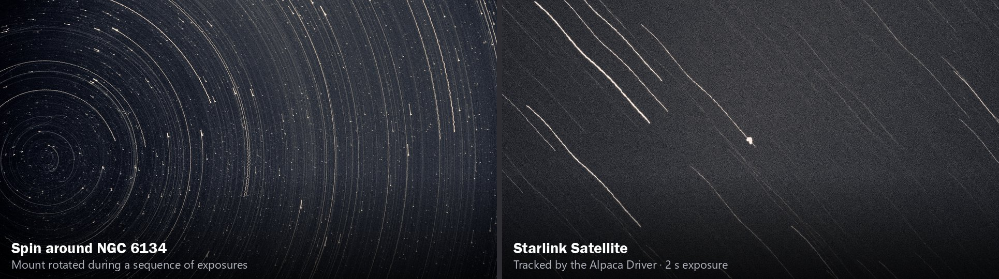
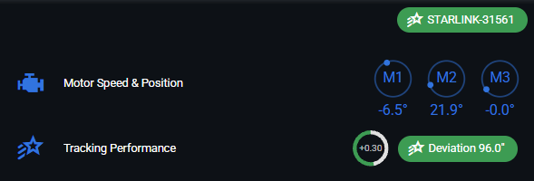

# Satellite Imaging
[Finding Satellites](#finding-satellites) ·
[Tracking a Satellite](#tracking-a-satellite) ·
[Capturing a Pass](#capturing-a-pass) ·
[Creating a Spin](#creating-a-spin) ·
[Other Orbitals](#other-orbitals)

>VIDEO DEMO - [26 - Tracking Orbitals](https://youtu.be/no47ZNagEDk)

Satellites such as the International Space Station (ISS) and Starlink cross the sky in a few minutes, far faster than the stars. The Alpaca Driver can track them: it fetches each satellite's orbit and updates the mount's target position every 200 milliseconds, so the satellite stays in the frame while the stars streak past. The driver can track over 32,000 artificial satellites, including space stations, rocket bodies and debris, as well as the Sun, Moon, planets, comets and asteroids.

The same motion control can also create a "spin": a star-trail image made by rotating the mount during a sequence of exposures.

## Finding Satellites

Satellites are found by their **NORAD ID**, a catalogue number that identifies each one.

* **ISS:** The International Space Station's NORAD ID is **25544**.
* **Starlink and other satellites:** In Alpaca Pilot's catalog, filter by the **Satellite** type, then open **Nearby Satellites**. It shows the satellites currently visible from your location on Heavens-Above.com. Find the satellite you want, such as a Starlink, and copy its NORAD ID to the clipboard. The other links there (N2YO, satellitemap.space and CelesTrak) list the brightest satellites and their positions around the globe.

The best time to see satellites is 1 to 2 hours after sunset or before sunrise, when a satellite is still sunlit but your sky is dark.

## Tracking a Satellite

A low satellite pass lasts only a few minutes, so prepare everything before it rises:

1. **Search for it.** Paste the NORAD ID (for example `25544` for the ISS) into Alpaca Pilot's search bar, then click **Search**. Or simply select a satellite you've searched for before from the catalog list, and click its **Goto**.
2. **Start tracking.** The driver fetches the satellite's latest orbital parameters from CelesTrak, and starts tracking it if it's more than 10° above the horizon. Alpaca Pilot switches to the Dashboard, where the status indicator shows the satellite's name, for example "ISS (ZARYA)".
3. **Watch the status.** While the satellite is below 10° altitude, the status turns **orange** and shows where it is, for example "ISS (ZARYA) (Az 223° Alt -31°)". The mount keeps tracking the stars meanwhile. When the satellite rises above 10°, the mount automatically slews to it and starts tracking, and it stops again when the satellite sets.
4. **Fine-tune the position.** Orbit data is never exact, so the satellite may sit slightly off-centre. Adjust the set point on the Dashboard's radial dials (or use the jogging keys) to centre it. The driver keeps tracking the satellite from that offset. To remove the offset, turn tracking off and back on.
5. **Fine-tune the orbit offset.** A fast satellite can drift steadily along its path, ahead of or behind the centre of the frame. Click the M1, M2 and M3 motor dials on the Dashboard to open the status panel. While an orbital is being tracked, the **Tracking Performance** row shows an offset dial, set from -5 s to +5 s. It aims the mount this many seconds ahead of the satellite's predicted position. The default of +0.3 s makes up for the short delay in the mount's control loop. If the satellite trails behind, increase the offset; if it runs ahead, reduce it. The change applies straight away, and the **Deviation** chip beside the dial shows how far the mount is from where it's aiming.

    

**Removing old satellites:** Every satellite you search for stays in the catalog list, and its orbit is cached so you can track it again without an internet connection. To remove one you no longer need, click the red bin icon (**Remove from orbital cache**) on its row, or click the satellite and choose **Remove**. Comets and asteroids you've searched for can be removed in the same way.

## Capturing a Pass

* **Set up the sequence beforehand.** In NINA, prepare a sequence of short exposures, such as the 2 s exposures used for the Starlink image above, and start it just before the satellite rises above 10°. The whole pass may be over in a few minutes.
* **Bright satellites:** For a detailed view of a bright satellite such as the ISS, record a **video** and use lucky imaging, as described in [Planetary Imaging](./planetary.md).
* **Satellite trails:** Alternatively, keep sidereal tracking on, and let the satellite sweep across the star field as a trail.

How long a pass lasts depends on the satellite's orbit:

| Orbit Type | Altitude Range | Pass Duration | Example Satellites |
|---|---|---|---|
| Low Earth Orbit (LEO) | 200–2,000 km | 2–10 minutes | ISS, Starlink, Hubble |
| Medium Earth Orbit (MEO) | ~20,000 km | 10–20 minutes | GPS, Galileo |
| Geostationary Orbit | ~35,786 km | Continuous | Weather, communications |

* **LEO satellites** like the ISS typically take **4–6 minutes** to cross from horizon to horizon when visible.
* **Inclination and observer latitude** affect how high and long the pass appears. Near-equatorial orbits may skim the horizon at high latitudes.
* **Elevation angle** matters: passes directly overhead (high elevation) are longer and brighter than low-angle ones.

## Creating a Spin

A spin is a star-trail image made by rotating the mount while the camera captures a sequence of exposures. The stars trace circles around the centre of the rotation, as in the image of NGC 6134 above.

1. **Point the camera.** The easiest spin points straight up at the zenith and rotates in azimuth. You can also point anywhere in the sky and rotate the camera around that point, as in the example above.
2. **Start a sequence.** In NINA, run a sequence of exposures of 10 to 60 seconds each.
3. **Rotate the mount.** While the sequence runs, rotate the mount slowly and steadily with Alpaca Pilot's jogging keys: in the topocentric reference frame (press **F** to switch frames), the **left** and **right arrow keys** turn it in azimuth, and **Q** and **E** rotate the camera. The number keys set the speed, from **1** (slowest) to **9** (fastest).
4. **Combine the exposures.** Stack the exposures with a star-trail blend (keeping the brightest value of each pixel) to join the trails into one image.

## Other Orbitals

Alpaca Pilot's catalog also tracks natural objects that move against the stars. Choose the object and click **Goto**, and the driver changes the tracking rate to match it:

| Tracking Rate | Target Type | Description |
|---|---|---|
| **Sidereal** | Deep-sky objects, stars | Standard tracking for objects outside the Solar System. |
| **Lunar** | The Moon | Follows the motion of the Moon. |
| **Solar** | The Sun | Follows the Sun. Requires a safety confirmation, and a proper solar filter. |
| **Custom** | Planets, moons, satellites, comets, asteroids and other near-Earth objects | Follows the object using its orbit. |

* **The Sun, Moon, planets and planetary moons** are listed in the catalog: filter by the **Planet** or **Moon** type. For imaging planets, see [Planetary Imaging](./planetary.md).
* **Comets, asteroids, dwarf planets and interstellar objects**: over 1 million of them can be found by name or designation, using NASA JPL Horizons. Find an object's ID on sites such as TheSkyLive.com, Eyes on Asteroids, MinorPlanetCenter.net, Sky-Tonight.com, AstroForumSpace.com or cobs.si, then enter it in the catalog search in one of these formats:
    * Long-period comets: "C/2025 A6", "C/2020 F3"
    * Short-period comets: "P/2023 R1"
    * Provisional comet designations: "2006 F8"
    * Dwarf planet names: "Ceres", "Makemake"
    * Named asteroids: "Vesta", "Pallas", "Iris", "Flora", "Hebe", "Apophis"
    * Numbered asteroids: "00433" → Eros
    * Provisional asteroid designations: "2023 BU", "2021 PH27", "A801 AA" → Ceres

JPL Horizons is strict about search terms, so check the success or failure notification to see whether a different format is needed.
