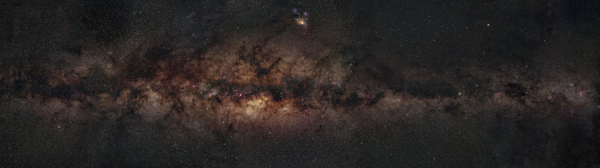
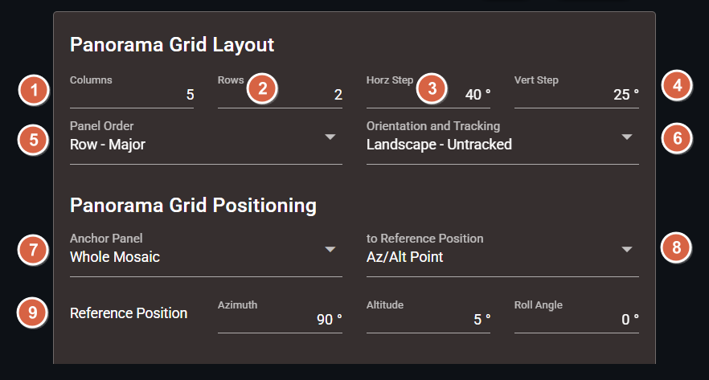
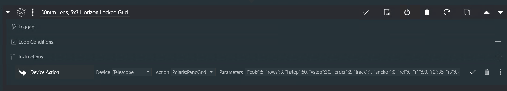
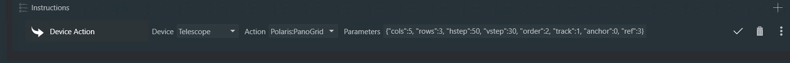
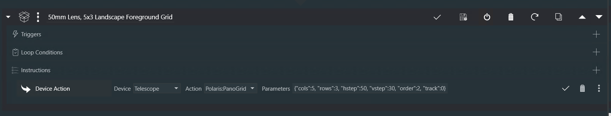
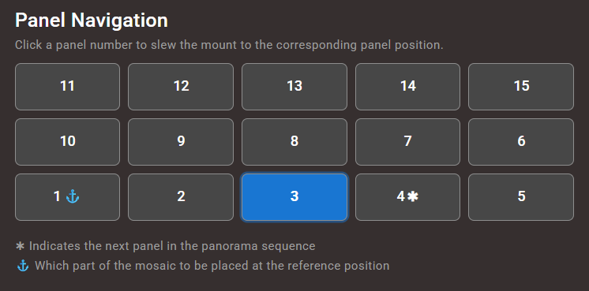
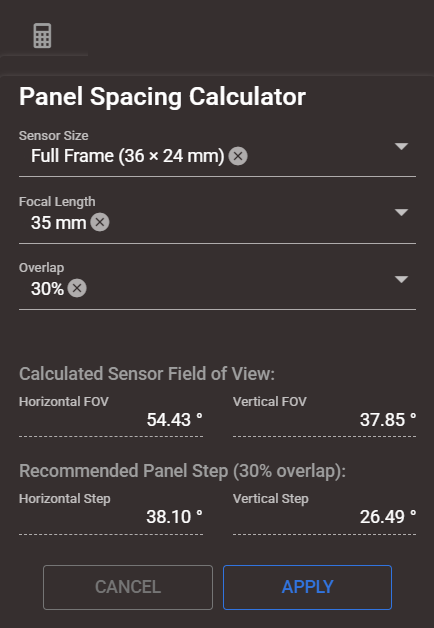
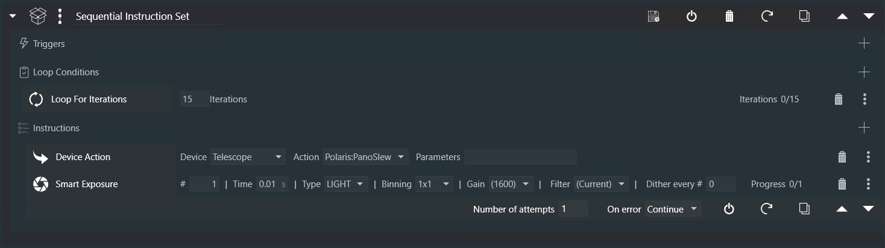
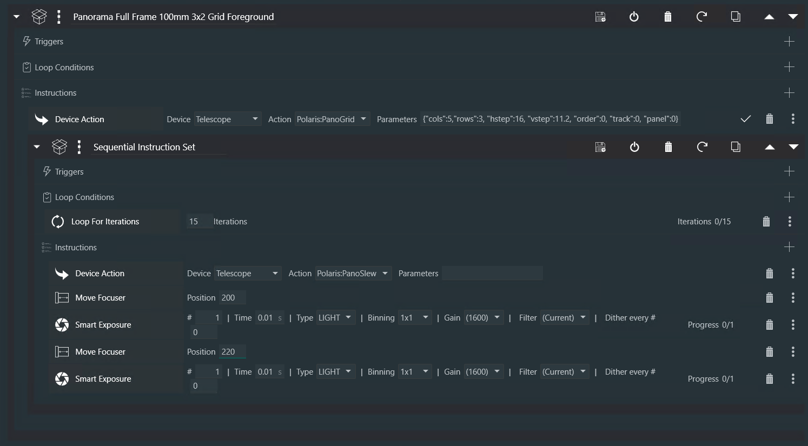
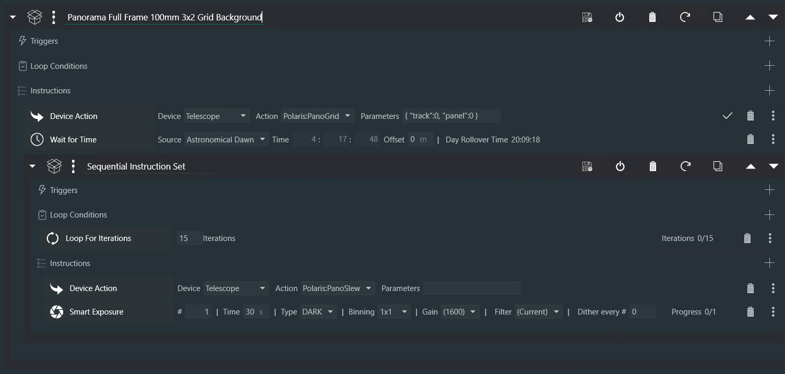

# Creating Panoramas
[Why the Alpaca Driver](#why-use-the-alpaca-driver) |
[Defining a Grid](#defining-a-grid) |
[Previewing](#previewing) |
[Capturing](#capturing) |
[Stitching](#stitching)



*A 13-panel Milky Way mosaic, captured in two passes framed in galactic co-ordinates.*

>VIDEO DEMO: [28 - Panorama Settings](https://youtu.be/k7OoPk98UCk?t=4m57s)

>VIDEO DEMO: [28 - Panoramas Workflows](https://youtu.be/k7OoPk98UCk?t=25m08s)

This guide explains how to plan, configure, and capture panoramas using the **Alpaca Driver**, with optional automation through **NINA Advanced Sequencer**. It is aimed at users who want deterministic, repeatable panorama capture for astrophotography and astro‑landscape imaging.

## Why Use the Alpaca Driver

The Benro Polaris **Standard Panorama** and **Pro Panorama** modes are excellent for quickly capturing wide-field panoramas: define the panorama, capture the panels in order, and stitch the result. NINA's **Framing Assistant Mosaic Panels** do a similar job for astronomical mosaics, and suit large deep sky objects that are captured as part of an imaging sequence.

Wide Milky Way and astro-landscape panoramas are harder. You often want tracked stars, a foreground captured at a different time, and a composition you can return to later. The **Alpaca Driver and the Pilot application** are built for this. They make it much easier, and they avoid three problems you will run into when using only the Benro Connect mobile application.

### Problems It Solves

1. **Benro Connect loses its place.** The app does not reliably save and restore its state (everything it knows about the current panorama orientation). To have any hope of returning to the same position, you must keep the phone unlocked with Benro Connect open the whole time. If the phone locks or you switch to another app for too long, that information can be lost. You then cannot truly return to an earlier position, and your panels will be misaligned.
    **With Pilot:** the device running Pilot keeps track of your panorama, so there is nothing to lose.

2. **Aligning changes the numbers.** Every compass calibration or single star alignment changes the altitude and azimuth that Benro Connect displays. Even if you get very close to a value you wrote down earlier, you may not be pointing at the same spot.
    **With Pilot:** you can point the camera at almost exactly the same place before and after changing your alignment, even with multi-point alignment. 

3. **The camera rotates while tracking.** Benro Connect can automate the photos for a panorama, but if you both track and stack, the camera rotates over time. With ultra-wide lenses and a 180–215° panorama this is tolerable. With standard to telephoto lenses, or a 360° panorama, the camera can easily rotate 15° or more between the first and last panel.
    **With Pilot:** the panorama tools have a **derotate** option that turns the camera back before each panel. Even with tracked stars, the horizon stays level from one panel to the next, which makes stitching much easier.

### What Else You Get

The Alpaca Driver treats a panorama as a **grid fixed in space**, rather than a one-time capture. You can save the grid, revisit it, reorder it, change it while imaging, and reuse it across sessions. That suits projects where the foreground and sky are captured separately, often at different times and with different tracking needs.

You can define the grid in whichever way fits the shot:

* **Topocentric Reference Frame (Az/Alt/Roll)** – panels are laid out relative to the horizon, so level foregrounds and horizon-aligned sky panoramas need no manual rotation adjustments.
* **Equatorial Reference Frame (RA/Dec/PA)** – panels are fixed relative the orientation of the stars in the sky, the same approach as NINA Mosaic Panels.
* **Galactic Reference Frame (Galactic Longitude/Latitude/Position Angle)** – large mosaics follow the Milky Way itself rather than the celestial coordinate grid.
* **Motor Position Reference Frame (M1/M2/M3)** – panels are tied to where the mount's motors physically are, so an anchor keeps pointing at the same spot even if the alignment changes afterwards. This suits blue-hour shoots, where the landscape is captured before any star alignment is possible.

It also gives you more control over how you capture:

* **Multiple passes** – reuse the same grid for an untracked foreground, a tracked sky, or extra layers such as the Moon or other orbitals.
* **Consistent camera orientation** – panel positions and camera roll stay the same between captures, so foreground and sky layers line up when combined or revisited later.
* **Changes on the fly** – adjust the grid during imaging to change the layout, recapture panels, or add coverage without starting again.
* **Custom capture order** – Row Major, Column Major or Serpentine, starting from any panel. This helps when timing matters, such as capturing the Milky Way before it moves out of the best framing.
* **Saved presets** – save a complete panorama and recall it later to reproduce the same composition.
* **Preview and check** – select individual panels before or during capture to confirm coverage, overlap and framing in the field.

In short, the Benro Polaris panorama modes and NINA Mosaic Panels each solve part of the panorama problem. The Alpaca Driver combines them into one reusable system that keeps its place, survives re-alignment, and keeps foreground, sky and other layers precisely lined up.


## Defining a Grid

At the core of the Alpaca Driver’s panorama system is the concept of a single, deterministic panorama grid anchored in space. At any given time, exactly one panorama grid is active in the driver. This grid defines the geometry, ordering, tracking behaviour, and anchor position for all panorama-related slews.

The active panorama grid can be defined or modified either interactively using Alpaca Pilot, or programmatically using NINA’s Advanced Sequencer. Regardless of how it is configured, the driver always operates against the same internal panorama grid.

### Using Alpaca Pilot

Alpaca Pilot provides a visual and interactive way to define the panorama grid. The Panorama Settings card allows you to configure the grid geometry, panel order, tracking behaviour, and anchor position in one place.

Changes made in Alpaca Pilot immediately update the active panorama grid in the driver. This makes it well suited to planning, experimentation, and on-site adjustment when refining framing and overlap.




- **① Columns `"cols":`**  Number of horizontal panels across the panorama. Range: **2–14**. 
- **② Rows `"rows":`**  Number of vertical panels in the panorama. Range: **1–3**.

- **③ Calc:** Panel Spacing Calculator used to calculate **Sensor Field of View** including recommended Horizontal and Vertical Step. To capture the MW you will likely need a "Galactic Lon FOV" of at least 180 degrees. If you use a full-frame camera and a 35mm lens in landscape mode (wider along the MW spine), you can get by with just a 4 x 1 grid. See below.

- **③ Swap:** Changes the spacing between panels for either a Landscape or Portrait orientation, by  swaping the `"hstep"` and `"vstep"` values. Landscape orientation will have a larger `"hstep"`, while Portrait orientation will have a larger `"vstep"`. This button only changes the spacing of the panels, you will need to use a lens collar to rotate your camera's sensor to match the orientation. 

- **③ Copy:** Copies the current Panorama Grid settings to the clipboard in JSON format. After defining the Panorama Grid Layout, use this button to paste the settings directly into the `Polaris:PanoGrid` **Device Action Parameters** field within the NINA Advanced Sequencer. See below for an example.

> Note: Clipboard access is restricted in browsers and the Copy function will only work over HTTPS. Refer to the instructions below to [enable HTTPS in Alpaca Pilot](./pilot.md#using-https). 

- **④ Panorama Preset `"pano_name":`**  The name used to save and load Panorama Presets. This field is automatically filled when applying Pano Calculator Setting and can be overriden with a custom name. Clicking the Save button will add the preset to the drop down list for later recall. 

- **⑤ Horizontal Step `"hstep":`**  Angular distance, in **decimal degrees**, between the centres of adjacent horizontal panels. Factor in FOV overlap. Horizontal means different things for diferent reference frames. For Topocentric it alters the Azimuth, for Equatorial it alters the Right Ascension and for Galactic it alters the Galactic Longitude.

- **⑥ Vertical Step `"vstep":`**  Angular distance, in **decimal degrees**, between the centres of adjacent vertical panels. Factor in FOV overlap. Vertical means different things for diferent reference frames. For Topocentric it alters the Altitude, for Equatorial it alters the Declination and for Galactic it alters the Galactic Latitude.

- **⑦ First Panel `"first":`** Defines which corner of the panorama grid is assigned panel number 1. This determines where the capture sequence begins and, together with the **Panel Order ("order")** setting, controls the rotational step direction in which the panorama progresses. 

    * **0 – Top Left**: Panel 1 is located in the top row and leftmost column.
    * **1 – Top Right**: Panel 1 is located in the top row and rightmost column.
    * **2 – Bottom Left**: Panel 1 is located in the bottom row and leftmost column.
    * **3 – Bottom Right**: Panel 1 is located in the bottom row and rightmost column.

     Selecting the correct first panel is important when photographing moving sky targets. Since celestial objects change position over time due to Earth’s rotation, the capture sequence should be planned to preserve critical details. For example:

    * When capturing a **Milky Way arch** later in the season, you may want to begin with the **top row** to capture the galactic center before it rises too high in the sky. You can then capture the lower row before those same targets move out of optimal framing.
    * For single-row panoramas, it is still advisable to choose the first panel based on the direction of sky movement. In the Northern Hemisphere, when capturing a Milky Way arch, starting on the **right side** of the grid can help prevent Earth’s rotation from moving the galactic center beyond the rightmost panels before they are captured.


- **⑧ Panel Order `"order":`** Defines the sequence in which panels are captured:
    * **0 – Row‑Major**: Complete each row before moving to the next row.
    * **1 – Column‑Major**:  Complete each column before moving to the next column.
    * **2 – Serpentine**:  Alternate direction on each row or column to minimise repositioning time.

- **⑨ Anchor Panel `"anchor":`** Specifies which part of the panorama is placed at the anchor position. The **Anchor Panel** and **Reference Position** work together to shift the entire panorama grid to your desired orientation:
    * **0 – Whole Mosaic**:  The entire panorama is centred on the anchor position.
    * **n – Panel n**:   This panel is placed at the anchor position and all other panels are offset accordingly.


- **&#9321; Reference Frame `"ref":`** Defines the coordinate system used to calculate the position of each panel. The panels position is defined by the Anchor Position plus a certain multiple of hstep and vstep, in the Reference Frames co-ordinates. 
    * **0 – Az / Alt / Roll** Topocentric coordinates.
    * **1 – RA / Dec / PA** Equatorial coordinates.
    * **2 – Glon / Glat / GPA**  Galactic coordinates.
    * **3 – M1 / M2 / M3**  Motor Position. Anchors the panorama to the mount's raw motor position instead of a sky coordinate. Panel Az/Alt/Roll are still calculated using `hstep`/`vstep` exactly as in the Topocentric Reference Frame — the only difference is where the anchor's Az/Alt/Roll comes from: it is re-derived from the stored M1/M2/M3 using whatever alignment corrections (Compass/Single Star Alignment, Multi-Point Alignment, etc) are active *right now*, rather than trusting a previously-stored Az/Alt/Roll value.
         *Use this for astro-landscape blue-hour shoots: there are usually no celestial targets available to align on yet, so you calibrate azimuth with just the Compass and Single Star Alignment, capture your landscape panels, and store the anchor as a Motor Position. If you later run a Multi-Point Alignment for more accurate sky tracking (which shifts what azimuth the software attributes to that same physical pose), the Motor Position anchor still resolves back to the exact same physical direction — so your sky panels line up with the landscape panels you already shot, with no need to crop for misalignment.*

- **&#9322; Rotation and Tracking `"track":`** Defines how the mount tracks and how camera roll is handled **after moving to each panel**:
    * **0 – Landscape · Untracked**: Tracking is disabled. The camera frame remains fixed relative to the horizon. Typically used in the Topocenteric Reference Frame.
        *Use for foreground or landscape panels where star motion is acceptable.*
    * **1 – Sky · Horizon‑Locked**: Sidereal tracking is enabled. The camera roll is reset to **0°** at each panel (when the Anchor Points r3 is zero).
        *Use for horizon‑aligned sky panoramas where consistent framing is required.*
    * **2 – Sky · Celestial**: Sidereal tracking is enabled. Camera roll is **not modified** between panels.
        *Use for astronomical sky mosaics such as large DSOs.*
    * **3 – Sky · Milky Way**: Sidereal tracking is enabled. Panel positions are calculated in the Galactic Reference Frame, with hstep adjusting Galactic Longitude and vstep adjusting Galactic Latitude. The Galactic Position Angle remains constant for all panels and is derived from the anchor's reference roll angle. *Use for mosaics aligned with the milky way spine.*
        * **Galactic longitude (0–360°)** defines the position around the Milky Way's disk. At longitude 0° and latitude 0°, the camera is pointed toward the Galactic Center, near Sagittarius A*.
        * **Galactic Latitude (–90° to +90°)** defines the angular distance above or below the Milky Way's disk. At latitude 0°, the camera is centered on the Galactic plane.
        * **Galactic Position Angle (-180° to +180°)** defines the camera's rotation about its viewing axis. At 0°, the top of the frame points toward the North Galactic Pole. At ±90°, the top of the frame is aligned with the Milky Way plane. Beware of Benro Polaris roll angle limits when defining a Galactic Panorama.


- ** &#9323;Anchor Position:** Defines the sky position for the anchor:

    * **Update Button**: Updates the anchor position with the mounts current orientation. In the Motor Position Reference Frame, this stores the mount's current raw M1/M2/M3 motor position rather than a sky coordinate.
    * **Reference Axis 1 `"r1":`**: Azimuth, Right Ascension, Galactic Lon, or M1 Position
    * **Reference Axis 2 `"r2":`**: Altitude, Declination, Galactic Lat, or M2 Position (decimal degrees)
    * **Reference Axis 3 `"r3":`**: Roll, Position Angle, Galactic PA, or M3 Position (decimal degrees)

- **Panel Navigation:** The Panel Navigation grid provides a visual representation of the panorama layout and allows you to click any panel number to slew the mount directly to that position. For Topocentric Reference Frame, the grid follows the panorama layout convention where the **bottom-left panel represents the lowest Altitude and lowest Azimuth**. As you move **to the right**, Azimuth increases; as you move **upward**, Altitude increases. The numbering and progression reflect the selected First Panel and Panel Order settings, while symbols indicate the next panel in the capture sequence and the anchor panel tied to the anchor position.
 
- **Current Panel: `"panel":`** This represents the active Panel Number being captured and is highlighted in blue on the Panel Navigation grid. This field effects what the next panel in sequence will be.


### Programmatically

In addition to configuring the Panorama Grid through Alpaca Pilot, the same grid can be defined programmatically using the `Polaris:PanoGrid` device action. Device actions are custom extensions to the Alpaca Driver that go beyond the ASCOM standard and expose higher-level behaviour.

When executed, `Polaris:PanoGrid` updates the single active Panorama Grid maintained by the driver. Any parameters included in the action override the corresponding values in the current grid, while any parameters that are omitted are left unchanged. This allows a sequence to either fully define a new grid or make small, targeted adjustments to an existing one.

Parameters are supplied in JSON format, enclosed in braces { }. Field names correspond directly to the panorama settings described earlier in this guide. Only the parameters you explicitly specify will be modified.

> Note: Defining or updating the Panorama Grid does not move the mount. The new grid settings are only applied when the driver is instructed to slew to a given panel or to advance to the next panel.

**Using NINA Advanced Sequencer**

To access Device Actions from the **Nina Advanced Sequencer** you must first install the **Device Actions and Commands** plug-in for Nina. Once installed, Device Actions become available in the Advanced Sequence Instructions list, located near the bottom of the instruction list under Utility.

The `Polaris:PanoGrid` device action can then be added as an instruction in your sequence and it is typically placed near the beginning to initialise the Panorama Grid for a specific capture pass. When adding the Device Action, set the Device to Telescope, then select `Polaris:PanoGrid` from the action dropdown, where it appears near the bottom of the list.

When used in a sequential instruction block, the block can be given a descriptive name (for example, “50 mm, 5×3,  Horizon-Locked Grid”) and saved as a template. This makes it easy to reuse consistent panorama grid definitions across multiple sessions or combine them into larger, multi-pass workflows.

In the example below, a 5×3 horizon-locked grid for a 50 mm lens is defined using a `Polaris:PanoGrid` action. 



To manually position the grid on site, omit `r1`, `r2`, and `r3` and set `ref` to `3` (current orientation). This uses the mount’s current pointing (at the time PanoGrid is run) as the reference.



To capture a foreground pass without tracking while retaining the previous grid orientation, set `track` to `0` and remove `anchor` and `ref` fields. This preserves the current grid geometry without redefining the anchor position.



As a reference, the following JSON Parameters example shows all available fields that can be set using the `Polaris:PanoGrid` device action. In practice, you would typically specify only the parameters you need to change.
```
{ "cols":3, "rows":2, "hstep":40, "vstep":30, "first":0, "order":2, "track":0, "anchor":1, "ref":0, "r1":90, "r2":5, "r3":0, "panel":0 }
```
**Using CCDciel Sequencer**

To define a Panorama Grid from CCDciel, make a script that sends the `Polaris:PanoGrid` device action and parameters to the Alpaca Driver, and add it as a script step in your plan (see [Other Device Actions](./ccdciel.md#other-device-actions)).


## Previewing
Once a panorama grid is defined, you will probably want to verify its coverage and panel overlap. You can use the Alpaca Pilot Panel Navigation to do this. This displays a grid of **Rows × Columns**, numbered according to the selected panel order. The currently active panel is highlighted in blue, the next panel with a *, and the anchor panel with a ⚓. Clicking on a panel number will slew the mount to center on that panel.



### Spacing Calculator
The Panorama Grid is designed to be simple, with the minimum number of parameters. It uses just two angular steps, `hstep` and `vstep` to define the spacing between panels. These fields effect the horizontal and vertical spacing of the panels from the cameras field of view.

A calculator is provided calculate these properties:

* Click on the Calculator icon on the Panorama Settings Card
* Adjust the number of Rows and Columns.
* Select your sensor size. 
     > You can also enter a custom sensor size by typing `ww x hh` and pressing *Enter*.  For example typing `16 x 9` and pressing *Enter*, sets a 16 x 9 mm sesnor size.
* Select your lens focal length in mm.
* Select the percentage of overlap between each panel
     > You can also enter a custom focal length or overlap value by typing a number and pressing *Enter*. For example, typing `16` and pressing *Enter* in the Focal Length field will set the focal length to 16 mm.
* The calculator will determine the Field of View of the Sensor and Full PanoGrid in Degrees, as well as the Recommended Panel Step, given your desired overlap.
* Click `Apply` to set the Rows, Columns, Horizontal Step and Vertical Step for the Panorama Grid. This will also store the Sensor Size, Focal Length and Overlap for next time you use the calculator.



### Checking Overlap
The actual panel overlap may differ from theoretical calculations, especially with wide-angle lenses. Use the verification procedure below to confirm with your setup before your imaging session begins.

To check the horizontal and vertical overlap:

* Point the mount and camera at a clearly visible scene (e.g., a bookcase or wall).
* Select a panel in Alpaca Pilot Panel Navigation and slew to it.
* Using Nina live view, note the horizontal bounds of the image.
* Slew to the adjacent horizontal panel and check the overlap. Adjust `hstep` as needed.
* Repeat for vertical panels to confirm `vstep` ensures sufficient overlap.

### Checking Coverage
Once on site, you can confirm that your panorama grid captures the full scene and desired foreground, and reaches the sky elevation needed for your selected celestial target.

To check the horizontal extent of the scene:

* Align the mount and anchor the panorama grid.
* Slew to the bottom-left panel and then to the bottom-right panel.
* Take some sample exposures at the desired panels to check exposure.
* Confirm that all desired features are within the captured area.
* Adjust the number of columns or anchor position if necessary.

To check the vertical extent of the scene:

* Slew to the top row of panels.
* Confirm that the grid reaches the desired altitude for your targets.
* Adjust the number of rows or anchor position as needed.

>Note: Because of potential gimbal lock, the Alpaca Driver may not always be able to calculate a fully canonical solution when the mount altitude is exactly 0°. When planning panorama grids, avoid placing rows at Altitude 0°. Instead, offset the grid by a few degrees above or below the horizon.

>Note: Vertical Panoramas and Galactic Panoramas may span more than 90 degrees vertically. These angles will wrap over to the other side of the sky: Altitude 100° is Altitude 80° at the opposite Azimuth, Galactic Latitude 100° is Latitude 80° at Galactic Longitude + 180°, and a Declination past the celestial pole continues 12h round in RA. Past the top the camera is upside down, which covers the same rectangle of sky. See [Vertical Panoramas](https://mymodernmet.com/vertical-panorama-landscape-geoff-decker/)

>Note: The Polaris can't point above Altitude 81.5°. A panel whose centre falls between 81.5° and 90° (or between 90° and 98.5°, just over the top) is shot from 81.5° directly below its centre, up to 8.5° short of it, and with the camera level: the roll range shrinks with altitude (about ±64° at 70°, ±32° at 80°, 0° at 81.5°). When a grid passes near the zenith, check the panels next to it with Slew to Panel, and add overlap (a smaller vstep) or move the anchor so no panel centre lands in the zenith zone. Tracked panels high in the sky also can't follow field rotation in roll: shoot them first, or keep their exposures short.


## Capturing

Because the Alpaca Driver does not communicate directly with your camera, the process of slewing between panels and capturing images is handled by your imaging application, such as **NINA** or **CCDCiel**. To support this, the Alpaca Driver provides the `Polaris:PanoSlew` device action, which allows the imaging application to move the mount between panorama panels in a deterministic way.

When executed with no parameters, `Polaris:PanoSlew` advances the mount to the next panel according to the grid’s defined sequence order. After the final panel is reached, the sequence wraps around and returns to panel 1.

If you need to slew to a specific panel, you may supply a JSON parameter to the `Polaris:PanoSlew` device action, with the `panel` field set to the desired panel number. For example: `{"panel": 3}`. 

If you need to change which panel is considered “next” without immediately slewing the mount, you can use the `Polaris:PanoGrid` device action with the `panel` field set to the current (or prior) panel number. This updates the internal panel index without moving the mount. The next time `Polaris:PanoSlew` is executed without parameters, the driver will slew to the panel that follows the one you specified.

The remainder of this section describes how to use `Polaris:PanoSlew` within NINA’s Advanced Sequencer to capture different types of panoramas.

### Capturing with NINA
A *panorama pass* consists of iterating over each panel in the active panorama grid exactly once and capturing one or more exposures at each position. In NINA, this is typically implemented using a Sequential Instruction Set with a loop.

To configure a sequence that captures all panels:

* Add a `Sequential Instruction Set` to the Advanced Sequencer.
* Add a `Loop for Iterations` as the loop condition.
    * Set the number of iterations to the total number of panels to be captured.
    * In most cases, this will be `rows × cols`. For example 15 = 5 x 3
    * For partial captures (for example, a single-row landscape foreground), you may choose to iterate only over the required subset.
* Add the `Polaris:PanoSlew` device action as the first instruction in the loop. Leave Parameters blank.
* Add a `Smart Exposure` instruction as the next instruction:
    * Set `#` to the number of exposures to capture at each panel.
    * Set the exposure `Time` as required. Must be non-zero.
    * Set the `Type` as required, to store into different folders. For example use LIGHT for foreground, and DARK for background.
    * Set `Dither every #` to `0`.



This structure ensures that the mount advances to each panel in turn, captures a consistent set of exposures at that panel, and continues until the pass is complete.

### Landscape Foreground
The landscape foreground is typically captured as an *untracked*, *horizon-aligned* and usually occupies only the lower rows of the panorama grid. This layer is often captured earlier in the session, such as during twilight, when there is sufficient ambient light in the foreground. In some cases, foreground capture may also involve acquiring panels at multiple focus distances, allowing near and distant landscape features to be combined later using focus stacking techniques.

A common approach is to use a nested Sequential Instruction Set that first configures the panorama grid and then performs the capture. This structure can be saved as a reusable template for future sessions.

A typical panorama foreground workflow includes:

* An outer Sequential Instruction Set, named as a template for your Panorama
    * First instruction is a Device Action `Polaris:PanoGrid`
        * Configure the panorama grid for foreground capture.
        * Set `"cols":5, "rows":3` as desired size of grid.
        * Set `"hstep":16, "vstep":11.2` for desired panel overlap.
        * Set `"track": 0` for Landscape - Untracked.
        * Set `"panel": 0` to change current panel to beginning of sequence
        * Omit reference fields if you want to reuse the existing grid placement.
    * Second instruction is a Sequential Instruction Set
* The Inner Sequential Instruction Set, loops through panels.
    * Set Loop Condition as a `Loop for Iterations` and use total number of panels.
    * First instruction is a Device Action `Polaris:PanoSlew` with no Parameters
    * Remaining instructions in the loop are for the exposure at each panel.
        * Optional `Move Focuser` if you are doing focus stacking of the foreground.
        * A Smart Exposure instruction to capture one or more foreground frames at each panel.



### Sky Background

The sky background pass is usually captured later in the session and is typically tracked, allowing longer exposures and improved signal-to-noise. Depending on the composition, this pass may reuse the same grid geometry as the foreground or extend to additional rows at higher altitude. It may be horizon-locked to aid in aligning panels between foreground and background.

The sequence structure is similar to the foreground pass, with key differences in PanoGrid and SmartExposure configuration.  A typical panorama sky workflow includes:

* An outer Sequential Instruction Set, named as a template for your Panorama
    * First instruction is a Device Action `Polaris:PanoGrid`
        * Configure the panorama grid for foreground capture.
        * No need to set cols, rows, hstep, vstep, if they are the same as foreground.
        * Set `"track": 1` for Sky - Horizon-Locked.
        * Set `"panel": 0` to change current panel to beginning of sequence
    * Second optional instruction `Wait for Time` set to `Nautical Dark`
    * Third instruction is a Sequential Instruction Set
* The Inner Sequential Instruction Set, loops through panels.
    * Set Loop Condition as a `Loop for Iterations` and use total number of panels.
    * First instruction is a Device Action `Polaris:PanoSlew` with no Parameters
    * A Smart Exposure instruction to capture one or more tracked frames at each panel.

Because the panorama grid is deterministic and persistent, the sky background pass will revisit the same panel centres as the foreground pass, even if the two passes are captured hours apart. This greatly simplifies later alignment, compositing, and stitching.



### Moon and Orbitals

You can capture the Moon or other orbitals using the special Device Action **`Polaris:TrackOrbital`**, which instructs the mount to start tracking a specific celestial body. This action requires two parameters:

* **`"category"`** – The type of orbital to track. For example `"category": 5` for moons

    * **4 – Planets:** Any solar system planet.
    * **5 – Moons:** Any Earth or planetary moon.
    * **6 – Satellites:** Any Earth satellite; searches Celestrak by name.
    * **7 – Comets:** Any comet; searches JPL Horizons by name.
    * **8 – Asteroids:** Any asteroid; searches JPL Horizons by name.

* **`"name"`** – The name of the orbital, enclosed in quotes. Examples include:
    * `"name": "Moon"`
    * `"name": "Jupiter"`
    * `"name": "C/2025 A1"`

A typical use case is to place this instruction within an outer loop so that, for example, the Moon can be captured after a certain number of panels. After executing **`Polaris:TrackOrbital`**, you should follow up with a **Smart Exposure** action to complete the capture.


## Stitching

Once you have captured all of the images for the panorama, you will need to use a dedicated **stitching application** to combine the individual panels into a single mosaic. These applications align overlapping frames, correct perspective, and blend exposure and color differences. There are many capable options available, depending on your workflow and experience level.

* **Kolor Autopano Giga** – A powerful, fully automatic stitcher with advanced projection models and excellent handling of complex panoramas.
* **Hugin** – An open-source alternative with extensive manual controls, ideal for users who want fine-grained adjustment. Based on same library as PTGui.
* **PTGui** – A professional-grade panorama stitcher offering precise control, robust optimization tools, and excellent results for large mosaics.
* **Adobe Photoshop** – Provides basic panorama stitching via *Photomerge*, suitable for simple mosaics and users already in the Adobe ecosystem.
* **Adobe Lightroom Classic** - Provides basic panorama stitching via *Photomerge*, only three basic projection types.
* **Microsoft ICE** – A lightweight and easy-to-use tool that works well for straightforward panoramas with minimal manual control.
* **PixInsight** – Designed primarily for astrophotography, offering advanced tools for stitching wide-field night-sky mosaics with high precision.

You may want to try **Kolor Autopano Giga**, as some users report better results due to its wide range of perspective mappings and advanced features. Further details can be found on HDRMaps:
**AutoPano Giga Is Now Free** [https://hdrmaps.com/blog/autopano-giga-is-now-free/](https://hdrmaps.com/blog/autopano-giga-is-now-free/)

To register the free version

* Download and install the application. Windows Installer at https://download.hdrmaps.com/AutopanoGiga_x64_442_2018-09-10.exe
* Run the application as Administrator the first time to ensure the registration details are saved.
    * User: freecopy@kolor.com
    * Registration code: KAPG7-K3A9X-IZJHX-FIIT7-C5IM8-MQF2N
* Once registered, the application can be launched normally without Administrator privileges.

## Closing Notes

The Alpaca Driver’s panorama system is designed to provide precise, repeatable control rather than fully automatic results. Complex panoramas benefit from rehearsal and careful planning, especially for time‑critical events like solar and lunar eclipses. Unlike native solutions that may "forget" lens sizes or panorama boundaries if a menu is exited, the Alpaca Driver maintains exactly one active panorama grid.

With a well‑defined panorama grid and sequenced capture passes, the Alpaca Driver enables workflows that are difficult or impossible with traditional panorama tools. With Horizon-Locked tracking, the driver prevents the significant horizon tilt, often 7.5 degrees or more, ensuring your raw frames maintain a consistent ground level, drastically easing stitching.

The Alpaca Driver V2.1 is a community-driven project designed to unlock the latent potential of the Benro Polaris hardware. As you push the limits of what this device can capture, from guided DSO mosaics, 270° Milky Way arches to composite lunar eclipses, we encourage you to share your results and feedback with the community to help refine these tools for the next generation of astrophotographers
