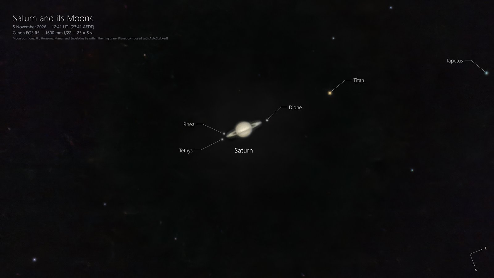

# Planetary Imaging
[Focal Length](#choosing-a-focal-length) |
[Pointing and Tracking](#pointing-and-tracking) |
[Capturing Video](#capturing-video) |
[Stacking](#stacking-with-autostakkert) |
[Sharpening](#sharpening) |
[Composing a Wider Shot](#composing-a-wider-shot)

Planets are small and bright, and at long focal lengths the atmosphere's turbulence (the "seeing") blurs and distorts them from moment to moment. Planetary imaging gets around this with **lucky imaging**: record a video of thousands of very short exposures, keep only the sharpest frames, and stack them into one detailed image. Deep-sky imaging works differently, with a smaller number of long exposures.

The Benro Polaris and the Alpaca Driver handle the pointing and tracking, so you can concentrate on capturing and processing. The example below combines a stacked image of Saturn, composed with AutoStakkert!, with a deeper exposure that shows its moons.

## Choosing a Focal Length

Planets are tiny: Jupiter's disc is less than 50 arcseconds across, Saturn's rings about 45 arcseconds, and Mars smaller still. Even with a long lens they cover only a few dozen pixels, so planetary imaging needs the longest focal length you can manage, matched to a camera with small pixels.

* **Use extenders.** A 2× extender doubles the focal length (and the f-ratio). Image quality drops a little with each extender, but the gain in image scale is usually worth it.
* **Prefer a small camera with small pixels.** A small-sensor astronomy camera puts far more pixels on the planet than a full-frame camera at the same focal length. Its crop factor makes the focal length act much longer.
* **Aim for an f-ratio of about 3 to 5 times the pixel size** in microns. Beyond that, the image just gets dimmer and blurrier without showing more detail.

For example, the Saturn image above used a 400 mm f/5.6 lens with a 2× III extender (800 mm f/11) on a MiniCam8 camera, whose IMX585 sensor has 2.9 micron pixels. That's about f/3.8 per micron of pixel size, within the ideal range. The sensor's 3.4× crop factor makes 800 mm act like about 2,700 mm on a full-frame camera, giving about 0.75 arcseconds per pixel, so Saturn's rings span about 60 pixels. A full-frame Canon EOS R5, with 4.4 micron pixels, would cover them with about 40 pixels at the same focal length.

Long lenses with extenders are heavy and sensitive to wind, so keep the payload balanced and within the Polaris's limits (see the [Hardware Guide](./hardware.md)).

## Pointing and Tracking

Find the planet in Alpaca Pilot's catalog: filter by the **Planet** type, or search by name. Its **Goto** slews to the planet and starts non-sidereal tracking at the planet's own rate, so it stays centred while you capture (see [Orbitals and Non-Sidereal Tracking](./control.md#orbitals-and-non-sidereal-tracking)). Planets also appear in Stellarium, but a goto from there tracks at the sidereal rate.

* At planetary focal lengths the field of view is tiny, so align the mount well before slewing. A [Multi-Point Alignment](./control.md) with a sync near the planet puts it in the frame first time.
* You may need to fine-tune the planet's position with Alpaca Pilot's jogging keys: the **arrow keys** (or **W**, **A**, **S** and **D**) move the mount, and the number keys set the jogging speed, from **1** (slowest) to **9** (fastest). Use the slowest speeds at planetary focal lengths, where a small movement shifts the planet across the whole frame.
* Centre the planet before you start recording, and re-centre between videos if it drifts.

## Capturing Video

The same principles apply whichever camera you use.

* **Exposure time:** Keep each frame short, to freeze the turbulence so that more frames come out sharp. Exposures of up to about 30 milliseconds work well for Saturn. Brighter planets, such as Jupiter and Mars, allow shorter exposures.
* **Gain or ISO:** Raise the gain (or ISO) until the planet is bright enough, but watch the histogram: the planet's brightest part should sit at about 60 to 80 percent, with **nothing piled up against the right-hand side**. Clipped highlights lose detail that stacking can't recover. A noisy, slightly dim frame stacks well; a clipped one doesn't.
* **Frame rate:** More frames give more chances of sharp ones. Use a **USB 3** port and cable, and reduce the capture size to a small region around the planet. The camera then sends far fewer pixels per frame, so the frame rate rises, often several times over, and the video files are much smaller. Leave a margin around the planet so it stays in the frame if it drifts.
* **Video length:** Planets rotate, which blurs detail in a long video. Keep videos to about 60 to 90 seconds for Jupiter, and a few minutes for Saturn and Mars. Capture several videos and keep the best.
* **Focus:** Focus carefully on the planet itself, or on a bright star nearby, at full magnification.

### Using SharpCap (astronomy cameras)

[SharpCap](https://www.sharpcap.co.uk/) is a capture program for astronomy cameras, such as ZWO, Player One and QHY cameras. The free version is enough for planetary capture.

1. Connect the camera, then set **Capture Format** to **SER**, which stores raw frames without compression, and **Colour Space** to **RAW8** for the fastest frame rate.
2. Reduce the **Capture Area** to a small region of interest around the planet, and set the **Frame Rate Limit** to maximum.
3. Set the exposure and gain using the histogram, as above, and check the frame rate SharpCap reports.
4. Click **Start Capture**, and limit the capture by time to suit the planet.

### Using EOS Utility (Canon cameras)

Canon's free **EOS Utility**, from your country's Canon support site, controls Canon cameras from a computer. A DSLR or mirrorless camera records the planet as a movie.

1. Set the camera to movie mode with **manual exposure**, and choose the highest frame rate.
2. Use the camera's **movie crop** mode, if it has one, so the planet covers more pixels. Unlike an astronomy camera's region of interest, a smaller movie size usually scales the whole frame down rather than cropping it, which shrinks the planet.
3. In EOS Utility's **Remote Live View** window, zoom in on the planet to focus, then set the shutter speed and ISO using the histogram, as above.
4. Record the movie from EOS Utility, or start recording on the camera.

AutoStakkert! reads SER and AVI files. Convert a camera's MOV or MP4 movies with [PIPP](https://sites.google.com/site/astropipp/) (free), which can also centre and crop the planet in each frame, making the files much smaller.

## Stacking with AutoStakkert!

[AutoStakkert!](https://www.autostakkert.com/) is a free Windows program that grades every frame of a video, aligns the sharpest ones and stacks them. Download it from the AutoStakkert! website, extract the zip file, and run `AutoStakkert.exe`: there is no installer.

1. **Open** the SER or AVI video.
2. Under **Image Stabilization**, choose **Planet (COG)**, then click **Analyse**. AutoStakkert! grades the quality of every frame and plots the results.
3. Choose how many frames to stack. Stacking the best 10 to 25 percent usually gives a good balance between sharpness and noise.
4. Set an **AP Size** to suit the planet's size, then click **Place AP grid** to cover the planet with alignment points.
5. Under the stacking options, choose **Drizzle 3.0x**. Drizzling combines the small shifts between frames into an image three times the size, recovering finer detail on a planet that covers only a few dozen pixels. It works best with a large number of stacked frames.
6. Click **Stack**. AutoStakkert! saves the stacked image as a TIFF file in a new folder next to the video.

## Sharpening

A stacked planet looks soft until it's sharpened. The wavelet sharpening in [RegiStax](https://www.astronomie.be/registax/) (free) is the usual next step. Sharpen gently, adjust the colour balance, and stop before rings and noise appear around the planet's edge.

## Composing a Wider Shot

A planet's moons are far fainter than the planet itself, so an exposure long enough to show them overexposes the planet into a featureless disc. The example above combines two images:

* **The moons:** a stack of longer exposures (23 × 5 s at 1600 mm f/22 on a Canon EOS R5), which shows the moons and nearby stars, but overexposes Saturn.
* **The planet:** a short-exposure video captured with the MiniCam8 at 800 mm and stacked with AutoStakkert!, which shows Saturn's rings and bands.

To combine them, stack the longer exposures (for example in [Siril](https://siril.org/)), then use an image editor to place the stacked planet over the overexposed disc on its own layer, scaled and rotated to match. Blend the edge with a soft layer mask. To label the moons, check their positions for the time of capture in Stellarium or [JPL Horizons](https://ssd.jpl.nasa.gov/horizons/).
