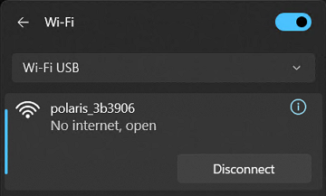
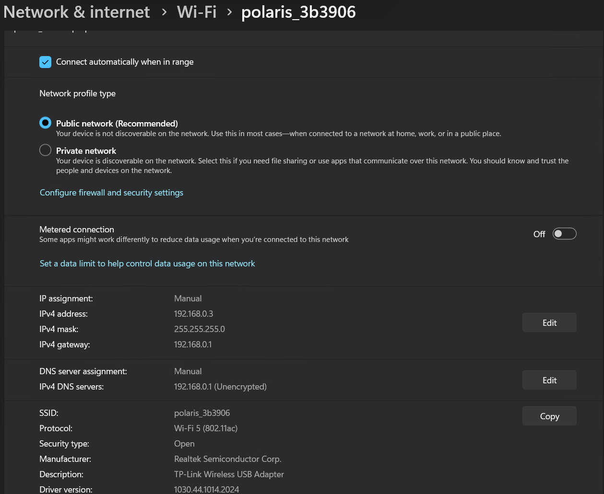
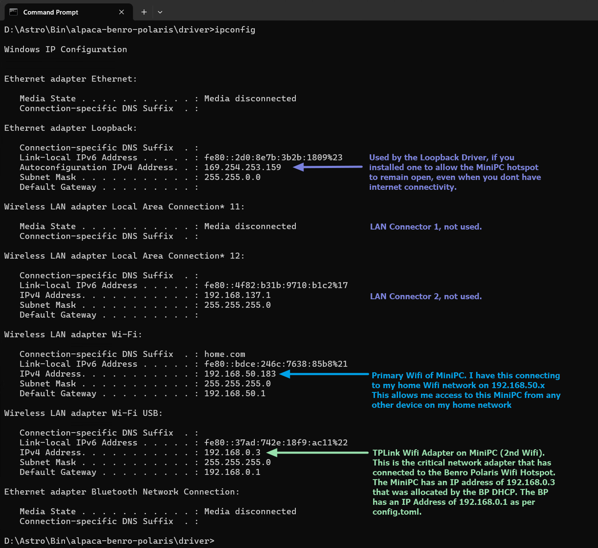
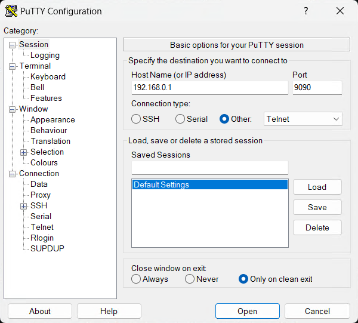
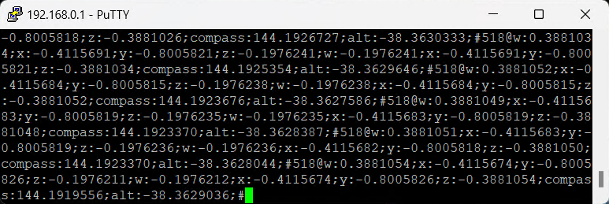

# Network Troubleshooting
Problems with the Wi-Fi connection between the driver's computer and the Benro Polaris, including reading the driver's log, connection dropouts, reaching Alpaca Pilot at ap.local, and diagnosing the network with PuTTY and PowerShell.

See [Troubleshooting](./troubleshooting.md) for the other guides, and the [FAQ](./faq.md) for common questions.

## C0 - PC Can't Join Wi-Fi
There appears to be an issue with some types of Wifi Adapters being able to conenct with the Benro Polaris Wifi. If you cannot get Win11 to form a connection with the polaris_XXXXX Wifi, you may want to try using a USB Wifi Adapter. The following adapter is known to connect with Benro Polaris, [TP-Link AC600 USB WiFi Adapter](https://www.amazon.com/wireless-USB-WiFi-Adapter-PC/dp/B07P5PRK7J/). 

You can use the Benro Polaris App to change the Band used by the Polaris to communicate. We recommend changing this to the 5Ghz band if you are using a MiniPC, and 2.4Ghz if you are using a Raspberry Pi Zero2.

1. Open the Benro Polaris App
2. Click on **Nearby Devices** and Connect to your Polaris
3. Click on the Mode button in the top right hand corner of the screen
4. Click on the Home icon in the top right hand corner.
5. Close the Select the device to be connected window (if it is open)
6. Click on the Cog icon inside the blue circle
7. Click on the **Wifi Range** menu
8. Choose **5G** for MiniPC, or **2.4G** for Raspberry Pi Zero2.

You can also change the TP-Link USB Wifi Adapter to only use the 5Ghz or 2.4GHz bands with the following procedure

1. Open **Windows Device Manager**
2. Under **Network Adapters**, double click on the **TP-Link Wireless USB Adapter**
3. Change to the **Advanced** Tab
4. Select the **Wireless Mode** Property
5. Change the value to "**IEEE 802.11 a/n/ac**" for 5Ghz only, ie MiniPC.
5. Change the value to "**IEEE 802.11 b/g/n**" for 2.4Ghz only, ie Raspberry Pi Zero2.


Forcing the TP-Link Adapter to only use the 5GHz or 2.4Ghz bands, can reduce a periodic network latency spike that is caused by WLAN AutoConfig Background Scanning. This is when Windows 11 momentarily diverts the adapter to scan for other frequencies, completely halting normal data communications and interfering with the Driver.

## C1a - Wi-Fi 2 Not Connected

* Use the Alpaca Driver log window to help diagnose your problem. The messages aim to help point you in the right direction. The driver will continue to retry connecting until you have resolved any issues.
* Confirm the mini-PC has connected with the polaris-XXXXX hotspot using the second `Wi-Fi 2` or `Wi-Fi USB` adapter. It should look like the following:
 

## C1b - Network Conflict
If you see the `polaris_xxxxxx`, `No internet, open` message on the Wi-Fi 2 adapter, you may have a network issue or conflict. Check each of these steps to see if it can resolve the issue.

* Click `Disconnect`, wait 15s, then Choose `Connect Automatically` and click `Connect` to re-establish connection. Wait 30s for the Driver to attempt reconnection.
* Check that your home network does not conflict with the Polaris IP address of `192.168.0.1`. Some home network routers may default to also using the IP address of `192.168.0.1`. We recommend that you change your home network to an address range of say `192.168.50.xxx`, so that it doesnt conflict with various IP devices that commonly use the address `192.168.0.1`.

## C1c - IPv6 Instead of IPv4
When Windows connects to the Benro Polaris network, sometimes it only sets up an IPv6 network. You can manually set the network settings to help speed up connection and force an IPv4 network. To manually set the network properties.

* From the polaris-XXXXX hotspot dialog, click the i circle for more information
* Under IP Assignment, Automatic (DHCP), Click Edit
* Click the Edit network IP setttings dropdown and choose Manual
* Select IPv4 On and IPv6 off
* Enter an IP address of `192.168.0.3`
* Enter a Subnet mask of `255.255.255.0`
* Enter a Gateway of `192.168.0.1`
* Enter a Preferred DNS of `192.168.0.1`
* Choose DNS over HTTPS to be OFF 
* Click the Save button
 

## C2 - Only Startup Lines in Log

* Check your device doesnt have any IT policy to not allow connecting to an open WIFI like the Polaris Hotspot.
* Check which Wifi adapter is being used. There is a known issue with the Mele Quieter 4C not being able to connect to the Polaris Wifi. Do not use the MediaTek RZ616 Wi-Fi 6E 160MHz (Driver version 3.3.0.595) built in Wifi Adapter. Use the [TP-Link AC600 USB WiFi Adapter](https://www.amazon.com/wireless-USB-WiFi-Adapter-PC/dp/B07P5PRK7J/) instead.
* Check your IP Configuration using a Command Prompt to run `ipconfig.exe`. Ensure your Mini-PC has a valid IP Address from the Benro Polaris DHCP server. It should look like the following:
  
 

Here is a revised and expanded version with clearer structure, tighter language, and additional real-world causes we’ve seen in the field.

You can paste this directly into your documentation.

---

## C3 - Wi-Fi Connection Drops

When **Alpaca Pilot** displays:

> *“The Alpaca Driver is not receiving position updates from Polaris”*

this means the Driver has not received the expected 200 ms position update from Polaris for more than 2 seconds. An occasional appearance of this message may be normal (e.g., brief RF interference). However, repeated or persistent occurrences indicate a network or system issue.

Another common symptom of a dropped connection is the Alpaca Driver log message:

```
[WinError 1236] The network connection was aborted by the local system
```

This indicates that Windows reset or tore down the TCP connection. This is typically due to a network adapter reset, IP address change, or power management event.

Below are common causes and troubleshooting guidance.

---

### C3-1 CPU Blocking

If the Mini-PC CPU is heavily loaded, the Alpaca Driver may not process incoming messages in time.

**Check:**

* Open **Task Manager → Performance**
* Confirm CPU usage is stable and not near 100%
* Watch for spikes during imaging operations

**Common causes:**

* ASCOM drivers blocking the message loop
* Antivirus scanning during capture
* Windows Update running in background
* Slow storage (SD cards / eMMC systems under load)

**Recommendations:**

* Where possible, connect to cameras natively rather than through ASCOM
* Disable unnecessary startup programs
* Exclude Alpaca directory from antivirus real-time scanning
* Ensure at least 40% CPU headroom during imaging

---

### C3-2 DHCP Lease Rejection

If Windows logs events such as:

> “The IP address lease 192.168.0.2 … has been denied by the DHCP server 192.168.0.1 (DHCPNACK)”

then the Polaris DHCP server has rejected the IP renewal request. When this happens, Windows drops the IP address, the adapter resets, all active TCP connections terminate and the Driver logs `[WinError 1236]`

**Common causes:**

* Two DHCP servers active (router + Polaris)
* IP address conflict
* Lease time set very short
* Another Device previously connected with same IP

**Check:**

Check Windows Event Viewer:

```
Windows Logs → System → Filter for “DHCP”
```

**Recommended Fix:**

The most reliable solution is to eliminate DHCP from this link:

* Set Mini-PC to a unique static IP (e.g., 192.168.0.20)

This removes lease renewal as a failure point.

---

### C3-3 Power Management

Windows aggressively powers down USB Wi-Fi adapters, especially “nano” style adapters. This can silently reset the adapter and terminate connections.

**Disable Power Saving:**

* Using **Device Manager**

* Network Adapters → TP-Link adapter → Properties
* Power Management tab:

    * Uncheck: “Allow the computer to turn off this device to save power”

* Using **Advanced Power Settings**

* Control Panel → Power Options
* Wireless Adapter Settings → Power Saving Mode → Maximum Performance
* USB Settings → USB Selective Suspend → Disabled

---

### C3-4 Adapter Limitations

Small “nano” adapters are prone to:

* Thermal throttling
* Weak RF performance
* Driver instability on Windows 11
* High packet loss under sustained traffic

We recommend using a full-size USB adapter with an external antenna as listed in the documentation.

If problems persist:

* Try a powered USB hub
* Try a different USB port (avoid front panel ports)
* Install the latest manufacturer driver (not Windows default)

---

### C3-5 Signal or Interference

Polaris operates on 2.4 GHz (if applicable), which is highly congested.

**Symptoms:**

* Intermittent dropouts
* Worse performance near homes or star parties
* Better performance at close range

**Causes:**

* Nearby Wi-Fi networks
* Bluetooth devices
* USB 3.0 cables radiating interference
* Metal obstructions or tripods blocking antenna

**Mitigation:**

* Maintain clear line of sight
* Keep Mini-PC within 2–3 m of Polaris
* Move USB 3 cables away from Wi-Fi adapter

---

### C3-6 Adapter Driver

Some Realtek-based adapters are unstable under Windows 11. Symptoms can include: No DHCP errors; Sudden disconnect/reconnect events; “Network adapter reset” events in Event Viewer.

**Check:**

Event Viewer → Windows Logs → System Filter for:

* Netwtw
* Realtek
* WLAN-AutoConfig

**Fix:**

* Install latest driver from manufacturer website
* Roll back driver if problem began after update

---

### C3-7 Roaming Networks

This can come from either side of the connection:

* **The Mini-PC itself**, if it has multiple saved Wi-Fi networks, Ethernet connected simultaneously, or Internet Connection Sharing enabled — Windows may switch interfaces automatically.
* **Your home mesh Wi-Fi system** (multiple access points sharing one network name), if it has a feature often called "Roaming Assistant," "Smart Connect," or "Band Steering." This disconnects a device it judges to have a weak signal, hoping it reconnects to a closer access point — some Wi-Fi adapters don't handle this well and get bumped repeatedly, even when their signal is actually strong.

**Symptoms (mesh bumping specifically):**

* The connection drops and reconnects every 30–90 seconds, indefinitely
* It happens even close to the router, with no obvious signal problem
* Your router/mesh app's own system log shows repeated "disconnect weak signal" entries for the device, even though the signal at each reconnect looks fine

**Fix:**

* Disable unused network adapters
* Set Polaris network to “Private”
* Forget other Wi-Fi networks during testing
* If your router/mesh shows signs of the bumping behaviour above: in your router/mesh app's Wi-Fi settings, find "Roaming Assistant" / "Smart Connect" / "Band Steering" and disable it (or raise its signal threshold well past the device's actual signal, if disabling isn't an option). This is a router-side setting — no change is needed on the device itself.

---


## C4 - Still No Communications
To further help diagnose communication problems between the Alpaca Driver and the Polaris, you can use `Telnet` or `PuTTY` to directly connect to the Polaris. This will isolate whether the problem is related to the Alpaca Driver or not.

On Win11:

* Use the following link to [Download PuTTY](https://www.putty.org/) (a telnet client) to your device running the Driver.
* Select the 64-bit x86 version for the Windows installer.
* Double click on the file you downloaded to install PuTTY.
* Perf the normal BP App setup (a) Search for Device (b) Connect to polaris_xxxxxx (c) Select Atro Mode (d) Align Compass (e) Align Star (f) Confirm.
* Connect the device running the Alpaca Driver to the Polaris Wifi Hotspot.

 

* Run the PuTTY app.
  


* Enter `192.168.0.1` into the HostName (or IP address) field.
* Enter `9090` into the Port field.
* Select Connection Type `Other` and drop down `Telnet`.
* Click `Open`
* Select `Yes` when asked by User Account Control, Do you want to allow this app to make changes to your device? This opens the firewall to allow PuTTY to communicate with BP.

The PuTTY application should show a window with the raw communications from the Benro Polaris. If your connection is working it should look like the following, constantly scrolling.



## C5 - No Telnet or PuTTY Data
If you cannot see the raw communications scrolling in PuTTY from Troubleshooting Step C4, then there is a problem communicating with your device that is independent of the Alpaca Driver.

* Check the Signal Strength of the Polaris WiFi hotspot at your Alpaca Driver device. You may need to move the device running the Alpaca Driver closer to the Benro Polaris.
* Check you are not running AntiVirus Software that may block open Wifi Connections
* Check you do not have an IT or Windows policy blocking open Wifi Connections.
* Check you do not have a Virtual Private Network (VPN) enabled.
* Check for IP connectivity to the Polaris by using a Command Window to ping the Benro Polaris.
```
C:\Users\Astro> ping 192.168.0.1
Reply from 192.168.0.1: bytes=32 time=1ms TTL=64
Reply from 192.168.0.1: bytes=32 time=2ms TTL=64
Reply from 192.168.0.1: bytes=32 time=2ms TTL=64
Reply from 192.168.0.1: bytes=32 time=2ms TTL=64

Ping statistics for 192.168.0.1:
    Packets: Sent = 4, Received = 4, Lost = 0 (0% loss),
Approximate round trip times in milli-seconds:
    Minimum = 1ms, Maximum = 2ms, Average = 1ms
C:\Users\Astro> 
```

* If the ping does not respond within a few milliseconds, go back through C1-C3 to double check the setup. 

## C6 - PowerShell Checks
You can use the following commands from a PowerShell window, to check the status of your TP-Link adapter and Wifi connection to the Polaris. 

1. To open PowerShell, from the Run menu type `PowerShell` and click the `Windows PowerShell` App
2. To list all interfaces, including MAC Address and current status
    ```
    PS C:\> Get-NetAdapter

    Name                      InterfaceDescription                    ifIndex Status       MacAddress             LinkSpeed
    ----                      --------------------                    ------- ------       ----------             ---------
    Wi-Fi                     Intel(R) Wi-Fi 6 AX201 160MHz                22 Up           80-38-FB-4C-AB-85       1.9 Gbps
    Loopback                  Microsoft KM-TEST Loopback Adapter           21 Up           02-00-4C-4F-4F-50       1.2 Gbps
    Local Area Connection* 15 Microsoft Wi-Fi Direct Virtual Ada...#7      16 Up           A8-29-48-B0-19-0B          0 bps
    Bluetooth Network Conn... Bluetooth Device (Personal Area Netw...      15 Disconnected 80-38-FB-4C-AB-89         3 Mbps
    Ethernet                  Realtek PCIe GbE Family Controller           14 Disconnected 00-CE-39-D1-58-BF          0 bps
    Wi-Fi 2                   TP-Link Wireless USB Adapter                 10 Up           A8-29-48-B0-19-0B      72.2 Mbps
    ```

3. To show driver details.
    ```
    PS C:\> netsh wlan show drivers

    Interface name: Wi-Fi 2

        Driver                    : TP-Link Wireless USB Adapter
        Vendor                    : Realtek Semiconductor Corp.
        Provider                  : Microsoft
        Date                      : 11/07/2011
        Version                   : 1030.38.712.2019
        INF file                  : netrtwlanu.inf
        Type                      : Native Wi-Fi Driver
        Radio types supported     : 802.11n 802.11g 802.11b 802.11ac 802.11n 802.11a
        FIPS 140 mode supported   : Yes
        802.11w Management Frame Protection supported : Yes
        Hosted network supported  : No
        Authentication and cipher supported in infrastructure mode:
        Number of supported bands : 2
                                    2.4 GHz [ 0 MHz - 0 MHz]
                                    5 GHz [ 0 MHz - 0 MHz]

    Interface name: Wi-Fi

        Driver                    : Intel(R) Wi-Fi 6 AX201 160MHz
        Vendor                    : Intel Corporation
        Provider                  : Intel
        Date                      : 1/05/2024
        Version                   : 23.60.1.2
        INF file                  : oem12.inf
        Type                      : Native Wi-Fi Driver
        Radio types supported     : 802.11b 802.11g 802.11n 802.11a 802.11ac 802.11ax
        FIPS 140 mode supported   : Yes
        802.11w Management Frame Protection supported : Yes
        Hosted network supported  : No
        Authentication and cipher supported in infrastructure mode:
        Number of supported bands : 2
                                    2.4 GHz [ 0 MHz - 0 MHz]
                                    5 GHz [ 0 MHz - 0 MHz]
        IHV service present       : Yes
        IHV adapter OUI           : [00 00 00], type: [00]
        IHV extensibility DLL path: C:\WINDOWS\system32\IntelIHVRouter10.dll
        IHV UI extensibility ClSID: {00000000-0000-0000-0000-000000000000}
        IHV diagnostics CLSID     : {00000000-0000-0000-0000-000000000000}
        Wireless Display Supported: Yes (Graphics Driver: Yes, Wi-Fi Driver: Yes)

    ```


4. To show Wi-Fi connection details (SSID, signal strength, bitrate, BSSID)
    ```
    PS C:\> netsh wlan show interfaces

    There are 2 interfaces on the system:

        Name                   : Wi-Fi 2
        Description            : TP-Link Wireless USB Adapter
        GUID                   : 41e960f6-3ef5-49fa-9372-0d229f7e8284
        Physical address       : a8:29:48:b0:19:0b
        Interface type         : Primary
        State                  : connected
        SSID                   : polaris_b83c06
        AP BSSID               : 94:bb:43:c9:e1:f1
        Band                   : 2.4 GHz
        Channel                : 9
        Network type           : Infrastructure
        Radio type             : 802.11n
        Authentication         : Open
        Cipher                 : None
        Connection mode        : Auto Connect
        Receive rate (Mbps)    : 72.2
        Transmit rate (Mbps)   : 72.2
        Signal                 : 100%
        Rssi                   : -29
        Profile                : polaris_b83c06
        QoS MSCS Configured         : 0
        QoS Map Configured          : 0
        QoS Map Allowed by Policy   : 0

        Name                   : Wi-Fi
        Description            : Intel(R) Wi-Fi 6 AX201 160MHz
        GUID                   : b67dddca-5819-4bb0-b2cf-9544bce8334f
        Physical address       : 80:38:fb:4c:ab:85
        Interface type         : Primary
        State                  : connected
        SSID                   : atlas_6G
        AP BSSID               : a0:36:bc:40:77:8c
        Band                   : 5 GHz
        Channel                : 36
        Connected Akm-cipher   : [ akm = 00-0f-ac:02, cipher =  00-0f-ac:04 ]
        Network type           : Infrastructure
        Radio type             : 802.11ax
        Authentication         : WPA2-Personal
        Cipher                 : CCMP
        Connection mode        : Auto Connect
        Receive rate (Mbps)    : 2402
        Transmit rate (Mbps)   : 1633
        Signal                 : 87%
        Rssi                   : -51
        Profile                : atlas_6G
        QoS MSCS Configured         : 0
        QoS Map Configured          : 0
        QoS Map Allowed by Policy   : 0

    ```

4. To show more detailed info on network interfaces, IP addresses (IPv4/IPv6), MAC address, and status.
    ```
    PS C:\> Get-NetIPConfiguration

    InterfaceAlias       : Loopback
    InterfaceIndex       : 21
    InterfaceDescription : Microsoft KM-TEST Loopback Adapter
    NetProfile.Name      : Unidentified network
    IPv4Address          : 169.254.176.36
    IPv6DefaultGateway   :
    IPv4DefaultGateway   :
    DNSServer            : fec0:0:0:ffff::1
                          fec0:0:0:ffff::2
                          fec0:0:0:ffff::3

    InterfaceAlias       : Local Area Connection* 15
    InterfaceIndex       : 16
    InterfaceDescription : Microsoft Wi-Fi Direct Virtual Adapter #7
    NetProfile.Name      : Identifying...
    IPv4Address          : 192.168.137.1
    IPv6DefaultGateway   :
    IPv4DefaultGateway   :
    DNSServer            : fec0:0:0:ffff::1
                          fec0:0:0:ffff::2
                          fec0:0:0:ffff::3

    InterfaceAlias       : Wi-Fi
    InterfaceIndex       : 22
    InterfaceDescription : Intel(R) Wi-Fi 6 AX201 160MHz
    NetProfile.Name      : atlas_6G
    IPv4Address          : 192.168.50.54
    IPv6DefaultGateway   :
    IPv4DefaultGateway   : 192.168.50.1
    DNSServer            : 8.8.8.8

    InterfaceAlias       : Wi-Fi 2
    InterfaceIndex       : 10
    InterfaceDescription : TP-Link Wireless USB Adapter
    NetAdapter.Status    : Disconnected

    InterfaceAlias       : Ethernet
    InterfaceIndex       : 14
    InterfaceDescription : Realtek PCIe GbE Family Controller
    NetAdapter.Status    : Disconnected

    InterfaceAlias       : Bluetooth Network Connection
    InterfaceIndex       : 15
    InterfaceDescription : Bluetooth Device (Personal Area Network)
    NetAdapter.Status    : Disconnected


    ```

5. To show routing table (default gateway + network routes).
    ```
    PS C:\> Get-NetRoute

    ifIndex DestinationPrefix                              NextHop                                  RouteMetric ifMetric PolicyStore
    ------- -----------------                              -------                                  ----------- -------- -----------
    16      255.255.255.255/32                             0.0.0.0                                          256 25       ActiveStore
    16      224.0.0.0/4                                    0.0.0.0                                          256 25       ActiveStore
    22      192.168.50.255/32                              0.0.0.0                                          256 30       ActiveStore
    22      192.168.50.54/32                               0.0.0.0                                          256 30       ActiveStore
    22      192.168.50.0/24                                0.0.0.0                                          256 30       ActiveStore
    10      192.168.0.255/32                               0.0.0.0                                          256 55       ActiveStore
    10      192.168.0.2/32                                 0.0.0.0                                          256 55       ActiveStore
    10      192.168.0.0/24                                 0.0.0.0                                          256 55       ActiveStore
    21      169.254.255.255/32                             0.0.0.0                                          256 25       ActiveStore
    21      169.254.176.36/32                              0.0.0.0                                          256 25       ActiveStore
    21      169.254.0.0/16                                 0.0.0.0                                          256 25       ActiveStore
    1       127.255.255.255/32                             0.0.0.0                                          256 75       ActiveStore
    1       127.0.0.1/32                                   0.0.0.0                                          256 75       ActiveStore
    1       127.0.0.0/8                                    0.0.0.0                                          256 75       ActiveStore
    10      0.0.0.0/0                                      192.168.0.1                                        0 55       ActiveStore
    22      0.0.0.0/0                                      192.168.50.1                                       0 30       ActiveStore

    ```

6. To generate a comprehensive wifi report file in HTML.
    ```
    PS C:\> netsh wlan show wlanreport
    ```
    > NOTE: This command requires Administrator privellages

7. To check which address family the TP-Link adapter actually obtained. If there is no `IPv4` row at all (only `IPv6`), the adapter has come up IPv6-only against the Polaris (see C1c) and needs to be reconnected/reconfigured for IPv4.
    ```
    PS C:\> Get-NetIPAddress -InterfaceAlias "Wi-Fi 2" | Format-Table AddressFamily, IPAddress, PrefixOrigin, SuffixOrigin

    AddressFamily IPAddress      PrefixOrigin SuffixOrigin
    ------------- ---------      ------------ ------------
    IPv4          192.168.0.100  Dhcp         Dhcp
    ```

8. To check the DHCP lease detail for the TP-Link adapter. Confirm `DHCP Enabled: Yes`, `DHCP Server: 192.168.0.1`, and that the `IPv4 Address` is `192.168.0.x` and not a `169.254.x.x` APIPA address (which means DHCP failed and Windows self-assigned an address).
    ```
    PS C:\> ipconfig /all
    ```

9. To force a DHCP release/renew on the TP-Link adapter and watch it fail live, which is useful if the connection is currently stuck. An error such as "unable to contact your DHCP server" confirms the Polaris's own DHCP server is refusing the request (see C3-2).
    ```
    PS C:\> ipconfig /release "Wi-Fi 2"
    PS C:\> ipconfig /renew "Wi-Fi 2"
    ```

10. To pull the DHCP client's own event log entries and look for a `DHCPNACK` (lease rejected by the Polaris, see C3-2). Cross-reference the `TimeCreated` timestamps against the Driver log's `[WinError 1236]` entries to confirm they line up.
    ```
    PS C:\> Get-WinEvent -FilterHashtable @{LogName='System'; ProviderName='Microsoft-Windows-Dhcp-Client'} -MaxEvents 30 |
        Select-Object TimeCreated, Id, Message | Format-List
    ```

11. To check whether Windows power management is allowed to turn off the TP-Link adapter (see C3-3). If `AllowComputerToTurnOffDevice` is not `Disabled`, this can silently drop the connection independently of any DHCP issue.
    ```
    PS C:\> Get-NetAdapterPowerManagement -Name "Wi-Fi 2"
    ```

## C7 - Can't Reach ap.local
If your browser can't open Alpaca Pilot at `http://ap.local`, the answers below explain why, and the other ways to reach it. If Alpaca Pilot opens in an Incognito/Private window but not in your normal one, see [A7 - Alpaca Pilot Won't Load](./troubleshooting-install.md#a7---alpaca-pilot-wont-load) instead.

**What are `ap.local` and mDNS?**

Alpaca Driver **v2.2 and later** include an mDNS (Multicast DNS) server. mDNS allows devices on the same local network to discover the Alpaca Driver and Alpaca Pilot Web Server without requiring a central Domain Name Server (DNS).

The Alpaca Pilot web interface is advertised on the local network using mDNS with the default hostname:

```text
http://ap.local
```

You can change the hostname advertised by mDNS from Alpaca Pilot's **Connect** page using the **Network Services** dialog.

The `ap.local` address should work when the device running your browser and the device running the driver are connected to the same local network. It will not normally work across different networks or routed subnets.

Some enterprise networks, browsers, Wi-Fi configurations, firewalls, and security policies may also block or restrict mDNS traffic. If you cannot reach Alpaca Pilot using `ap.local`, use the driver's hostname or IP address instead, as described below.

mDNS is **optional** and is not required for the Alpaca Driver or Alpaca Pilot to operate. If you can already access Alpaca Pilot using the device hostname or IPv4 address, mDNS simply provides an alternative method of access.

**What alternative methods can be used to reach Alpaca Pilot?**

There are three ways to reach Alpaca Pilot:

1. **Use mDNS**

    On networks where mDNS is supported by both the network and the client device, use:

    ```text
    http://ap.local
    ```

2. **Use the driver's hostname**

    If the hostname can be resolved by the device running the browser, replace `<hostname>` with the driver's hostname and use:

    ```text
    http://<hostname>
    ```

3. **Use the driver's IP address**

    If you know the IPv4 address allocated to the driver, replace `<ipaddress>` with the driver's IPv4 address and use:

    ```text
    http://<ipaddress>
    ```

   

**How can I find the IP address of the driver?**

There are several ways to find the driver's IP address.

1. **Use the driver's log file**

    The IP address is recorded in:

    ```text
    alpaca-benro-polaris/logs/alpaca.log
    ```

    Look for the `==STARTUP==` message containing the mDNS hostname. The address following the `->` characters is the IP address of the driver.

    In this example, the driver's IP address is `192.168.50.73`

    ```text
    2026-09-24T18:47:05.665 INFO ==STARTUP== Serving mDNS hostname [http://ap.local](http://ap.local) -> 192.168.50.73:80
    ```

  

2. **Use your router**

    Log in to your router's administration interface and look for a list of connected devices. Depending on the router, this may be called **Connected Devices**, **DHCP Clients**, **LAN Clients**, **Attached Devices**, or something similar.

    Look for the hostname of the device running the Alpaca Driver. The router should display the IPv4 address assigned to it.

3. **Use Windows**

    If the driver is running on Windows, open **Command Prompt** and run:

    ```text
    ipconfig
    ```

    Find the network adapter that is currently connected to your local network and look for its **IPv4 Address**.

    You can also use the following command to display the computer's hostname:

    ```text
    hostname
    ```
  

4. **Use Raspberry Pi**

    If the driver is running on a Raspberry Pi, open a terminal and run:

    ```text
    hostname -I
    ```

    This displays the IP addresses currently assigned to the Raspberry Pi.

    You can also use the following to display the Raspberry Pi's hostname:

    ```text
    hostname
    ```

**Can you use a phone's hotspot as a network?**

Yes. A phone's hotspot can provide a network connection when a normal Wi-Fi network is unavailable.

| Platform                      | Windows                                                                                                               | Raspberry Pi                                                      |
| ----------------------------- | --------------------------------------------------------------------------------------------------------------------- | ----------------------------------------------------------------- |
| **Join your phone's hotspot** | On the driver's Windows device, select your phone's hotspot from the Windows Wi-Fi connection list and connect to it. | Add your phone's hotspot using the setup command described below. |
| **Example configuration**     | Use the normal Windows Wi-Fi configuration interface.                                                                 | `./setup.sh -n <ssid> -w <ssidpassword>`                          |

Once configured, the driver will join the phone's hotspot whenever it is available. If the hotspot is unavailable, it will fall back to the configured home network. If no configured network is available, it will ultimately fall back to access-point mode.

There is an important limitation when using an **Android phone as a hotspot**: Android browsers do not always resolve mDNS hostnames while the phone is operating as the hotspot. In this situation, `http://ap.local/` may not work even though the phone and driver are correctly connected to the same hotspot.

If this occurs, find the driver's IP address and access Alpaca Pilot using the IP address instead.

**How can I test mDNS?**

If `ap.local` does not work, you can test whether the device running the browser can resolve the hostname.

On Windows, open **Command Prompt**. On Linux or macOS, open **Terminal**, and run:

```text
ping ap.local

nslookup ap.local
```

If these commands cannot resolve `ap.local`, mDNS may be unavailable or blocked on your network, or the client device may not support mDNS resolution in its current configuration.

Note that a successful `ping` is not required for Alpaca Pilot to work. Some devices or network configurations may block ICMP traffic while still allowing access to the web server. The important test is whether `ap.local` can be resolved to the driver's IP address.

If mDNS is unavailable, use the driver's hostname or IP address instead.
